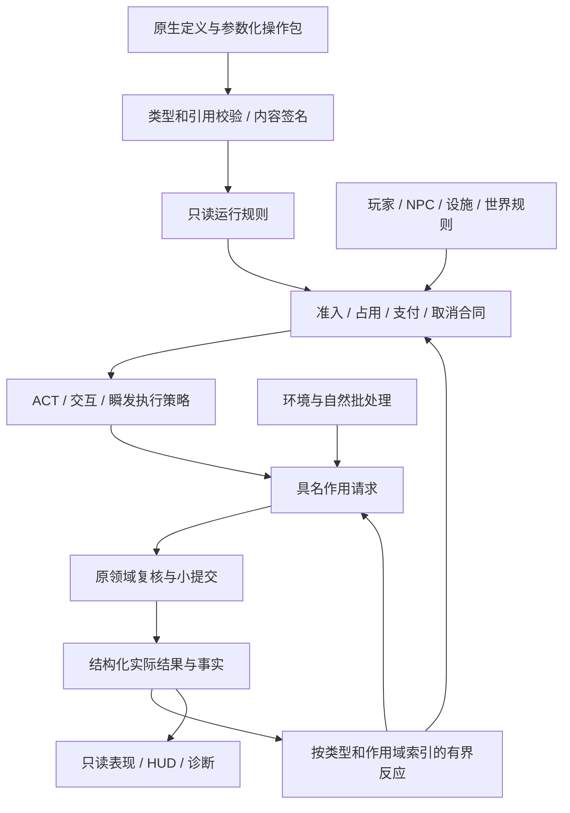

# 通用行动与作用框架

**候选方案，尚未实施。** 本页定义战斗、工具使用、采集、制造和交互可以共用的执行合同。施工顺序只维护于[主计划P4](../../docs/plans/foundation-priorities.md#p4方案通用行动基座与战斗组合)，战斗特有的结算、接触时序与样例仍归[ACT规格第13节](combat_framework/act_and_barrage.md#13-p4通用战斗基座方案未实施)。当前代码与写入者查[运行架构](../../docs/engineering/architecture.md)，不能把以下设计当成已实现接口。

## 1. 要统一什么

把原P4的公共部分上提为**全游戏共用的行动、作用和反应能力**。技能、工具、物品、设施和规则都可以调用它；同一种作用由同一领域规则执行。制作者能用已有原语组合新内容，程序员新增一种机制时，只接一次必要的校验、提交、结果和恢复。

“采矿是对矿物释放一种能力”可以作为制作入口：选择目标、检查能力、播放挥镐、按时间付出劳动、获得实际产物。执行层不要求矿物有战斗HP、护甲、受击硬直，也不要求炉子、天空或植物取得村民身体。**可引用的公共能力包括读条件、选目标、请求行动、提交作用、响应事实；不只是一组伤害函数。**

当前已经有两类可复用资产：`World.begin_interaction/settle_action/release`承载接近、预约、耗时和取消；P3承载ACT相位、交付、空间接触与效果。演进目标是收口它们的准入、支付、生命周期交接和作用合同，保留各自合适的推进算法。

| 层次 | 负责的问题 | 例子 |
|---|---|---|
| 意图/任务 | 想做什么、知道什么、是否愿意、先做哪一步 | 先拿水再做饭；寻找本人知道的矿点 |
| 行动 `Action` | 谁使用什么能力、占用什么、何时能取消/交付 | 三连的一刀；一次采集；对伙伴发起交易 |
| 作用 `EffectOp` | 这次实际要求世界发生什么变化 | 转移物品、照料植物、伤害、完成配方、贡献工时 |
| 持续状态/过程 | 哪些影响跨越一次动作继续存在 | 护盾、毒、蓝图工期、炉内加工、无人机 |
| 条件与查询 | 在什么依据下允许执行，作用于谁 | 库存可用量、目标能力、已知身份、净空/范围 |
| 事实与反应 | 什么已发生，哪些规则因此继续执行 | 实际采得物品后回能；破盾后爆炸 |
| 表现 | 玩家何时看见/听见什么 | 镐击、施法、命中、进度条、失败提示 |

这些是职责，不要求分别建立一套Autoload或七个管理器。世界事实继续归[原领域](../../docs/engineering/architecture/05-framework-domains.md)，公共框架属于跨域执行接缝。

## 2. 推荐结构与替代路线

采用**公共执行合同＋类型化领域操作＋按用途选择的运行策略**。



继续把公共机制全部放在战斗中，会重复支付/状态/结果规则，并使工具、设施与法术相互调用困难。把所有模拟改为单位施法、通用效果图解释执行，又会让交易原子性、目标驻留进度和批量自然过程承担无益的表达成本。两种问题都应由真实跨域样例验证，不能仅用架构名词判断。

框架不承诺任意玩法都零代码。新内容若只换数值、条件、目标、已支持作用的组合，主要改资源；若新增矿物生成、化学反应或全新身体运动规则，需要在对应领域增加处理器。处理器一旦接好，可被其他内容继续引用。

## 3. 原生制作与可复用的“代码积木”

延续Godot原生`Resource`、类型化导出数组、Inspector和现有资源库工具。定义经过结构/引用/范围校验，编译成递归只读值和稳定ID；运行实例另外持有相位、计数、预算及支付记录。两名使用者和两个在途实例不能互改共享模板。

| 定义 | 关键内容 | 复用出口 |
|---|---|---|
| `ActionDef`公共头＋执行profile | 目标、资格、占用、成本/CD、中断政策、执行策略与作用引用 | 工具交互、技能栏、AI请求、设施能力 |
| `EffectBundle` / 参数化操作包 | 类型化参数、具名操作、局部中间结果引用、失败政策 | 动作交付、弹体、区域、状态、触发器、领域调用 |
| `ConditionDef` / `TargetQueryDef` | 只读条件、上下文角色、范围、过滤、排序/数量上限 | 预览、准入、提交前复核、AI、反应 |
| `ReactionRuleDef` | 事实类型、作用域、条件、概率/次数/CD、后续操作或行动 | 装备、被动、设施、场景规则 |
| 状态/修饰/池定义 | 时限、周期、来源、叠层、数值/权限贡献、合法成本 | 战斗状态、料理增益、工具效率、施法资源 |
| 领域操作定义/绑定 | 参数类型、所需能力、预检/提交、结果类型、恢复字段 | 接入新机制一次后，被上述入口引用 |

首轮组合能力支持：有序操作、具名条件分支、有限目标集合、显式延时和有次数/周期/生命周期边界的重复。延时不是保存GDScript协程栈，而是记录下一个阶段、参数、到期、来源和取消政策。复杂工作流仍由任务或领域状态机承载；任意`while`、`eval`、按字符串调用任意方法及`SetField("world.xxx")`不作为制作API。

原子操作包与普通效果序列分开：前者必须整体预检并提交；后者允许前一交付成功、后一目标失效，返回各自结果，不能把“有序”误当“全部可回滚”。交易的`ExchangeItems`、配方的`CommitRecipe`和施工完工可作为一个具名复合操作，不要求拆成几十个通用加减节点。

处理器声明参数与结果schema、是否可原子准备。原子包不能包含等待、延时、重复或提前派发反应；允许部分数量的操作只有在准备阶段已固定实际数量且保证整体采用时，才可作为具名复合操作加入。普通序列默认遇拒绝停止，继续需明确声明；零有效量是否成功由操作语义决定，依赖成功的后序作用须检查结果，防止没吃到食物却领取增益。后续步骤只能用经过类型校验的`ResultRef(步骤, 字段)`读取本包已发生的结果，必要数值缩放使用少量具名纯算子；不开放任意字符串路径或表达式执行。

延时/重复明确绑定当前run还是已离手承诺。前者随该run合法终止而取消，后者保留独立交付记录；两者各自声明目标消失政策。不能因动作正常结束就把已交付的延时一并删除。

扩展一个处理器需声明：参数与结果类型、查询/写入owner、目标能力、适用时刻、准入和提交检查、失败/取消、是否支持原子准备或批量入口、保存字段及必要短反例。注册采用显式代码绑定，编译资源时能定位到`资源路径→字段/操作序号`；插件或内容包不直接取得活World的随意写入能力。

原生编辑器出口是：复制/选择能力模板→填写参数和目标/条件→绑定操作包→校验→在普通世界或练习场使用→检查实际结果。常见参数集中显示，允许小定义内联，避免做一项照料动作必须跳转十几个资源。未来图形界面可编辑同一数据，先按需要提供依赖导航，另造一套图语言没有当前收益。

以下用简化写法展示将来Inspector中资源的关系，字段为方案示意：

```text
操作包 plant_care(caregiver: ObjectRef, plant: ObjectRef)
  调用 Nature.Tend(caregiver, plant)
  由领域申报：1份实物水、植物阶段资格、补水/损伤变化

行动 manual_tend
  策略 Interact：接近、就位、劳动、完成时提交
  作用 plant_care(执行者, 目标植物)

行动 water_art
  策略 ACT：鼠标选定植物、前摇、交付、后摇/CD
  作用 plant_care(执行者, 目标植物)

反应 harvest_charm
  事实 Collected，条件 实际采得数量 > 0
  调用 ModifyPool(受益人, energy, 配置量)，遵守规则CD/次数
```

前两个动作共用的水/植物规则只写一次，动画、距离、时间策略来自各自定义。最后一个使用实际采集结果组合既有资源操作，展示同一制作能力也能服务非战斗被动；这类结果反应随P4-C接入。

## 4. 身份、能力、上下文与查询

普通人物、植物、矿物、箱、建筑引用原Objects单调唯一ID；器物、弹体、区域等使用明确引用种类。外部命令保留会话epoch检查，身体槽位不是实体身份。不为永不复用的对象ID额外捏造一套实体身份；确有版本敏感的准备结果检查它实际依赖的版本。

目标可以是实体、位置、方向、有限集合或明确参与者角色。每项操作声明所需能力：例如`Collectable`、`Inventory`、`PlantCare`、`HealthReceiver`、`WorkSite`、`MovableBody`。这是对真实领域能力的适配，不要求引入完整ECS，也不使用全字段可空的万能单位。

公共上下文最少区分：

- 本次执行/操作ID、根因果链、父事件、事件序号与世界时刻；
- 发起者、实际执行者/载体、责任归属与受益对象，允许来源是物品、设施或世界过程；
- 具名目标/参与者和本次参数；请求、支付、实际交付的时刻与采样政策。

战斗额外带接触点/来向、命中组、源属性快照等，详见战斗规格。自然来源用明确的过程引用/原因描述，不用一个没有含义的`actor=0`包办全部来源。对象消失后可保留只读归因，但向该对象写回血/发物品前重新检查有效性。

条件和查询不得改变事实。UI与AI使用同一规则的脱离预览/权威查询接口，预览不是执行承诺；真实提交仍复核变化的条件。本人已知目标、物理命中候选和开发全知诊断分别处理。公共框架不能因统一索敌而让NPC、设施或召唤物免费全知；盲射/物理范围命中也不自动补全角色认识。

目标消失时的政策由交付声明：拒绝、在原定点继续、沿当前轨迹继续等；没有“所有技能自动追到最后已知位置爆炸”的默认赠送行为。

## 5. 行动生命周期与不同执行方式

公共生命周期为：**受理→取得必要声明/占用→按策略准备→承诺前复核→一次或多次提交/交付→收尾；任何可中断阶段均能明确终止。** 不需要的阶段直接跳过。

| 策略 | 时间和空间过程 | 与公共层共享什么 |
|---|---|---|
| ACT | 原缓冲/连段/取消窗口、前主动后摇、冲刺与精确接触小段 | 准入、占用裁决、支付/CD、上下文/结果、取消交接 |
| 交互 | 接近、等待操作位/伙伴、实际工期、复核和中断 | 相同行动头及提交/释放合同；按到期/变化唤醒 |
| 瞬发 | 当前合法边界完成检查、支付和交付 | 同样留下执行/结果与成本事实，不走虚假的读条 |
| 设施/自主生产 | 宿主过程按合法CD/周期请求作用或行动 | 同一规则入口；不占主人的手部/主行动 |

计划采用**一份公共运行头＋策略专属状态**。公共头持`run_id`、定义、执行者/参与者、状态、提交序号和声明引用；ACT专属相位/确认/缓冲仍由原快路径推进，交互专属等待/路径仍由交互策略推进。同一字段不同时保存在`combat.states`与另一份ActionRun中；过渡索引只指向唯一记录，迁移完成即撤去旧写入口。

已迁移动作的阶段/下次作用以run为唯一原状态；Units页只接收当前运动任务/物理模式和可重建到期摘要，不能再按旧`Mode.ACTION`私自推进同一动作。等待唤醒、到期、伙伴撤出与旧动作清理均携带`expected_run_id`和必要提交序号；与当前运行不符就作废，不能仅凭人物ID写回`IDLE`或清掉后来动作。

人物先保留一个主要主动动作，但运行记录以`run_id`而非永久以`actor_id`作为身份；按人物的前台索引只是查找方式。占用由少量真实通道/权限表达，初始只做样例需要的移动、主要出手与交互互斥。可并行瞬发仍做门禁/付费，持续状态和离手弹不占主行动。未来确需双手/骑乘多轨，可扩通道，不提前实现全身调度器。

控制下能否使用某能力也由定义声明：普通眩晕阻止相应主动动作；专门的解控/应急能力可有明确豁免，但仍走相同资格、支付和结果规则。不能因为是瞬发、物品或生活按钮就自动豁免，也不能在迁移中无意取消既有能力的明示例外。

新指令必须经过原动作的取消政策。点箱、采集、对话不能清掉不可取消后摇、硬控、CD或已支付事实；战斗合法打断工作时，通过一次共同终止交接保存施工贡献、释放本次占用并通知伙伴。`release`式的“全部清一下”需要拆清本次行动终止、输入清理和实体死亡等不同原因。

行动替换在同一World边界完成：先只读检查新请求、旧动作是否可取消及可用成本/目标；失败保留旧动作，合法缓冲也不提前终止。通过后将旧run标为终止中，只结算一次贡献并释放其声明；终止钩子不立即启动自己/伙伴的新动作，可选反应暂存。随后重验受终止影响的条件，提交新run及该付款点的成本/CD，最后处理排定的后果/反应。若旧run终止的必要事实使新请求失效，返回“旧动作已中断，新动作未启动”的明确结果，不回滚已记工期，也不让状态覆盖冒充成功。预检只可计入旧run将释放的未消费占用，不预支假定退款。

A1过渡期让全部旧公共命令、自主交互及能力入口经过共同准入；适配器识别尚未迁移的交互/采集/移动模式及其占用，通过原领域一次退场。不能让适配器与新run同时写同一相位，不能先清旧模式再检查新请求。

A2把前台交互记录收口到唯一run容器；未选中改造的播种、砍伐、对话等使用策略/领域提交适配器调用原算法，不另留一张可独立推进的`world.actions`。这是运行容器迁移，完整任务选择和领域玩法不因此重写。原来专属动作的易受罚窗口与受击保护也区分来源/寿命，不能为清动作而一并清控制保护。

角色动作结束不代表因果链结束：已飞出的弹、状态和领域加工过程各自持有承诺；取消主动作不会自动销毁它们。输入上下文切换继续按原代次合同清未启动输入，不能重置已发生的动作/CD。

## 6. 预约、成本、提交与取消

**预约、支付、交付是三件不同的事实。** 目标/操作位预约保证谁能执行；物资预留减少可用余额但未消费；支付扣实际资源；交付产生实际后果。内容明确成本发生在起手、承诺点还是每次有效周期，退款也需明确政策。

P3成功起手就扣物品、起CD；现有烹饪完成时检查并扣材料；建设材料已进入蓝图。首轮迁移保留这些语义。未来可为具体技能选其他付款策略，不将“前摇取消免费”设成全游戏约定。

### 6.1 小提交的原子性

一组不可分割的多成本/交易/配方操作采用：**准备最终变更→全部验证→World owner中连续采用→发布结果**。

同一容器/资源可能被多个参数别名引用，准备时须按真实owner和资源键合并**总支出**，检查原量减他人预留足够支付；同组产出不能反过来抵扣前置成本。不能把两次各扣8都拿“余额10”单独验过，也不能在没有水时用“扣2水、产2水，净值0”通过。容器容量另按全部输入/输出后的最终占用检查，满包就地加工不能因未先扣料而被误拒；采用阶段不让中间容量截断产生部分交换。

同一成本只由一处规则声明。行为级成本交公共支付计划，`Tend/CommitRecipe`等复合领域操作申报自身物资代价并合入相应提交；调用者不再额外扣一遍水或材料。转移、真实消耗和新产物的来源账分别记录，不能仅用净值掩盖守恒关系。

操作公开只读成本描述供UI、AI与起手预检使用；行为定义引用其具名成本项和付款时机，另加法力等成本用独立项。编译拒绝同一成本项重复声明，合法的两笔同种物资仍合计支付，不能按物品名盲目去重。若领域材料提前付款，owner生成绑定**激活/操作调用/交付序号**的一次性支付依据，在实际交付时核销；领域处理器不再扣同一项。依据随在途交付保存，不能仅凭`op_id`标志给多个目标/多次周期免单，也不能接受外部输入自称“已付”。后续才确定的目标/次数成本按声明延后准备，不能假称已预付。

只有可完整准备且采用时不再发生业务拒绝的操作才能加入同一小提交。采用期间不`yield`、不执行用户回调、不派发反应；必要分配、落点/数量组检查和变化内容在准备阶段做好。跨时间移动、未来碰撞、未知目标或延时爆炸不属于这一事务；它们是已支付交付的后续结果，不回滚整段历史。

准备结果临时持有规范资源键、总支出、净占用、领域变更和必要后果，采用只消费该结果；不再逐项调用可能中途截量的普通搬运函数。此准备记录不跨步、不作为另一份可写世界保存。复杂空间变化若不能完整准备则保持独立领域操作，不为了“所有原语都能随意原子组合”扩大通用事务。

每个支付点与**当时成立的承诺**一起提交：起手成本对应运行记录/起手CD；离手付款对应当刻发射/交付。起手已支付不保证未来召唤位或目标仍合法，交付前重验并按内容政策失败/等待，不自动退款。若要保名额须另有显式占用。同组空间变更需能在准备结果中检查彼此冲突，不能只对旧世界逐条验过。

命中多个目标时按交付声明逐目标裁决，挡住或目标失效不意味着退还整次法力。持续引导每个有效周期各有提交序号，不能一边先扣若干池一边发现最后一项不足。消耗HP的普通技能默认要求支付后仍存活；自杀/献祭是另有明确死亡和离手政策的操作，不在写到一半时执行死亡清理。

对库存转移，`exact`与`up_to`分别表达全量与实际可搬数量；原`Objects.transfer`的部分搬运继续合法，交易仍由`Objects.exchange`整体成功。框架不能以统一结果接口偷偷改掉业务含义。

### 6.2 声明与多人参与

占用记录归具体run/process，标明资源键、操作位/数量和撤销条件。操作位/参与者声明由公共行动owner持有，定量物资预留由物品owner持有；run只保存引用，不复制可写Token。互斥、数量汇总和参与者反向索引均可重建，避免另一份“框架库存”。多项申请失败只释放本次取得的声明，不能释放别人的预约。

首轮沿现有目标预约实现操作位/参与者声明，不为所有物品强加长期托管。确需材料预留时在物品owner增加统一可用量接口，所有相关转移/消耗均检查它，不能只让技能扣费认锁而普通搬运仍能拿走。接近/等待不能无限占满整个背包；等待策略应有目标失效/取消/必要期限，不靠每帧全图扫描解锁。

未来启用定量预留时区分普通消费与持本run凭证核销预留：普通消费只能用未预留余额；持有者可以消费自己那份，不能把自己的预留也扣掉而永远判不足。凭证的归属/数量、核销和物理扣除在同一小提交完成，非法超占候选拒载。

双人交互持一份具名参与者记录和对称派生索引，意愿/报价仍归Society。邀请不等于锁住对方人格；新命令、进入不兼容行动、死亡或离开合法距离会终止/重验。双方变更不能由旧动作的恢复回调覆盖。当前`settle_action`已经检查目标实时距离，不能为论证新框架宣称旧版必然隔空交易。

### 6.3 保留哪些已发生的事实

取消释放本run持有的未消费声明，已成交物资、已贡献工期、已发弹与已付费按各自政策保留。建设中断把尚未记账的劳动区间结入蓝图，换人/读档不能重复贡献；施工完工的占地/拓扑检查仍归Facilities。两人交易要么整体交换成功，要么双方原物保留。

烹饪预检可更早提示缺料，但完成前仍可能失去材料，届时正常失败；若未来选择开工托管，则另定义取消/宿主损毁/满包时的去向。框架不会凭空采用退款或地面掉落规则。

## 7. 结果、事件与可复用反应

结果使用共同封套＋具名领域载荷：操作/运行/因果ID、时间、来源、`applied / partial / rejected`与原因；其内部可以是实际搬运数量、原物去向、配方产物、工期贡献、实际损血/吸收/治疗。不是把所有结果压成一个`actual_delta`。

行动受理、开始、支付/承诺、交付和完成分别表示。返回`accepted`不能让任务AI或UI提前认为物品已经到手。复合操作全部采用后才生成对外可反应的事实，内部调用不重复发布“同一件物品获得两次”。

公共事件分清三类：

| 类别 | 作用 | 执行边界 |
|---|---|---|
| 请求 | 希望开始动作或施加作用 | 经过准入/支付/目标复核，可被拒绝 |
| 已提交事实/结果 | 描述真实变化 | 只读、可作为后续规则的依据，不能被监听者倒改 |
| 表现与诊断通知 | 提供HUD、动画、人物记录/调试说明 | 沿`World.emit`等出口，不反向写模拟 |

死亡、占用释放、原物转移、必要索引/路径失效属于领域提交必须闭合的后果，不能交给可选规则、概率监听或性能裁剪。装备被动、额外生弹、采集回能等才通过内部反应机制组合；必要后果和可选派生不混用配额。

反应按事件类型、拥有者和作用域索引，不全图广播所有事件后逐装备筛选。反应声明执行操作包，或请求一个仍受正常门禁的完整行动；两者有区别。任何被动额外动作继承原因果链，不因“又cast一次”重获全额预算。

反应通过有限队列展开，使用共享链配额、深度、规则CD/次数、传播访问集和生产上限。延时/状态续期/跨域调用保留链关系；兄弟分支不各复制一份满额预算。长期生产者按合法自主周期创建新激活，事件要求的追加攻击仍属旧链。详细分裂/传染/生产规则沿用[战斗13.6](combat_framework/act_and_barrage.md#136-触发链分裂传播与持续生产)。

公共接口不另定义一条全局FIFO覆盖战斗顺序。同一时刻的命中桶、待死亡、次级反应和空间交付采用[战斗13.4](combat_framework/act_and_barrage.md#134-统一结算格挡护盾吸血与同刻死亡)/[13.7](combat_framework/act_and_barrage.md#137-空间时序与瞬移)；非战斗操作进入自身合法的共同World边界，跨域立即后果带原时刻与稳定序号。不通过表现事件的回调重入当前提交。

## 8. 状态、属性和资源怎样成为公共能力

持续影响共用来源、寿命、周期、叠层/刷新、移除原因、修饰和权限贡献。料理、装备、技能、环境接触可引用同一种状态定义；并非只有战斗函数能施加。工作速度、移速和技能动作速度分别是明确属性，不因叫“加速”就一起改。

数值属性仍从基础、装备和活跃来源集合重建，源集合相同则不受增删顺序影响。资源池接口适合有可用量、上下界和消费规则的蓝、怒等；HP/已有身体能量通过原owner适配。多层盾还需来源、掩码、到期和消费顺序，不退化成一条普通蓝条。

植物生长阶段、建筑结构、热量守恒或温度不是换个名字的Buff/蓝量。公共作用可以请求这些领域变化，算法和状态仍由领域负责；只在语义一致时复用生命周期/数值工具。吃饭恢复饥饿与施加料理增益可以在同一操作中合作，不把植物成熟和人物眩晕强行塞进同一状态机。

## 9. 任务、长期过程和无人来源

“缺料先去拿、搬回后再制作”属于认识与自主选择的任务计划，计划通过同一Action入口逐步执行。每一步已经提交的物品移动都是事实；后续失败不自动把水倒回水井。确需补偿/清理行为时，作为任务的后续动作执行。

施工进度、机器批次和矿脉储量归目标。Action只负责本次合法劳动/启动；已点火的无人加工可继续存在，操作者不必一直假装施法。过程持有宿主/创建来源、状态、到期/相位和失效政策；不需要另一份世界时钟或独立线程。

自然生命/环境继续用合适的页、分组和批量算法。外部法术/工具需要改变植物时调用同一领域规则；批处理也可直接调用该规则的批量入口，省去逐对象包装。不为每一格温度变化生成事件或创建ActionRun；需要反应的真实离散变化/订阅者才生成对应事实。框架不预设所有过程必须同频。

## 10. 真实用法与证明范围

| 场景 | 公共入口与组合 | 原领域保留的职责 | P4范围 |
|---|---|---|---|
| 现有收集/搬运 | 交互策略＋目标/容量条件＋`Collect/Transfer`＋实际数量结果 | Nature产物资格，Objects原物/容量 | 迁移实有流程，保留部分搬运规则 |
| 对矿物采矿 | 工具能力＋劳动周期＋`ExtractResource`＋产出/枯竭事实 | 未来矿藏/储量/副产物规则 | 设计走查；当前木材库存夹具不冒充完整矿业 |
| 手工照料与引水术 | 交互/ACT两种profile引用同一`Nature.Tend`操作 | 原水量消耗、宿主补水与植物损伤变化 | 显式点选合法植物，ACT前摇/交付；均付实物水，B后可另加耗池；不依赖D的静物弹道扫掠 |
| 烹饪 | 配方条件＋交互策略＋`CommitRecipe` | 配方、材料/产物去向，完成时原子提交 | 适配现有做饭，补早期反馈；不自动改托管退款 |
| 施工 | 工作策略＋贡献区间＋完工操作 | 蓝图进度、材料、占地与拓扑变化 | 换人/取消/恢复的原进度保留 |
| 双人交易 | 参与者协议＋意愿/条件＋`ExchangeItems` | Society同意与估价，Objects整体交换 | 无部分交割，新命令可撤出 |
| 三连/分裂箭/吸血 | ACTprofile＋交付＋状态/结果反应 | 原战斗接触、控制与同刻规则 | 继续原P4主要试玩目标 |
| 炉子/无人机 | 宿主过程＋合法自主周期＋相同作用 | 宿主生命周期、物资、独立动作/器物耐久 | 无人机随原P4-D；无人炉仅检验接口可表达 |
| 雨水/着火/植物生长 | 世界过程/批量入口＋必要的跨域作用和事实 | 气候/热/生长专属算法 | 架构走查；不顺带建设全图燃烧、降雨或新生态 |

跨域小样必须共用**真实的校验与提交**，不是两边分别改字段、最后包装同名结果。引水术即便用不同动画/射程，也调用手工照料相同的植物资格、原物水扣除、宿主补水和损伤规则；取消/材料不足/读档都得到一致结果。

## 11. 时间、恢复与性能合同

共用World时间和推进/采用顺序，不再开一套事件时钟。ACT仍用已有运动/接触小段和明确空间交付边界；交互在到期或相关事实变化时推进；批量自然过程按领域精度运行。共同定义不意味着把生活升到每帧，也不意味着把三连降成250ms轮询。

动作相位、下次提交序号/到期、必要占用、已付费记录、待交付、状态/生产者相位和仍有后代的因果预算随机制保存。只在小提交完成的一致边界捕获世界；零时间队列可在边界前闭合，未来待交付不能步末清空。绝对世界deadline与累计剩余量按各自语义合法保存，不存函数/协程栈、Node或Callable。

恢复在独立候选中验证原状态、定义签名、物资与占用一致性，重建索引/派生属性；不重付费、不重新施加状态/产出、不靠重放启动事件恢复。非法原状态拒载，不能删除承诺/退还材料后伪称无损恢复；失败保留活会话和原档。格式升级遵守既有兼容政策，不默认承诺未来直接读取P3格式。

热路径可直接调用同一具名处理器，通用分发用于制作与跨域入口；二者共用规则和结果语义，不能通过“快路径”省掉门禁或成本。飞弹飞行、单位移动、环境积分不需要每帧创建操作对象；必要事件/结果的成本按实际活动量观察，不以“绝对零分配”替代测量。

512²/24人保留为当前同场景短窗对照，不设人口/弹量或固定回归百分比门槛，也不把24人写成架构上限。优先控制无界内容、重复查询和快照成本；大世界降频/近似仍只在实测瓶颈成立时按原方案选择。真正增加大量连续场模拟时扩领域批量算法；大规模无代码UGC、全图倒流等新目标另评估，不要求现在预付全部实现。

## 12. 怎样判断这层抽象有用

P4-A分两片：先完成公共合同与P3战斗迁移，再接现有交互和照料法术；每片可运行，随后继续原P4-B～E的状态、触发、实体和战斗组合。具体范围、短反例与交付只列[主计划](../../docs/plans/foundation-priorities.md#p4方案通用行动基座与战斗组合)。

判断依据是：同一原语确实被不同系统调用；同一门禁阻止生活命令绕过战斗承诺；物资/进度/成本在取消和恢复时不丢不重；原八套ACT/弹幕仍可玩；新增组合主要改定义。若只是增加转发包装、出现双份运行事实、制作时必须理解所有内核细节，应收窄或调整接口。资料和静态顾问评审都不能代替实施后的试玩与验证。
