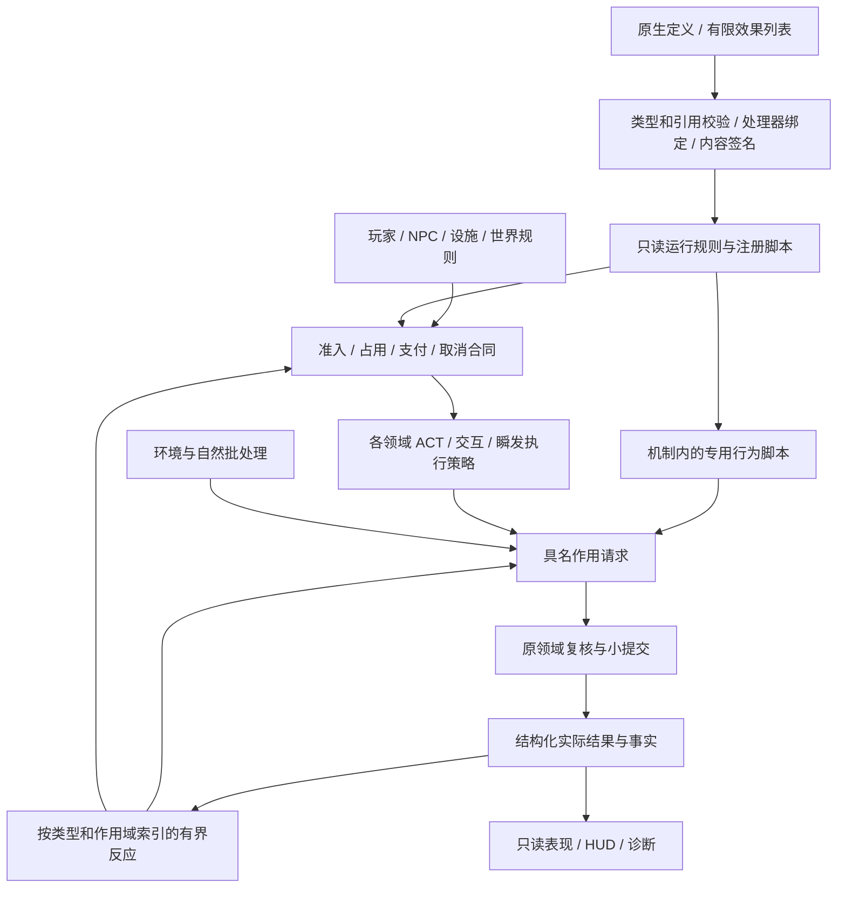

# 通用行动与作用框架

**候选方案，尚未实施。** 本页定义战斗、工具使用、采集、制造和交互可以共用的执行合同。施工顺序只维护于[主计划P4](../../docs/plans/foundation-priorities.md#p4方案通用行动基座与战斗组合)，战斗特有的结算、接触时序与样例仍归[ACT规格第13节](combat_framework/act_and_barrage.md#13-p4通用战斗基座方案未实施)。当前代码与写入者查[运行架构](../../docs/engineering/architecture.md)，不能把以下设计当成已实现接口。

## 1. 要统一什么

把原P4的公共部分上提为**全游戏共用的行动、作用和反应能力**。技能、工具、物品、设施和规则都可以调用它；同一种作用由同一领域规则执行。制作者能用已有原语组合新内容，程序员新增一种机制时，只接一次必要的校验、提交、结果和恢复。

用户以“采矿像施放技能”说明希望不同系统能复用能力。这是方向类比，正式设计采用**共享执行协议与领域规则**：选择目标、检查工具资格、付出劳动、提交采得物。矿物是否有可破坏结构由矿藏玩法决定，不从类比推导战斗HP、护甲或受击硬直；炉子、天空和植物也无需取得村民身体。**可引用的公共能力包括读条件、选目标、请求行动、提交作用、响应事实；不只是一组伤害函数。**

当前已经有两类可复用资产：`World.begin_interaction/settle_action/release`承载接近、预约、耗时和取消；P3承载ACT相位、交付、空间接触与效果。演进目标是收口它们的准入、支付、生命周期交接和作用合同，保留各自合适的推进算法。

| 层次 | 负责的问题 | 例子 |
|---|---|---|
| 意图/任务 | 想做什么、知道什么、是否愿意、先做哪一步 | 先拿水再做饭；寻找本人知道的矿点 |
| 行动 `Action` | 谁使用什么能力、占用什么、何时能取消/交付 | 三连的一刀；一次采集；对伙伴发起交易 |
| 作用 `EffectOp` | 这次实际要求世界发生什么变化 | 转移物品、照料植物、伤害、完成配方、贡献工时 |
| 持续状态/过程 | 哪些影响跨越一次动作继续存在 | 护盾、毒、蓝图工期、炉内加工、无人机 |
| 条件与查询 | 在什么依据下允许执行，作用于谁 | 库存可用量、目标能力、已知身份、净空/范围 |
| 事实与反应 | 什么已发生，哪些规则因此继续执行 | 实际采得物品后回能；破盾后爆炸 |
| 表现 | 玩家何时看见/听见什么 | 镐击、施法、命中、进度条、失败提示 |

这些是职责，不要求分别建立一套Autoload或七个管理器。世界事实继续归[原领域](../../docs/engineering/architecture/05-framework-domains.md)，公共框架属于跨域执行接缝。

## 2. 推荐结构与替代路线

采用**公共执行协议＋可复用机制＋有限数据组合＋专用脚本**，实际状态仍由原领域持有。以下名称是本项目候选接口，不是已实现类型或统一的行业术语。



继续把公共机制全部放在战斗中，会重复支付/状态/结果规则，并使工具、设施与法术相互调用困难。把所有模拟改为单位施法、通用效果图解释执行，又会让交易原子性、目标驻留进度和批量自然过程承担无益的表达成本。两种问题都应由真实跨域样例验证，不能仅用架构名词判断。

### 2.1 新内容放在哪里

| 变化性质 | 推荐做法 | 例子与边界 |
|---|---|---|
| 机制、生命周期和作用已存在 | 改定义与组合 | 火弹换毒弹、散射数量、同一料理增益的强度/时长，不各写一份弹体脚本 |
| 局部算法或编排特殊，共同生命周期可用 | 在现有机制内绑定专用脚本 | 只引爆本次激活留下的标记；按目标状态选择折返目标。脚本调用既有查询/状态/伤害接口，不给主循环加技能名分支 |
| 多种内容共享稳定的推进算法、状态寿命或结算职责 | 提炼参数化机制或共用函数 | 可回收器物供飞剑/浮游炮使用；传播供不同病症使用。先确认真实共性，不按“已有三个实例”机械决定 |
| 新增持久世界事实、守恒或空间/批量算法 | 扩相应领域；职责确实独立时再建领域 | 矿脉储量、设施生产或热传播。一次特殊技能本身不构成新领域的理由 |

机制族指**共享算法和生命周期的实现集合**，不要求每族有一个Manager、基类层次或Autoload。定义和组合是作者入口，机制/领域提供执行，专用脚本是受框架约束的扩展口；四者并非强制逐层转发的调用栈。

提炼前检查：共享的究竟是数值，还是算法/状态责任；是否已有或可合理预见第二个用途；抽出后能否减少重复规则且降低制作成本。先用小脚本验证尚不稳定的特例，稳定后再上提。不能把用户“特殊场景也通用化”的方向解释为每个例子必须新建一种通用类。

## 3. 原生制作、有限组合与专用脚本

延续Godot原生`Resource`、类型化导出数组、Inspector和现有资源库工具。定义经过结构/引用/范围校验，编译成递归只读值、稳定ID与代码中显式注册的处理器绑定；运行实例另外持有相位、计数、预算及必要支付记录。两名使用者和两个在途实例不能互改共享模板。类型检查主要发生在制作/加载边界，不在每次命中时重新解释一份动态schema。

| 定义 | 关键内容 | 复用出口 |
|---|---|---|
| `ActionDef`公共字段＋执行profile | 目标、资格、占用、成本/CD、中断政策、执行策略与作用引用 | 工具交互、技能栏、AI请求、设施能力 |
| `EffectBundle`有限效果列表 | 类型化参数、具名操作、结算阶段、失败政策 | 动作交付、弹体、区域、状态、触发器、领域调用 |
| `ConditionDef` / `TargetQueryDef` | 只读条件、上下文角色、范围、过滤、排序/数量上限 | 预览、准入、提交前复核、AI、反应 |
| `ReactionRuleDef` | 事实类型、作用域、条件、概率/次数/CD、后续操作或行动 | 装备、被动、设施、场景规则 |
| 状态/修饰/池定义 | 时限、周期、来源、叠层、数值/权限贡献、合法成本 | 战斗状态、料理增益、工具效率、施法资源 |
| 机制/领域操作绑定 | 参数类型、所需能力、预检/提交、结果类型、必要恢复字段 | 接入新机制一次后，被上述入口引用 |

### 3.1 数据组合到哪里为止

`EffectBundle`是**单次交付边界内完成的有限同步列表**，可按战斗结算阶段分组；条件和目标查询作为具名参数/规则使用。不提供跨步骤`ResultRef`、任意表达式、通用分支/变量寄存器、循环或跨步程序计数器。伤害后的吸血、实际采集回能由相应类型结果和具名反应参数表达；“消耗食物成功才施增益”由进食复合处理器实现，不在Inspector重写一段程序。

普通列表可有前一作用成功、后一作用被免疫/目标失效，默认拒绝时停止，独立的后序作用继续需明确声明。零有效量是否成功由操作语义决定。有序列表不承诺整体回滚，也不越过战斗结算阶段。交易`ExchangeItems`、配方`CommitRecipe`、进食或施工完工保留具名领域提交，不能拆成任意加减节点。

结算阶段与执行次数是两项独立声明：一次激活、一次交付、每个目标接触、每个周期或一次规则触发不能混用。列表中一个目标被拒绝，默认只结束该目标的列表，不取消其他目标已经成立的接触。按实际损血吸血读取该目标结果；“一刀最多回能一次”用本次激活内的规则计数，不能按命中人数重复执行，也不能复用一个含义不同的`confirmed`布尔包办所有被动。

延时/重复由ACT多段交付、弹体到期、区域周期、状态节拍、器物/设施过程或专用策略的阶段承载。P4不预建独立的通用`DelayedDelivery`队列；现有宿主不能合理承载的新过程，在实际所属领域接入共同时间/恢复，不恢复通用脚本栈。所有未来交付区分绑定当前run与已经离手承诺，不能因动作正常结束就一并删除。

### 3.2 程序员怎样接入特殊行为

按实际需要提供三类扩展，不要求每个脚本实现同一套空钩子：

| 扩展口 | 最小责任 | 状态归属 |
|---|---|---|
| 具名作用处理器 | 校验参数/目标，调用领域提交，返回该类结果；可提供只读成本描述 | 同步完成；需跨时则创建明确宿主过程 |
| 机制行为策略 | 在宿主给出的出生、接触、到期等边界补充局部算法 | 弹/区/状态/器物等宿主中的本地状态 |
| 多阶段行动策略 | 准入、下一边界、交付、合法终止；复用公共占用/成本规则 | ACT或交互owner中的本次run状态 |

处理器代码与运行实例分开；只读模板/无状态策略不能存某位使用者的进度。新增本地状态需声明种类/版本、字段、引用有效性、恢复校验和取消/宿主销毁政策；语义/状态版本纳入规则签名，未完整声明就不能成为可保存内容。引用可按业务合法保留已失效的只读归因，不强制所有历史来源仍存活；需要活目标/宿主的引用则验证相应完整性。定时通过World时刻/宿主唤醒推进，不使用Node计时、`await`或墙钟。需要随机时使用可恢复序列。

脚本通过原owner接口提交HP、物资、位置等变化，不复制世界原状态；不得同步递归执行被动、重入行动交接或自行清除他人的run。产生反应先入队，在既有时间/因果边界展开。默认只传本次所需的具名上下文与宿主状态，不复制整个World作“局部世界”。

扩展脚本是**受信任的项目代码**，靠类型、接口、评审和相关反例维护合同，普通GDScript不是安全沙盒。定义仅可选择显式注册的脚本/机制；存档只保存种类/版本与值，不从存档加载任意Script、Node或Callable。新增领域算法仍需开发和验证，不能承诺注册一行就自动获得正确存读、性能与可视预览。

原生编辑器出口是：复制/选择能力模板→填写参数和目标/条件→绑定已有作用/策略→校验→在普通世界或练习场使用→检查实际结果。常见参数集中显示，允许小定义内联，避免做一项照料动作必须跳转十几个资源。错误定位到资源路径/字段/列表项；引用导航和模板按真实制作困难增加。未来图形界面可编辑同一数据，不另造图语言。

以下用简化写法展示将来Inspector中资源的关系，字段为方案示意：

```text
具名操作 TendPlant(caregiver: ObjectRef, plant: ObjectRef)
  调用同一个 Nature.Tend 领域提交
  同时复核植物资格、消费1份实物水并补水/调整损伤

行动 manual_tend
  策略 Interact：接近、就位、劳动、完成时提交
  完成时提交 TendPlant(执行者, 目标植物)

行动 water_art
  策略 ACT：鼠标选定植物、前摇、交付、后摇/CD
  有效交付时提交 TendPlant(执行者, 目标植物)
  不在起手再扣一遍该份水；额外法力/CD是另有归属的项

反应 harvest_charm
  事实 Collected，条件 实际采得数量 > 0
  调用 ModifyPool(受益人, energy, 配置量)，遵守规则CD/次数
```

前两个动作共用的水/植物规则只写一次，**实物水都在有效照料提交时消费**，动画、距离、时间策略不同；水不足则拒绝，取消未交付不赠补水。P3既有动作的起手付费不因这个新样例改变。最后一个使用实际采集结果组合既有资源操作，随P4-C接入。

## 4. 身份、能力、上下文与查询

普通人物、植物、矿物、箱、建筑引用原Objects单调唯一ID；器物、弹体、区域等使用明确引用种类。外部命令保留会话epoch检查，身体槽位不是实体身份。不为永不复用的对象ID额外捏造一套实体身份；确有版本敏感的准备结果检查它实际依赖的版本。

目标可以是实体、位置、方向、有限集合或明确参与者角色。每项操作声明所需能力：例如`Collectable`、`Inventory`、`PlantCare`、`HealthReceiver`、`WorkSite`、`MovableBody`。这是对真实领域能力的适配，不要求引入完整ECS，也不使用全字段可空的万能单位。

内容分类标签、目标实际能力与组合适用条件分别校验：标为“火”不会自动获得飞行或可分裂行为；目标显示为“建筑”也不能替代它是否具备生命/耐久接口的检查。条件可组合少量固定谓词，新增特殊兼容算法走具名处理器，不把所有语义压成字符串标签匹配。

离散请求/交付的公共上下文按需区分：

- 本次执行/交付ID与世界时刻；有后续反应时带共享因果引用和必要父事件/序号；
- 发起者、实际执行者/载体、责任归属与受益对象，允许来源是物品、设施或世界过程；
- 具名目标/参与者和本次参数；请求、支付、实际交付的时刻与采样政策。

战斗额外带接触点/来向、命中组、源属性快照等，详见战斗规格。自然来源用明确的过程引用/原因描述，不用一个没有含义的`actor=0`包办全部来源。对象消失后可保留只读归因，但向该对象写回血/发物品前重新检查有效性。

公共字段是语义约定，不要求每次内部函数调用都分配完整上下文对象。无派生的开门/普通查询不保存整棵因果树，连续飞行/环境积分不逐帧生成操作封套；恢复、归因或反应真正依赖的信息才进入运行原状态。

条件和查询不得改变事实。UI与AI使用同一规则的脱离预览/权威查询接口，预览不是执行承诺；真实提交仍复核变化的条件。本人已知目标、物理命中候选和开发全知诊断分别处理。公共框架不能因统一索敌而让NPC、设施或召唤物免费全知；盲射/物理范围命中也不自动补全角色认识。

目标消失时的政策由交付声明：拒绝、在原定点继续、沿当前轨迹继续等；没有“所有技能自动追到最后已知位置爆炸”的默认赠送行为。

## 5. 行动生命周期与不同执行方式

公共生命周期为：**受理→取得必要声明/占用→按策略准备→承诺前复核→一次或多次提交/交付→收尾；任何可中断阶段均能明确终止。** 不需要的阶段直接跳过。受理前检查不能偷偷创建蓝图/种植点等世界事实；“放置目标”若本身是独立命令，须有明确成功结果，不能与“立即开始工作”混成一个不可解释的半成功请求。

| 策略 | 时间和空间过程 | 与公共层共享什么 |
|---|---|---|
| ACT | 原缓冲/连段/取消窗口、前主动后摇、冲刺与精确接触小段 | 准入、占用裁决、支付/CD、上下文/结果、取消交接 |
| 交互 | 接近、等待操作位/伙伴、实际工期、复核和中断 | 相同身份、占用与提交/释放合同；按到期/变化唤醒 |
| 瞬发 | 当前合法边界完成检查、支付和交付 | 同样留下执行/结果与成本事实，不走虚假的读条 |
| 设施/自主生产 | 宿主过程按合法CD/周期请求作用或行动 | 同一规则入口；不占主人的手部/主行动 |

计划采用**共同占用/交接协议，各领域保留自己的运行记录**。`ActionGate`只维护人物通道到`(domain, run_id)`的当前绑定，并向该owner查询取消与准入政策；不再存相位、取消窗口、CD、已付款或另一份到期。ACT相位/确认在Combat，交互等待/工期在交互owner。共同run身份与提交合同不等于必须合并为一张多态`ActionRun`大表。

每个动作只有一个实际推进owner；绑定/反向占用索引从活run与声明重建，完整候选中的双占/悬空引用拒载。动作的阶段/下次作用以该owner的run为唯一原状态；Units页可持运动任务/物理模式及可重建到期视图，不再按一份旧`Mode.ACTION`计时独立提交同一动作。等待唤醒、到期、伙伴撤出与清理均比较完整的`(expected_domain, expected_run_id)`及必要提交序号；不同域恰有同号也不能误认。身份不符就作废，不能仅凭人物ID写回`IDLE`或清掉后来动作。

`run_id`和现有激活序号尽量复用/对应，不另堆同义编号。读旧档可能使世界内序号回退，Runner现有会话epoch仍负责拒绝旧会话命令/结果，不能用持久化单调ID替代这条边界。

人物先保留一个主要主动动作；每次激活有`run_id`，按人物索引的表仍可保留。占用只表达样例需要的移动、主要出手与交互互斥。可并行瞬发仍做门禁/付费，持续状态和离手弹不占主行动。未来确需双手/骑乘多轨再扩通道，不提前实现全身调度器。

瞬发必须声明是请求替换当前动作，还是允许与哪些动作/控制状态并行；后者不终止原run，但仍分配自己的激活身份、检查资格/豁免并付费。持续输入、导航和AI接敌意图不是自动等同前台动作，不因新占用协议取消边走边打或换目标不打断已出招的行为。

控制下能否使用某能力也由定义声明：普通眩晕阻止相应主动动作；专门的解控/应急能力可有明确豁免，但仍走相同资格、支付和结果规则。不能因为是瞬发、物品或生活按钮就自动豁免，也不能在迁移中无意取消既有能力的明示例外。

新指令必须经过原动作的取消政策。点箱、采集、对话不能清掉不可取消后摇、硬控、CD或已支付事实；战斗合法打断工作时，通过一次共同终止交接保存施工贡献、释放本次占用并通知伙伴。`release`式的“全部清一下”需要拆清本次行动终止、输入清理和实体死亡等不同原因。

行动替换在同一World边界完成：先只读检查新请求、旧动作是否可取消及可用成本/目标；失败保留旧动作，合法缓冲也不提前终止。通过后由原owner将旧run标为终止中，只结算一次贡献并释放其声明/绑定；终止钩子不立即启动自己/伙伴的新动作，可选反应暂存。随后重验受终止影响的条件，连续提交新run、绑定及该付款点的成本/CD，最后处理排定的后果/反应。交接中间不对外观察、不重入、不捕获存档，因此不能出现两个可推进的前台owner。若旧run终止的必要事实使新请求失效，返回“旧动作已中断，新动作未启动”，不回滚已记工期。预检只可计入旧run将释放的未消费占用，不预支假定退款。

旧run自身必须撤销的临时姿态/权限/本次附着贡献，在终止中同步撤回，再复核新请求；不能将它们当可选反应延后，拿已失效的护盾/资格放行新动作。外部反击/追加攻击等才排入后续波次，执行时也服从真实事件时间。

替换的只读预检应排除已知将随旧run撤销的本次权限/修饰，计入其将释放的未消费占用；只计算新请求实际依赖的派生值，不建立通用影子World。这样可以提前拒绝“资格仅由旧架势提供、换招即失去资格”的请求并保留旧动作；收尾后仍复核不可预见的必要变化。

A1过渡期让全部旧公共命令、自主交互及能力入口经过共同准入；适配器识别尚未迁移的交互、`RESOURCE/HARVEST`等持预约模式及其占用，通过原领域一次退场。旧模式仍可暂由原Units/World算法持有，适配只绑定身份/owner，不额外复制相位和到期；不能出现gate空闲而旧采集仍占目标。不能先清旧模式再检查新请求。

A1就拆清普通动作终止、导航/输入清理与死亡清理；`release`的旧调用点全部按原因归类，不保留一个会跨域全擦的侧门。适配覆盖`settle`内部转入采集/释放预约和`livelihood`重派入口，不能只包UI。寻路失败只影响对应导航/接近run，正常交互结束不清其他并行动作或控制保护；旧休息/重新派工唤醒也校验其所属身份/代次，不覆盖后来动作。当前`combat.controls`是本地持续输入，控制保护在`combat.status`，不能按英文名字混同。

A2让前台交互成为共同占用协议中的合法owner；`world.actions`可继续保存交互事实，并持自身run/相位/到期，不与Combat同时代表同一前台行动。持物资预约的旧采集也纳入明确owner。未选中改造的播种、砍伐、对话等沿具名适配器运行；每项以迁移前或迁移后的其中一处为原状态，不以统一容器为由重写全部生活。易受罚窗口与受击保护区分来源/寿命，不能为清动作而一并清控制保护。

角色动作结束不代表因果链结束：已飞出的弹、状态和领域加工过程各自持有承诺；取消主动作不会自动销毁它们。输入上下文切换继续按原代次合同清未启动输入，不能重置已发生的动作/CD。

## 6. 预约、成本、提交与取消

**预约、支付、交付是三件不同的事实。** 目标/操作位预约保证谁能执行；物资预留减少可用余额但未消费；支付扣实际资源；交付产生实际后果。内容明确成本发生在起手、承诺点还是每次有效周期，退款也需明确政策。

P3成功起手就扣物品、起CD；现有烹饪完成时检查并扣材料；建设材料已进入蓝图。首轮迁移保留这些语义。未来可为具体技能选其他付款策略，不将“前摇取消免费”设成全游戏约定。

### 6.1 成本与领域提交的原子性

公共`CostBatch`只负责同一支付点的多资源成本；交易、配方、照料等由具名领域操作负责自身不可分割的业务。它们各自采用**准备所需变更→全部验证→World owner中连续采用→发布结果**，不提供能把任意伤害、空间变化与等待拼在一起的通用事务解释器。

同一容器/资源可能被多个参数别名引用，准备时须按真实owner和资源键合并**总支出**，检查初始可用量；同组产出不能反过来抵扣前置成本。不能把两次各扣8都拿“余额10”单独验过，也不能在没有水时用“扣2水、产2水，净值0”通过。配方/交换的容器容量另按全部输入/输出后的最终占用检查，满包就地加工不能因未先扣料而被误拒；采用阶段不让中间容量截断产生部分交换。

同一成本只由一处规则声明：动作附加费用由动作支付，领域材料/配方输入由其提交负责，调用者不再重复声明。同一边界需要共同支付的多项成本通过该具名提交一次验足；不能先扣两项再检查第三项。只读成本描述供UI/AI预检，不代表已经付费。合法的两笔同种物资应合计，不能按物品名盲目去重。转移、真实消耗和新产物的来源分别记录，不能仅用净值掩盖守恒关系。

首轮不建立统一支付凭证系统。`manual_tend/water_art`都由同一有效照料提交消费水；配方保持完成扣料。P3起手付费由run/激活保留必要已支付事实与提交序号，恢复不能再走起手扣费。若未来确需提前消耗领域材料并延后作用，再定义绑定本次交付的在途承诺、重复应用防护及失效政策；不能凭外部`paid=true`、`pay_water=false`或仅一个操作名给任意次数免单。

照料的起手预检调用同一领域只读接口，包括水/植物/范围资格，避免零水仍消耗CD空放；它不预留水，前摇后条件改变可正常失败。A2仅做显式单目标、无在途实体的直接交付，不把这个付款策略自动推广到多目标水波或离手水球。

领域提交采用期间不等待、不派发可选反应或重入行动交接。必要校验/分配在改写前完成；复杂操作有自己的prepare/commit实现，不要求所有处理器实现一套通用`PreparedDelta`。跨时间移动、未来碰撞、未知目标或延时爆炸是后续结果，不回滚整段历史。

多成本/经济准备记录只在本次同步提交内使用，不跨步、不作为另一份可写世界保存。物资交割不逐项调用可能中途截量的普通搬运函数。伤害、状态、瞬移和召唤在各自领域做必要的整体校验与连续采用，不能用“没有通用事务”省略召唤位/落点/身份分配失败处理。

每个支付点与**当时成立的承诺**一起提交：起手成本对应运行记录/起手CD；离手付款对应当刻发射/交付。起手已支付不保证未来召唤位或目标仍合法，交付前重验并按内容政策失败/等待，不自动退款。若要保名额须另有显式占用；一次多体出生等复合空间提交仍需由所属领域检查内部冲突，不能只对旧世界逐条验过。

命中多个目标时按交付声明逐目标裁决，挡住或目标失效不意味着退还整次法力。持续引导每个有效周期各有提交序号，不能一边先扣若干池一边发现最后一项不足。消耗HP的普通技能默认要求支付后仍存活；自杀/献祭是另有明确死亡和离手政策的操作，不在写到一半时执行死亡清理。

对库存转移，`exact`与`up_to`分别表达全量与实际可搬数量；原`Objects.transfer`的部分搬运继续合法，交易仍由`Objects.exchange`整体成功。框架不能以统一结果接口偷偷改掉业务含义。

### 6.2 声明与多人参与

占用记录归具体run/process，标明操作位/参与者和撤销条件，`ActionGate`只索引持有者；参与者反向索引可重建。多项申请失败只释放本次取得的声明，不能释放别人的预约。首轮复用既有预约，不另造一份“框架库存”。

首轮沿现有目标预约实现操作位/参与者声明，不为所有物品强加长期托管。确需材料预留时在物品owner增加统一可用量接口，所有相关转移/消耗均检查它，不能只让技能扣费认锁而普通搬运仍能拿走。接近/等待不能无限占满整个背包；等待策略应有目标失效/取消/必要期限，不靠每帧全图扫描解锁。

完整的物资定量预留/托管不是P4首轮设施。未来确需时，预留原状态归物品owner，普通消费只能动未预留余额，持有者可核销自己那份；所有搬运/消耗入口都必须承认同一可用量规则。不能先做一套只有技能认、普通搬运不认的影子锁。

双人交互持一份具名参与者记录和对称派生索引，意愿/报价仍归Society。邀请不等于锁住对方人格；新命令、进入不兼容行动、死亡或离开合法距离会终止/重验。双方变更不能由旧动作的恢复回调覆盖。当前`settle_action`已经检查目标实时距离，不能为论证新框架宣称旧版必然隔空交易。

### 6.3 保留哪些已发生的事实

取消释放本run持有的未消费声明，已成交物资、已贡献工期、已发弹与已付费按各自政策保留。建设中断把尚未记账的劳动区间结入蓝图，换人/读档不能重复贡献；施工完工的占地/拓扑检查仍归Facilities。两人交易要么整体交换成功，要么双方原物保留。

烹饪预检可更早提示缺料，但完成前仍可能失去材料，届时正常失败；若未来选择开工托管，则另定义取消/宿主损毁/满包时的去向。框架不会凭空采用退款或地面掉落规则。

## 7. 结果、事件与可复用反应

结果使用少量共同语义字段和**各领域固定类型的载荷**：运行/交付、时间、来源、`applied / partial / rejected`与原因；因果字段仅在需要时携带。实际搬运量、原物去向、配方产物、工期贡献与实际损血/吸收/治疗各有类型，不压成一个`actual_delta`。域内函数可直接返回相应轻量值，不强制每层调用分配完整通用封套，也不以一个`bool`丢掉跨域消费者必需的实际结果。

行动受理、开始、支付/承诺、交付和完成分别表示。返回`accepted`不能让任务AI或UI提前认为物品已经到手。复合操作全部采用后才生成对外可反应的事实，内部调用不重复发布“同一件物品获得两次”。

公共事件分清三类：

| 类别 | 作用 | 执行边界 |
|---|---|---|
| 请求 | 希望开始动作或施加作用 | 经过准入/支付/目标复核，可被拒绝 |
| 已提交事实/结果 | 描述真实变化 | 只读、可作为后续规则的依据，不能被监听者倒改 |
| 表现与诊断通知 | 提供HUD、动画、人物记录/调试说明 | 沿`World.emit`等出口，不反向写模拟 |

死亡、占用释放、原物转移、必要索引/路径失效属于领域提交必须闭合的后果，不能交给可选规则、概率监听或性能裁剪。装备被动、额外生弹、采集回能等才通过内部反应机制组合；必要后果和可选派生不混用配额。

反应按事件类型、拥有者和作用域索引，不全图广播所有事件后逐装备筛选。反应声明执行有限效果列表/具名处理器，或请求一个仍受正常门禁的完整行动；两者有区别。任何被动额外动作继承原因果链，不因再次请求行动就重获全额预算。

反应通过有限队列展开，使用共享链配额、深度、规则CD/次数、传播访问集和生产上限。延时/状态续期/跨域调用保留链关系；兄弟分支不各复制一份满额预算。长期生产者按合法自主周期创建新激活，事件要求的追加攻击仍属旧链。详细分裂/传染/生产规则沿用[战斗13.6](combat_framework/act_and_barrage.md#136-触发链分裂传播与持续生产)。

预算记录按需建立，以`chain_id`关联共享余额，分支深度归各待处理项；不把一个共享可变深度当所有兄弟的深度。规则自身CD/次数归规则实例，不因新root清空；传播访问集按声明的传播范围/规则实例划分，不把无关来源永久去重。只保存仍被未来交付/状态/生产承诺引用的必要原状态，不维护永久事件溯源树；开发追踪另用有界诊断缓冲。

公共接口不另定义一条全局FIFO覆盖战斗顺序。同一时刻的命中桶、待死亡、次级反应和空间交付采用[战斗13.4](combat_framework/act_and_barrage.md#134-统一结算格挡护盾吸血与同刻死亡)/[13.7](combat_framework/act_and_barrage.md#137-空间时序与瞬移)；非战斗操作进入自身合法的共同World边界，跨域立即后果带原时刻与稳定序号。不通过表现事件的回调重入当前提交。

## 8. 状态、属性和资源怎样成为公共能力

持续影响共用来源、寿命、周期、叠层/刷新、移除原因、修饰和权限贡献。料理、装备、技能、环境接触可引用同一种状态定义；并非只有战斗函数能施加。工作速度、移速和技能动作速度分别是明确属性，不因叫“加速”就一起改。

数值属性仍从基础、装备和活跃来源集合重建，源集合相同则不受增删顺序影响。资源池接口适合有可用量、上下界和消费规则的蓝、怒等；HP/已有身体能量通过原owner适配。多层盾还需来源、掩码、到期和消费顺序，不退化成一条普通蓝条。

植物生长阶段、建筑结构、热量守恒或温度不是换个名字的Buff/蓝量。公共作用可以请求这些领域变化，算法和状态仍由领域负责；只在语义一致时复用生命周期/数值工具。吃饭恢复饥饿与施加料理增益可以在同一操作中合作，不把植物成熟和人物眩晕强行塞进同一状态机。

## 9. 任务、长期过程和无人来源

“缺料先去拿、搬回后再制作”属于认识与自主选择的任务计划，计划通过同一Action入口逐步执行。每一步已经提交的物品移动都是事实；后续失败不自动把水倒回水井。确需补偿/清理行为时，作为任务的后续动作执行。

施工进度、机器批次和矿脉储量归目标。Action只负责本次合法劳动/启动；已点火的无人加工可继续存在，操作者不必一直假装施法。过程持有宿主/创建来源、状态、到期/相位和失效政策；不需要另一份世界时钟或独立线程。

自然生命/环境继续用合适的页、分组和批量算法。外部法术/工具需要改变植物时调用同一领域规则；批处理也可直接调用该规则的批量入口，省去逐对象包装。不为每一格温度变化生成事件或创建ActionRun；需要反应的真实离散变化/订阅者才生成对应事实。框架不预设所有过程必须同频。

## 10. 真实用法与证明范围

| 场景 | 公共入口与组合 | 原领域保留的职责 | P4范围 |
|---|---|---|---|
| 现有收集/搬运 | 交互策略＋目标/容量条件＋`Collect/Transfer`＋实际数量结果 | Nature产物资格，Objects原物/容量 | 迁移实有流程，保留部分搬运规则 |
| 对矿物采矿 | 工具能力＋劳动周期＋`ExtractResource`＋产出/枯竭事实 | 未来矿藏/储量/副产物规则 | 设计走查；当前木材库存夹具不冒充完整矿业 |
| 手工照料与引水术 | 交互/ACT两种profile引用同一`Nature.Tend`操作 | 原水量消耗、宿主补水与植物损伤变化 | 显式点选合法植物，ACT前摇/交付；均付实物水，B后可另加耗池；不依赖D的静物弹道扫掠 |
| 烹饪 | 配方条件＋交互策略＋`CommitRecipe` | 配方、材料/产物去向，完成时原子提交 | 适配现有做饭，补早期反馈；不自动改托管退款 |
| 施工 | 工作策略＋贡献区间＋完工操作 | 蓝图进度、材料、占地与拓扑变化 | 换人/取消/恢复的原进度保留 |
| 双人交易 | 参与者协议＋意愿/条件＋`ExchangeItems` | Society同意与估价，Objects整体交换 | 无部分交割，新命令可撤出 |
| 三连/分裂箭/吸血 | ACTprofile＋交付＋状态/结果反应 | 原战斗接触、控制与同刻规则 | 继续原P4主要试玩目标 |
| 炉子/无人机 | 宿主过程＋合法自主周期＋相同作用 | 宿主生命周期、物资、独立动作/器物耐久 | 无人机随原P4-D；无人炉仅检验接口可表达 |
| 雨水/着火/植物生长 | 世界过程/批量入口＋必要的跨域作用和事实 | 气候/热/生长专属算法 | 架构走查；不顺带建设全图燃烧、降雨或新生态 |

跨域小样必须共用**真实的校验与提交**，不是两边分别改字段、最后包装同名结果。引水术即便用不同动画/射程，也调用手工照料相同的植物资格、原物水扣除、宿主补水和损伤规则；取消/材料不足/读档都得到一致结果。

## 11. 时间、恢复与性能合同

共用World时间和推进/采用顺序，不再开一套事件时钟。ACT仍用已有运动/接触小段和明确空间交付边界；交互在到期或相关事实变化时推进；批量自然过程按领域精度运行。共同定义不意味着把生活升到每帧，也不意味着把三连降成250ms轮询。

A2的跨域提交需把交互到期/到达与战斗接触按真实发生时间裁决，必要到期进入共同边界；移动/完成候选在准备时捕获run身份，在采用前重验，不能处理前序事件后才用当前run给旧候选补身份。寻路失败按其实际声明时刻处理，当前只有段末结果时就作为`end`候选，不能先于段内更早事件清理。到达后新产生的零/短工期到期若落在当前区间内，继续进入该区间的有界候选队列，不一律拖到下个心跳。

空间/距离复核按候选时刻采样已准备的运动轨迹，不能拿段末位置冒充中段位置。拓扑或运动政策改变时在对应空间边界连续采用并刷新相关索引，失效/重查其后的候选/运动准备；不能先写新墙到步末才更新阻挡，也不要求全图回滚。工期只结算一次合法非负区间，不能靠截断负数掩盖倒序提交。必要边界与区间内新承诺如何闭合沿战斗13.7，不为每格连续数值创建公共事件。

同刻直接数值/领域交付与轨迹/拓扑变更分别按稳定阶段/键裁决；更早死亡/打断会使较晚工作提交失效。不能保留“先提交整段所有生活完成、再结算该段更早致死接触”的顺序，也不把整个16ms/50ms区间当成同一时刻。

动作相位、下次提交序号/到期、必要占用、已付费记录、待交付、状态/生产者相位和仍有后代的因果预算随机制保存。只在小提交完成的一致边界捕获世界；零时间队列可在边界前闭合，未来待交付不能步末清空。绝对世界deadline与累计剩余量按各自语义合法保存，不存函数/协程栈、Node或Callable。

恢复在独立候选中验证原状态、定义签名、物资与占用一致性，重建索引/派生属性；不重付费、不重新施加状态/产出、不靠重放启动事件恢复。非法原状态拒载，不能删除承诺/退还材料后伪称无损恢复；失败保留活会话和原档。格式升级遵守既有兼容政策，不默认承诺未来直接读取P3格式。

热路径可直接调用同一具名处理器，通用分发用于制作与跨域入口；二者共用规则和结果语义，不能通过“快路径”省掉门禁或成本。处理器/ID/引用在编译或加载时绑定；飞弹飞行、单位移动、环境积分不逐帧做字符串反射、完整schema检查或创建操作对象。常见高频状态按机制批推进、低频特例按到期/相关变化唤醒，避免给每个对象挂通用每帧回调。必要事件/结果的成本按实际活动量观察，不以“绝对零分配”替代测量。

512²/24人保留为当前同场景短窗对照，不设人口/弹量或固定回归百分比门槛，也不把24人写成架构上限。优先控制无界内容、重复查询和快照成本；大世界降频/近似仍只在实测瓶颈成立时按原方案选择。真正增加大量连续场模拟时扩领域批量算法；大规模无代码UGC、全图倒流等新目标另评估，不要求现在预付全部实现。

## 12. 怎样判断这层抽象有用

P4-A分两片：先完成公共合同与P3战斗迁移，再接现有交互和照料法术；每片可运行，随后继续原P4-B～E的状态、触发、实体和战斗组合。具体范围、短反例与交付只列[主计划](../../docs/plans/foundation-priorities.md#p4方案通用行动基座与战斗组合)。

判断依据是：同一原语确实被不同系统调用；同一门禁阻止生活命令绕过战斗承诺；物资/进度/成本在取消和恢复时不丢不重；原八套ACT/弹幕仍可玩；新增常规组合主要改定义，特殊算法能通过既有宿主的脚本扩展而不修改主循环。若只是增加转发包装、出现双份运行事实、制作时必须理解所有内核细节，应收窄或调整接口。资料和静态顾问评审都不能代替实施后的试玩与验证。
