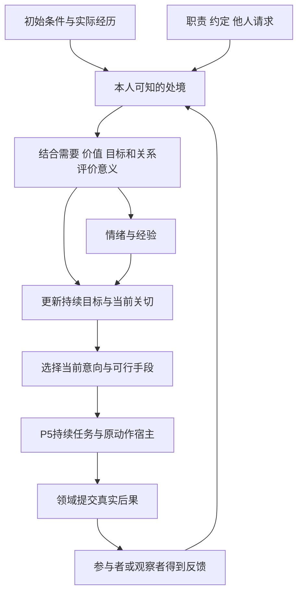

# 自主生命：个人动机、行动与共同生活

性质：依据用户目标提出的架构方案，**尚未实现**。P5已实现的协调/任务合同归[单位决策](../unit_decision_framework.md)，身体与主体概念归[身体与身份](bodies.md)，数值/资源/能力归[角色基础](character_state.md)，关系与组织记录归[社会系统](../social_system.md)，首个共同体的传承/供养/制度样本归[宗门生活](../sect_life.md)，人格与情绪模型的来源比较归[NPC研究](../../research/npc_personality_and_emotion.md)。实施次序与阶段出口只归[主计划](../../../docs/plans/foundation-priorities.md#下一阶段候选)。下文的结构名称是职责示意，不表示仓库已有相应类。

## 1. 产品目标与首轮范围

世界中的NPC应像持续参与世界的其他玩家：有自己的处境、目的、本领、认识与社会联系，在玩家没有安排时也生活、求学、承担职务和相互影响。这里的“近似网游体验”指这种共同参与感，当前仍是单机，不由此引入联网、统一任务大厅或玩家式刷怪脚本。

用户希望将生命映射成可计算模型。工程目标是建立**具有内容边界、可解释且能持续运行的角色模型**，不是声称复制真实生命、意识或任意人类心智。初始条件影响选择，不预写全部未来；新作用机制仍需开发，不能靠一个人格参数自动生出整套行为。

首个完整样本是**本地约百人的宗门**：有实际住处、日常维持、工作职责、职位与责任范围，也有个人学习修行和彼此合作/冲突。先贯通NPC自主与NPC之间的协调；玩家只需共用的结构化请求/委托入口。百人是验证样本，不是引擎极限或硬性帧率承诺。远方抽象模拟、随机事件代算、人口繁衍、复杂政治与完整指挥系统均不在首轮。

生产、教学、居住等是检验共同能力的实际领域。必须有足够的真实过程让宗门运转，但本阶段不以扩充工种和配方数量为目标。战斗继续复用现有能力，打磨和新增预警仍后置。

## 2. 个体怎样装配，差异怎样持续

| 组成 | 初始来源与后续作用 | 边界 |
|---|---|---|
| 身份与实际载体 | 稳定个体引用、当前身体或依附物，保持经历连续 | 不从移动槽位、精灵或物种ID推出人格；本轮不提前实现换身全套机制 |
| 维持、感知、操作与表达能力 | 身体/形态定义及后天变化，决定需要什么、能察觉和做什么 | 没有某需求就不装配；无移动身体不等于不能自主，不为静止主体伪造步行槽位 |
| 已有本领与手段 | 实际掌握的能力、可采用的方法和使用条件 | “想学”“听过”“已掌握”分别成立；新技能必须由能力owner提交 |
| 较稳定倾向与价值 | 出身、模板和经历形成看重什么、风险取舍、常用方法 | 不是一条智力等级或“善良者必答应”的动作表；不必永远不变 |
| 个人认识与关系依据 | 自己熟悉的地点、人物、约定、见闻及其来源 | 不初始化全图真值，不全人口两两建立复杂关系矩阵 |
| 当前生活条件与社会位置 | 实际住处、资产、职位、职责、未结约定及其范围 | 职位与任职者分开；知道有权不等于物资已经在手 |
| 持续关切与经历 | 身体缺口、个人抱负、已接受事项、实际重要往事 | 不在每次空闲或读档时重新随机生成“人生目标” |

宗门开局先建立空间、设施与有限物资，再装配成员、住所/职位和合理的熟悉关系，最后生成与实际条件相容的个人目标。成员可以知道自己的住处、常用食堂、直属负责人和熟人；不知道全图库存、他人的真实想法或每个人实时位置。初始认识标明开局背景，不能假冒运行中发生过的目击。用相关模板与约束生成差异，避免独立抽出“不会做饭的唯一厨师”“没有可用住所的住户”等无意矛盾；刻意的困境则明示为情景条件。

共享机制按能力组成。普通植物不强制有抱负和语言；普通动物也不被固定为没有情绪、经验或长期关切。首轮用宗门成员完成主要闭环，另用必要的小对照检查不同维持/行动能力没有被人类步行与饥饿写死，不承诺同时制作全物种目录。

## 3. 所有自主活动共用的工作流



| 层次 | 保存/回答什么 | 不代替什么 |
|---|---|---|
| 需要、价值与个人评价 | 什么受到影响，我为什么在意，是否紧迫，责任和风险怎样理解 | 不直接下动作，不改变客观库存、伤势或他人意愿 |
| 持续目标 | 希望什么条件成立，来源、对象、期限/维持性质、达成/失效依据是什么 | 不等于某一次采集、某个host或人物小传 |
| 当前意向 | 目前准备推动什么目标，采用何种投入与切换规则 | 选中一件事不抹掉其他抱负、义务与未结事项 |
| 手段/分段计划 | 根据本人所知和本领，尝试怎样推进、缺什么前提、下一步是什么 | 预计他人答应不等于已答应，预计获得物品不等于已取得 |
| P5任务与实际过程 | 当前步骤的host/run、等待对象、进度、合法交接及反馈 | 不再复制预约、路径、成本、工时和资源结算 |
| 领域后果与个人认识 | 实际改变了什么，我实际获知并相信了什么 | 动作完成不保证目标达成；本人以为完成也不使世界事实成立 |

目标可由身体状态跨界、任职/接单、已知机会、个人抱负与重要经历产生。习惯提供有条件的常用方法，作息提供机会/期限，二者不等于全局排班表。无事时休闲或平稳生活是有效选择，不强求所有人持续劳动或制造戏剧。

不是每个世界变化都要先经过一次决策：代谢、受伤、植物生长与动作内部的逐步移动仍由原过程推进。自主层选择要参与的活动及应对办法，不逐格规划走路，也不把身体自动后果包装成一串目标。

候选目标状态为待推动、当前推进、受阻/等待、暂缓，以及达成、失效、明确放弃；具体编码在实施时收敛。维护性目标可反复产生工作事项，不每次检查都复制新目标。目标、所采用的方法、实际任务和社会约定分别有稳定引用；目标合并/去重按来源、对象及适用范围判断，不能把两个人的不同委托错误合成同一责任。

方法由作者定义有限的前提、步骤、可能结果与替代途径。可以依赖子目标，但保存父子关系与已采用方法，检查循环和重复需求；预算跨唤醒保留，不能不断重建根目标绕过限制。缺少认识时可以打听、检查或有目的地探索；没有支持的手段就报告/等待或放弃，不假装能理解和完成任意愿望。只展开眼下相关部分，无需一次规划全部人生。

方法恢复依据已提交结果和当前条件，不能机械重播步骤。例如已从箱中取出粮水，途中被打断，恢复后应检查背包中的实际可用物资及原事项要求，再接续烹饪；不能又取一份或因箱子空了便抱着原料发呆。换目标/放弃时，已带物资仍真实存在，按有关使用/归还规则处理，不回滚转移或假定全部私有可耗。首片验证就包含这种有物资转移/消耗的多步样本。

反馈保留具体原因和适用范围：临时工位占用、缺少前提、路径/目标失效和对方拒绝不作同一种失败解释。沿P5已有的操作/目标/个人依据退避，分别用于等待/换对象、补前提、核查新线索或等有意义条件变化；不能每几秒重新骚扰明确拒绝者，也不能因一次暂忙永久否定整种学习方法。不预先把所有领域失败硬压成固定三类枚举。

## 4. “为什么去做”的可计算模型

基础选择采用**有条件约束的目标评价、有限方法和意向坚持**。借鉴BDI的认识/目标/意向分离，用效用曲线比较具体机会，复用P5执行；不同时建设四套BT、GOAP、HTN和效用运行时。

一次选择分四步：

1. **形成有关目标。** 身体缺口、本人看重的事情、已接受责任、个人抱负及可知事件提供理由。目标的存在和紧迫程度有来源；不是每次扫描所有动作，选最短路的那一个。
2. **按所知找可尝试的手段。** 检查实际能力和本人已知条件；区分不愿、不会、不知、资源不足、无人回应和当前受阻。未知条件可以先查证。世界变化仍由原宿主在执行时复核。
3. **分清执行硬条件与个人选择政策。** 实际能力、资源及P5合法交接约束由原宿主裁决；本人当前确实不考虑的手段可按明确个人政策排除，例如不愿承担某种风险。普通职责、守约偏好和社会规范通常进入预期得失，不一律成为硬禁令；即使角色主观上不愿违背，世界也不因此物理禁止违规。政策何时因处境或新认识而改变需显式表达，不能既写“绝不考虑”又仅靠大收益跨过。不会规定全生命一律“生存＞职责＞个人目的”。
4. **在剩余候选中估计实际推进。** 结合目标当前重要性、预期进展、成功把握、耗时、物资/风险及对其他关切的影响，与继续当前方法比较。相近选择才允许有限随机，随机不是人格的主要来源。

一种可供首轮调试的评分形式是：

```text
评价(手段) = Σ [有关关切的当前重要性 × 预计的处境改善]
           − 本人预计的时间、资源与风险代价
           − 改换当前有效意向的代价
```

公式只比较已通过当前选择政策的候选，不是世界统一货币或科学心理公式。“重要性”由需要缺口、价值、期限和关系/承诺意义的各自曲线取得；“预计改善”基于本人认识，比较本段投入后与继续/不处理时的处境差别，包含避免预期损失，允许判断错误。不能直接把“吃饭恢复3000饥饿”“终身抱负完成1%”和“供给目前达标所以进度0”相加。日常需要按缺口改善、抱负按有实际意义的当前阶段、维持职责按已知的供给/期限风险各自评价，再在一致的决策时间范围内比较投入；不能把每切一小段都奖励一次“完成100%”，也不统一除以时间而永远追逐最快的小收益。

这是需要实际对照校准的游戏模型，增加一层抽象不会自动免除调参。首轮只保留能解释行为差异的少量因素，记录依据与主要胜出/落选原因；具体维度、曲线和参数通过“吃饱后仍会求学、供给足够时能离岗、临近短缺时合理处理”等对照收敛，不把示例常数变为产品规则。

有期限或维持窗口的关切，可用“已知期限前可用时间－预计必要耗时”的余量参与紧迫评价；供给充足时不把巡检本身当无穷正收益，预计将短缺时才提高处理价值。预测使用本人可得的库存记录、消耗经验与时间估计，不读取隐藏实时真值，也不为每次评估跑全图精确规划。余量不足时再按个体取舍比较协调、暂缓或承担违约后果，而非用另一组绝对欲望阶级代替。

持续抱负提供方向，眼前缺口和机会决定当前投入；不能因为长期目标没有近期截止期就一直给零分。暂缓目标保留相关唤醒条件或有限的下次复查机会，避免只等一个永远不会发生的事件；不因此保证每个目标平均分配时间。比较相关结果时，父目标与其工具性子目标不能把同一收益重复计分，也不能靠生成更多目标增加选择权重。失败先更新有关方法/对象的预期与证据，不直接把人物永久改成“讨厌学习”；重复有效经历才按明确规则逐步影响偏好或能力判断，不要求首轮训练神经网络。

**例：求学者承担一项职责。** 他先前愿意承担，可能因为认同职责、报酬、守约习惯或求得指导的机会；这使履职本身也推进其个人关切。吃饱后不会只因“需求归零”而盲逛，而会继续求学或履职。遇到一次讲学机会，他比较是否能先完成、申请换人或延期；不是每次思考都重抽是否服从。若已明确选择违约去听课，未履约的事实、损失与他人可能的追责继续存在，不能靠换目标洗掉。

坚持不等于把旧动作锁死。小的分数/距离变化通常不抢断；危险、失效、重要新认识和原任务反馈可触发重选，按动作的合法取消点交接。不能用已投入很多时间强迫继续明显无望的方法。中断后重验剩余前提；可以换办法继续同一目标，也可以有理由地放弃。紧急脱险复用现有战术策略，不等待慢速人生规划。

## 5. 经历、情绪与敌对怎样接入

评价路径是“本人获知什么 → 对其关切意味着什么 → 本人认为谁负责、是否有意、能否应对 → 情绪/人物判断/后续选择变化”。稳定倾向、短期情绪和对具体人/事项的判断分开，保留必要原因；不合成全局好感或工作效率条。

情绪影响关注、风险、切换和表达，但不直接抢占动作或自动解除承诺。重要经历属于持久认知状态；可淘汰的界面日志和trace不承担该责任。新证据能够改变归因，例如得知对方因救人迟到后重新理解失约，不只是等待愤怒衰减。

学习、修行、合作、拒绝与敌对共用上述机制，但需要各自真实的作用能力：

| 处境 | 共同选择路径 | 需要实际发生的后果 |
|---|---|---|
| 想学会某种本领 | 已知老师/资料、自己条件、对方回应与其他日程 → 找指导、学习资料或先补前提 | 实际耗时/消耗、掌握与进展；学到的方法能够改变后续行动 |
| 收到协助请求 | 理解内容、能力/权限/当前承诺及关系 → 接受、暂缓、拒绝或提出已有机制支持的替代 | 接受留下在办事项，拒绝向请求者提供可表达的反馈；不在幕后强制另一人同意 |
| 个人目的与职责冲突 | 比较坚持、协调、转托/报告等已支持方法 | 真实交接、延期或未履约；不能只有一条“忙碌”台词 |
| 对某人存在冲突 | 具体利益与经历、力量/风险、关系和可用手段 → 不合作、回避、交涉或动武 | 实际不提供可选帮助、合法改变自己有权决定的服务、脱离或共同战斗结果 |

敌意不等于永远见面攻击；阵营/当前敌对许可仍可承担战斗准入，但不冒充整个人的动机。首轮验证至少包括有理由的不合作及危险下的冲突/退避，复用已有战斗。偷窃、造谣、告密、阴谋和制度惩罚不是用户举“下绊子”后的自动功能清单；没有相应机制时不以“破坏成功”日志或暗扣对方数值代替。

连续因果样本可用“弟子求学，同时承担日常职责”：他按实际供给与职责安排生活，发现教学机会后尝试协调；负责人依据自己收到的进展和既有记录回应；拒绝后弟子保留原抱负，改用已知资料或等待下一机会；实际学会后使用新本领，后续选择随之改变。换一组倾向、关系或信息应改变选择。这是共同机制的测试，不编成只对几名角色触发的剧情链。

## 6. 宗门怎样由这些个体运转

宗门提供成员关系、职位、职责、责任范围、住所与资产使用安排、可访问记录和有限规则。**职位不是另一套AI，管理者也走相同工作流。** 具体记录归[宗门原型](../social_system.md#本地宗门原型)；社会资格、实际身体能力、物资保管和物理阻挡分别归原责任，不用一个“权限”标记统一解释。

```text
有权任职/已有约定 → 持续职责与个人目标关联
本人检查 / 取得记录 / 收到成员报告 → 发现具体缺口
    → 自己处理 / 在职责内提出事项 / 请求协助或升级
有关成员实际获知并受理 → 自主组织手段 → 真实交付与回报
负责人按获得的证据复核 → 完成、受阻、调整或补位
```

持续职责描述要维持的条件、范围、允许手段及何时检查，例如某片设施的补给与可用状态；不是要求负责人每锅饭重新批准。开局成员都有相容的生活位置和职责分工，不必人人担任管理职务。成员可在已有授权内自发履职，管理者处理缺口、协调和例外。共同事项可以有范围受限的公开清单，不能直接变成全知全能的工单池。

首轮采用简化、明确的消息/记录送达规则：与实际互动、已配置的组织通道或成员可访问记录相连，保存发起者、接收者/范围、事项版本与送达状态。局部交谈和指定公共记录点可以先承载流程；简化投递只传发起者实际提交的内容，不从全世界真值自动补齐。无需先做完整传令网络；也不能因为消息在开发数据里存在就视为全员已知。账目是记录的内容与依据，不直接复制所有容器的实时真值。

负责人缺席时，例行授权内的工作仍可继续；发现超时、受阻或无人回应后，按已有代理/上报关系请求处理。代理或替任需实际有权者受理、提交，不能由全知程序因人死亡立刻替全员决定。信息未到、权力不足、替代人选不在都可以造成延误。物资不足或制度失灵时允许可理解的下降、自救或停摆，不承诺宗门永不出问题。

住所是实际可到达空间/床位及使用安排，不是角色面板的一行文本；公共与私人资源通过真实容器和存取过程使用。设施竞争继续由原作业位置、预约和容量机制裁决；拥挤时能等待、换目标或报告。先测实际问题，再决定是否需要队列展示或人群避让，不预先把每个物体改成排队系统。

当前`begin_interaction()`会在部分接近任务开始时取得目标预约，接近时间可能影响短操作的实际吞吐；`take/put/eat`不走这把独占预约，不能据独占床位的假设推导所有取餐都串行。未来宗门纵切需要区分到场前的社会安排与现场操作/占用。先核实际路程、占用与重复失败，再选择设施分布、候选方法或必要预约演进；不预判百人必然活锁，也不把教学时段、材料份额和所有工位强塞进同一把锁。公私堆叠物的真实归属、受托取物和加工按[物资批次合同](../appearance_and_possessions/objects.md#52-堆叠物的公私与受托用途)接入，个人方法不得按库存合计擅用他人材料。

## 7. 玩家与NPC的行动机会

玩家为自己选择意向，NPC由程序选择意向；双方共用已支持的动作、准入、成本、资源、技能成长和后果规则。NPC不能免费取得材料、隔空获得技能或知道他人私密信息，玩家也不因控制方式获得另一套领域结算。相近机会不等于所有人出身、权限、知识、本领或规划算力相同，也不保证AI能想到人类的任意策略。

不能只在接口层声称对等：首轮内容中NPC要能自主使用随身物、学习并使用新本领、利用公共服务与提出协助，而不只是吃饭/伐木。采用同一初始快照、更换控制输入的少量对照，检查关键手段对双方是否可发现、可提交、付同样代价、产生同类结果；不要求二者走完全相同路线或AI获胜。

玩家命令首轮只需结构化表达目标、对象/范围、依据和结束条件，并能看到已送达、受理/拒绝、执行/受阻及结果。复用NPC之间相同的事项接口，复杂谈判、多级指挥和自然语言理解后置。常规职责内的有效指令应及时响应，不每次演成慢速谈判或随机抗命。

玩家直接操作主角时不由自主程序代设必须追求的抱负，也不自动抢回控制。对下属的委托不能靠清空其人生状态实现；直接控制的暂停仅影响自主执行，未来引入的持久目标与社会责任需保留并按控制恢复重验。现有P5短期施工`commitment`及`suspend()`清理符合其旧合同，**不是当前已有持久目标被删的bug**，新层接入时才调整边界。

## 8. 与现有代码的接续

下表是源码核对后的演进位置，不是已完成实现：

| 当前入口 | 保留 | 需要增加或演进 |
|---|---|---|
| Objects / Units / Nature及领域owner | 稳定身份、身体热列、原株、物资与实际作用 | 按真实能力查询；认知状态按需装配，不建立第二份身体/物资账 |
| Livelihood观察、known与失败依据 | 有限认识、真实观察、个人证据和失败退避 | 拆出可复用观察/候选责任；固定生活优先级逐步转为目标来源与方法，不把旧大分支包成万能节点 |
| Decisions与策略Resource | 唤醒、任务、交接、host/run反馈和局部战术 | 补持久目标、意向与有界方法；高层通过共同任务交付执行，不另造世界调度器 |
| Society与学习样例 | 实际互动准入、回应、交换和学习后果 | 去除示例技能/对象对机制的绑定；按职责分离共享社会记录、个人解释与学习能力，不让Society变成全世界管家 |
| 设施、空间、库存与操作宿主 | 实际作业位置、预约、工时和真实转移 | 按宗门闭环的实际需要补供给、存取与设施使用条件，不另建抽象物流结算替身 |
| Frame、界面与存读 | 不可变表现、既有通知和整份候选恢复 | 显示可知状态/回报，持久保存仍影响选择的原因和在办状态，新增数据做签名/版本评估 |

当前开局只是样例：约50间围合空间没有分配住所；床、灶台与供给箱只提供少量演示库存；末尾几名敌对单位和静止旅居修士也不是宗门成员模型。不能把人数设为100便宣布宗门原型完成。需明确的情景装配，替换这些演示假设；现有format14不因本设计自动改变。

定义优先使用Godot Resource/Inspector，沿现有校验、冻结与目录签名；定义共享，个人状态独立。作者主要配置能力组合、初始条件、目标触发、有限方法、评价因素和职责规则。新的作用机制先形成有明确读写与反馈的可复用代码，专用内容再引用它；不开放任意`Script.run(world)`，也不为每个NPC复制脚本、Timer或行为树。

## 9. 频率、算量与恢复

高层按有关事件或到期唤醒，不逐帧重想人生。目标期限、检查机会与情绪变化可按经过时间计算；当前运动/动作60Hz、战术默认50ms等精度继续归[运行节奏](../../../docs/engineering/simulation-pacing.md)。远方模拟本轮不做，未来方案也没有预定为随机事件拼接。

复用共同Decisions唤醒机制，为新增的较重评价/方法展开保留可续算状态、合并同主体重复请求、限制一次展开与重试工作，并记录排队等待。按等待次序/老化避免固定ID长期占先，重建目标不能重置预算。正在运行的合法动作照常推进，轻量的紧急反应不排在长规划后。事件只通知有依据的参与者/观察者/已送达接收者，不全世界广播每一条事实。

百人同处时需要测同步唤醒、设施竞争、失败重试和寻路尖峰；这属于风险，不是尚未测量就断言Godot主线程必然撑不住。记录高层耗时、候选/展开量、等待年龄、重复失败和原动作耗时，再决定是否增加索引、批处理或线程。此阶段不承诺固定毫秒预算、万人规模、流场或远区LOD。

目标/方法执行、知识依据、社会事项与情绪评价保存必要状态和来源。恢复时重新关联原身份与实际任务，复核失效条件；已发生的物资、成长、承诺和评价不重复提交。临时调试日志可淘汰，仍在使用的目标/约定及其依据不能因缓存满而消失；有界的详细经历可归纳，摘要仍保留影响判断的意义与引用。

新增引用随原独立候选验证：原对象/能力和共享社会记录先可核验，再校验个体目标、方法、P5任务与事项版本的关联。合法的完成、取消或对象失效要有可验证的终态/失效语义，恢复后按现状重验；结构核验不能顺便向本人补造“某处物品已消失”的知识，何时获知仍遵守原观察/行动反馈。结构损坏或不合法关联仍拒绝整份候选，不能用“自动修复成空闲”绕过现有坏档保护。

## 10. 首个宗门样本怎样判断成功

具体依赖与交付只归主计划。总体结果是：**初始化后，不持续注入命令或物资，成员能持续维持生活、推进个人目标，并经实际职责与互动共同处理宗门事项。**

- **生活有着落且供给有来源。** 住所/设施真正被使用，物资有有限开局量和真实补给链；核对真实消耗、产出、操作/移动工时与设施吞吐，保留求学和个人活动的余量，不靠全员永远求生掩盖链条不平衡。至少跨过补给、消耗和休养/职责的重复周期，依据实际节奏选择窗口，不能几十秒消耗初始库存就称自给自足。自然产出有对象、时间、条件和数量，水等来源亦明确，不定时凭空往箱子加料。
- **不只在劳动。** 有成员持续求学/修行、使用本领或参与社会事项，个人目的在吃饱、换班或中断后仍有后续。正常休闲不算故障，也不为达成行为配额强迫闲聊。
- **差异来自同一机制。** 相同处境改变某个相关倾向、经历、信息或约定，应改变可解释的选择；同一个人在条件改变后也能改选。标签、台词和动作数量本身不能证明鲜活。
- **组织确实协调。** 范围内的职责、已获知缺口、真实受理/交付和复核形成闭环。移走负责人、阻断设施或造成短缺后，有据的发现、调整/求助或可理解的恶化；不能后台瞬间补位或保证每次扰动都复原。
- **认识与行动机会成立。** 未获知的变化不应凭空改变计划；拒绝后能换已支持方法或合理等待；玩家/NPC在所选对照中共用实际规则。
- **能看懂、可继续。** 玩家在正常世界中跟踪/多次接触同一成员，能看到受扰改换方法、续推旧目的或学会后使用本领；常规互动给出愿意表达的目的/阻碍，开发诊断再展示私密因果和落选原因。后续行动与表达相容，改变时有新处境或解释，不靠新增一个面板就证明自主。中途存读后不复制资源/成长、不重抽初始人格或丢掉未完事项。

宗门资源平衡、协作可靠性、个体差异和玩家可读性需要一起验证。一次无崩溃、一次高帧率或一段预写故事均不等于这个目标达成；也不把首轮扩大成完整生活模拟器、市场经济、司法系统或任意阴谋生成器。

## 11. 依据与咨询取舍

外部参考与能力限制归[NPC研究](../../research/npc_personality_and_emotion.md#2-公开游戏与非llm架构证据)。其中The Sims提供按需要与机会选择的工程参考；Versu展示角色与社会情境分离；FAtiMA/EMA提供对事件作个人评价的思路。它们不证明Reol的规模、长期人格或宗门运转已经成立。另读取[Rao与Georgeff的BDI论文](https://cdn.aaai.org/ICMAS/1995/ICMAS95-042.pdf)与[Game AI Pro第12章](https://www.gameaipro.com/GameAIPro/GameAIPro_Chapter12_Exploring_HTN_Planners_through_Example.pdf)，只借鉴持久意向、有界手段及执行重验，不引入全套逻辑求解器。

先前自主基座双顾问原答留本机`.local/advisor/agency-foundation-20261116/round-1/`。本轮宗门咨询留`.local/advisor/sect-autonomy-20261116/`：第一轮hydrogen完整返回并已通读、argon上游代理失败；第二轮初次两路均代理失败，用户恢复代理后在`round-2-retry/`取得两份完整复核并通读。第二轮均声明未联网，属基于方案的静态推演；顾问未运行本机，不作为性能或修复证据。

采用第一轮的多源动机、目标/执行分离、角色无关的职责/事项、有限认识、简化异步协调、真实供给及有界思考建议。未采用固定四档欲望优先级、统一情绪/关系维度、目标/方法槽数、固定毫秒预算、必然卡帧/必须全量排队的判断；它们缺少本项目验证。也未接受将`suspend()`旧合同称为现存人生目标丢失bug、把偷盗/造谣/功过政治列作首轮主干、保证负责人消失仍可无损自救、用闲置率/非劳作比例证明自主性。保留问题相关的对照与扰动，具体取舍以本页和主计划为准。

第二轮促成了硬准入/个人政策澄清、不同关切评价尺度与时间余量、事项份额受理、供给工时余量、多步物资重入、具体失败原因及跨主体恢复核验的补充。未接受所有消息永久必须实体簿、职位必须靠独门技能/钥匙垄断、解除一项阻碍便必然立即答应、固定三类失败枚举、三日/60分钟/开局库存倍数或后勤比例验收等要求。顾问对“多久吃光库存”的估算缺少实际需求速率依据，不能据其假设的每天一两餐推导本项目停摆时间；测试窗口与供给配置按原代码实际消耗/产出测定。采用建议不表示其全部论证或同题一致已获验证。
