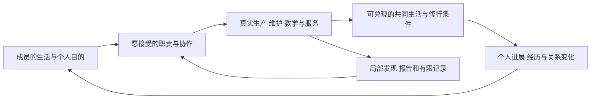

# 宗门生活：传承、供养与成员自主

性质：首个本地百人宗门的设计与已接入合同。青禾宗已用原生Resource装配到正常main（玩家1＋99自主居民），持续供养与交付证据只归[BASELINE](../../docs/status/baseline.md)，各节仍区分已实现与长期候选。这是用来检验共同框架的一种宗门形态，不规定天下所有宗门必须同制。角色数值归[角色基础](beings_and_lifeways/character_state.md)，个人工作流归[自主生命](beings_and_lifeways/agency.md)，关系/职务/事项的唯一模型归[社会系统](social_system.md)，学习过程归[学习设计](cultivation_and_learning/learning.md)。阶段出口只归[实施任务表](../../docs/plans/foundation-priorities.md#百人宗门实施任务表)。来源、顾问取舍与核查限制见[基础研究](../research/sect_foundation_sources.md)。

## 为什么这些人愿意一起生活

首个样本是一个**以传承与修行为中心、能维持共同生活的共同体**。成员从中获得实际住所、供给与照护、资料与教习、可用修行条件、相互帮助及已有防卫能力；通过已接受职责、有限投入、交付与自愿协作维持这些条件。

它和普通生产聚落的设计差异，体现在稀缺教习时间、资料传承、修行条件与方法改变对日常安排的持续影响。它也不要求每名成员以突破境界为最高目标：有人求长进，有人重同伴，有人希望安稳行医，有人珍惜个人手艺。身份、能力、责任和实际投入分别成立；不把凡人永久设为苦力、修士设为自动脱产者。

这是一种具体的可玩样本。未来可用相同成员、资源、职责与约定能力配置松散师承、小型家族或商业化门派，而不是为每种组织另做一套AI。本轮不先扩这些内容。

### 成员参与的因果链

图中的“愿接受”不是每次上工重抽是否听话。既有职责提供稳定的行动理由，正常授权内可自行办理；成员也会在供给、课程、自己修行和他人请求冲突时作出取舍。拒绝、暂缓、协调或失约各有实际后果，不能靠切换个人目标消除已接受责任。

成员留在宗门的理由会被生活结果支持或削弱。首轮用实际选择、求助、投入变化和有因不合作表现这种变化；不预设完整出走、叛宗、迁居或忠诚度归零事件链。缺少离开机制时应诚实显示受阻，不能宣称已模拟所有人生选择。

## 制度做到可以办事为止

需要的是**谁有何责任、能决定什么、资源从哪里来、承诺怎样兑现、发生问题谁能得知和处理**。部门日常事务已接准确的授权管理信息与面板命令，不要求现场盘点、报工或到告示案办事；NPC管事使用相同权限和命令。个人探索/交往仍有有限认识，物品运输和劳动仍实际到场。ERP/OA只作管理体验类比，不预建财务、薪酬或通用审批平台。[设计依据](../proposals/department-management.md)保留原源码审查背景，现行合同归本页与社会系统。

| 必要安排 | 首个样本中产生的真实效果 | 不是 |
|---|---|---|
| 成员与生活安排 | 谁可使用哪些住所和常规供给；实际到达/领取/休养 | 全体免费无限恢复，或只在面板写一个房号 |
| 职位、职责与范围 | 供给、修缮、教学/修行安排、照护/防卫有明确责任来源；可兼任与代理 | 一人一张职业AI，或强制设定四位管事与固定后勤比例 |
| 日常授权与资源使用 | 约定范围内取公料、操作设施与交付，不每次等掌门批准 | 社会权限凭空变出材料、隔空完成工作 |
| 部门目标与工作配置 | 上级目标、管事分工、范围内选活与实际结果统计；私人协作另走自身条件 | 每次做饭跑告示案、全图潜在工作与所有闲人实时匹配 |
| 教学与修行安排 | 有实际提供者、资料、时段/名额、场所/材料及受理条件 | 扣贡献即刻学会、所有活动都锁死在刚性时间表 |
| 奖励与负担的约定 | 明确的实物、服务机会、已承认履职及未结责任 | 一枚万能贡献点兑换全世界和别人的情感 |

首轮成员可以按开局背景已接受相容职责和常规资源使用安排。无需先完成招募、晋升、考核、司法与完整继任流程才能生活。管理者要处理的是有意义的资源和时间冲突，例如：

- 教习本期愿投入多少授业时间，提供集体讲解、个别指导还是先形成可自学资料；安排须符合本人能力、意愿与已有责任。
- 某段工作繁忙时怎样让成员完成既有职责、申请交换投入或改期，而不是让求学永远排最后。
- 有限材料先供医护、维护还是个人修行；决定只约束其有权支配的部分，并实际通知有关人。
- 负责人缺席时，已有代理/日常授权可继续哪些事，哪些例外需要上报与有权者决定。

不为证明管理有价值强制垄断基础技能、给每次做饭加签字或让负责人不在便全门停工；同样不能让全知后台自动找到替代者、开放全部资源。职位的作用来自持续负责、信息渠道与协调能力。

## 任务、回报和贡献怎样成立

一个组织事项来自职责内的缺口或已接受目标。成立时要明确目标/分配、办理范围、何时算完成以及资源/服务从何兑现。部门例行工作直接由授权管理接口安排并据真实结果统计，不要求逐次报工或每位成员重新协商；私人求助、对外约定仍分别处理知悉/受理。发起事项不等于已经履行，履行也不等于奖励已经交付。

厨房已接上级产量目标、工作台绑定、人员工作配置与供料需求；员工按配置把合法原料实送台内、在工位加工、将成品归仓。实际生产自动核销生产目标；搬同一批饭和重复报同一结果不能增加产量。产量、现存库存和指定交付分开，私人做饭、赠食和公差按各自事实处理。四院膳堂与仓务由同一开局Resource装配，厨房主链不再发布/领受实体告示；田务职责、私人委托及其他实际社会渠道保留。

公料与私料、加工后产物及交付用途的处理沿[物资批次合同](appearance_and_possessions/objects.md#52-堆叠物的公私与受托用途)，部分履行、转托余料与单次赴约沿[共同事项合同](social_system.md#职责怎样变成成员行动)。需要保管人办理和日常授权自取的资源在场景中分清，不借“管事缺席”统一解释所有领用失败。

首个样本采用三类不同后果：

| 后果 | 归属与兑现 |
|---|---|
| 履职历史 | 机构承认的事实与证据，影响以后有关选择；不是每次都能花掉的余额 |
| 已约定实物/服务 | 实物从实际持有者转移，教学/修行机会受提供者、时间与场所条件约束 |
| 个人感激与关系变化 | 只有获知且在意的当事人形成，不由发奖自动给全宗门加好感 |

如以后需要可花的宗门额度，另设由该组织承诺的支取权，明确发行依据、适用项目、承担者与可用储备/服务能力。历史贡献可保留，同时支取额度已花；不能把二者写成同一个可归零的分数。首轮不为了积分系统而制造所有任务，常规职责和私人互助也可以没有逐次奖金。

组织可以承诺未来给付，不要求把每一份未来收益锁死为现存实物；但须区分已留资源、未来承诺与实际可兑付，不能将同一受限名额/实物重复保证给多人。跨域操作继续使用原owner的校验/提交结果与关联依据，不另造一个同时管理库存、教学、信用的通用事务引擎。

“替师兄领药”需说明谁是受托者、使用何项资格、允许领什么/多少、交给谁。代理不转让全部身份与支配权，药物实际归处仍唯一。已有服务安排不等于所有库存都被物理锁住；首轮可以先不开放偷取交互，不能把社会许可解释成物理定律。

## 四条相互支持的循环

### 生计：有限来源到真实消费

真实粮水来源 → 采集/取水与搬持 → 公私储存 → 烹饪/领取 → 实际进食与消耗。

第一条持续链要解决原料再生/种植、有限取水、真实取放和加工，不能只给百人发无限饭。使用现有Nature与设施作业合同，选择最少且可持续的内容样本，不展开整条农作物科技树。物品进入在途人物库存就是在途实物，不再在组织账面留一份可重复领取的货。

#### 已接入的生产合同

`ProductionRecipeDef`引用于共同操作，声明输入/输出、标准劳动、可选静置/收取、本领/实践及首次开工资源费用。目录编译为只读值并签名；同机制配方新增Resource和库/设施配置，不新增World物项分支。当前炊事与煎药共用`craft`，只加工需要灶台指定单侧位置，取饭/取物和拆除各用原位置规则。

原料先正常搬到台内唯一`stock`，开工选一组足量且权属相容的实际原料并锁定输入量；不从操作者背包远程扣料，也不保留第二份work_stock。原料仍占空间且不能被取走，成功完成才一次扣输入/加输出；容量检查扣本次消耗并计其他入库承诺。跨run的`process`留原设施，当前action只保存过程身份与本段劳动区间。离岗换人保留标准劳动；显式暂停还冻结静置剩余时间，明确取消整批清工时、释放输入锁，不耗料/产物或退还已付身体成本。换人不重投或沿用上一人速度；成品延续原料归属，公料到台即结运输保管，加工不再算旧搬运者个人领料责任。出料阻塞保留原物与已干劳动，拆台保权回收库存与建材。

当前灶台容量6，一台同一时刻只加工一批；工匠须占指定作业位。补料只备当前一锅，扣台内可用与有效在途，并留净增输出空间；在途物不代表已可开工。成品和配方变更后的闲料经真实运输归箱。取消当前锅不等于停开新批，持续停产须暂停其目标。

炊事为2粮1水→3餐、标准劳动4秒；煎药为2草药1水→1药物，备料1.5秒、静置4秒、收取0.5秒，需要煎药入门，首次备料耗100精力。静置只记共同世界到期时刻，释放人和预约，人工收取才转换产物；读取不推进工序，没有逐锅时钟。实际参与者按标准劳动比例获得实践，最多128份贡献、超限旧贡献归匿名总量；活动回执只输出有界人员摘要，不承担权威进度。

`stock_source`设施能力提供有限真实补给；当前汲水井容量24、每15秒自然回补1、单次最多取4，满时不积攒未来水。沿原World每秒边界，来源时刻/累计自然产量可恢复，索引可重建。它不是完整水文或任意地形水格无限取水。T11b已贯通真实供养消费者，T12a正常四院各配置两口井；具体百人来源、消耗和竞争结果沿BASELINE核对，不能仅由单井参数推断长期容量。

### 当前自然与栽培合同（T11a）

`Nature`沿原5秒错峰采样积分前段生长，`Objects`仍唯一保存实物；`Cultivation`只计算载体规则，不持另一份水量或调度器。花盆与多格田畦均以`capabilities.cultivation`配置土壤、水容量100、初水80、活株每30秒减少1、一份真实水物品恢复40。空载、未完成播种和枯株不耗水；裸地没有可写的全地图水文。生长所需日照/适温/季节和生存伤分开：夜晚停长不受伤；缺水、过水与极温可积伤，一年生非适季积伤，多年生休眠。

正常操作`plant_crop`以`plant_definition`引用共享只读植物定义，种子需求自动派生，不能另手写相冲突的数量。`sow_grain`与`sow_herb`共用此机制，目标是空栽培载体，1500ms真实工作后沿原播种完成路径一次消耗种子、创建幼苗并结清原受托投入；中途取消不扣种、不造株。原地面预付种子施工点仍可保留和续播；拔除未消费种子时保原批次落地，不当作新的自然收获。载体与植株保持双向关联、相容权属和完整占地，操作位置继续从原载体派生。

养护的共同Query、手工与引水领域提交使用同一需要判断：健康裸地或适水已足时不白耗水，真实伤可以恢复；过湿单列状态，照料不能排水时拒绝继续耗水；容器补水不超过植物适水上限。个人认识只保存可观察的占株、宿主、受伤与湿度档位，有宿主幼苗可以正常发现；未把每次连续水量变化都变成全员重选。正常UI显示湿度与禁用原因。

成熟跨界只将剩余有效生长时间计为产物进度，满株不囤未来产出；采收/移除先结清前段采样区间，避免摘空后追溯补产。`generated_items`只累计实际运行生成的果实/成熟体材，初始摆物不计，是证据而非可花费库存。自然来源、真实转化与消耗的整体供养仍须T11b/T12验证。

当前样本`sect_grain`（宿根灵稻）是多年生春夏秋作物：有效成熟600秒、成熟后每150秒有效时间结1粮、株上最多12粮，冬季停长；不缩短原野稗/野药周期。一株与2×2田畦是本样本的明确空间归约；96容量粮仓共用原储物设施。晴/雨每天实际有效光约561/541秒，以上是内容参数而非百人平衡结论。全年农政、地形水文、持续野生扩散与完整工艺经济后置。开工/收尾双顾问均已核查并独立整改，证据归BASELINE。

#### 当前自主田务（T11b）

原任职职责增加`cultivation`分型，声明种植操作、巡检间隔和照料湿度档；任职绑定多处稳定`sites`、领料`sources`与归库`destination`。一名任职者仍只持一个`role_duty`，不按每株/每次浇水另开事项。粮田、药圃为同机制定义；同一仓可出种入粮。单畦损毁只移除该范围，全部田畦/来源或目的库失去后才停止职责；被撤销的职责保留历史，受托实物沿原退还流程处理。

无状态田务方法只读本人认识，沿原Planner/共同Query提出下一步：本田已收产物显式归库，救危/清枯/照料，库有余量才限量采收，空畦补种或续播；当前无事时复检最陈旧的有关现场。满仓时让粮留株上，仍可护田；空来源/无法进入的单畦不撤掉整个任职。原反馈、到期复评及观察继续唤醒，不新增独立农夫执行器/时钟。

新株只在同组织、公有且真实寄宿时，从稳定田畦继承耕作及同条耕作授权下的供给许可，不继承拆除/私产/其他组织权。取源资格与领出用途分别检查；种水仅按当前已知需要保留，采收用`supply`，真正入库后才成为可按其他用途再次领出的公物。通常退料优先材料仓；未指定目的地时，服务仓只接适用于其实际服务的物品，不把生粮/药草塞进餐箱。显式交付仍遵原约定地点。仓满时已携粮可退其他材料仓，无处可存则暂持等待；新采收仍受目的库容量回压。宿主、已知占株及持有批次的历史来源受本人目的保护；观察宿主只同时观察实际可见的植株，不远程读所有田的状态。缺水熟株仍可采收；同操作共同缺料/取源失败本轮只求解一次，保留其他田务的预算。新鲜现场并无工作时不反复巡视，缺料闲暇与手持待交实物分别参与教学意愿判断。

### 维护与照护：让共同条件可以持续

观察到的设施/工具受损或身体缺口 → 有能力者提出/承接处理 → 真实材料、时间和方法 → 恢复有关能力或保留受阻。

已有施工、修理和HP治疗接缝可以复用，但各自处理的损伤不同。首轮只接闭环实际需要的设施/身体状况，不先添加全装备耐久、全部病种和自动损坏计时器。木愈当前只恢复HP，不能因为名字带“木”便用于修建筑。

### 传承：老师的时间能换成新的行动机会

本人想学且知道渠道 → 与愿教且会教者/可访问资料形成安排 → 实际讲授、理解与练习 → 学会可用方法 → 在真实事情中使用并获得反馈。

首个教学样本采用一对一，资料自学作为已支持条件下的另一种方法；集体授课留后扩展，不先建设课堂模拟器。老师与学生实际受理、准入及任务关联同一教学过程，只有双方满足该方法的在场/投入条件才推进；双方个人时间不能同时拿去运粮或自修。原任务中断结束的是当前执行段，已提交学费、消耗与进展继续由各自owner保留，重入只办理剩余步骤，不能以另一run重领进度。不得用当前2秒休息/4秒做饭的参数类比未经定义的教学耗时。

师徒名分不自动产生一次完整授业，学会也不自动获得组织职位或无限教学能力。方法可声明哪些已掌握部分能够指导他人、需要什么表达/资料与条件；实际知识和组织授课许可分别查询。这样传承可以逐步延续到后来学成的人，不必让唯一的开局老师永久扮演技能商店；首轮不为此扩完整代际更替或掌门继任。

#### 当前一对一运行合同（T10）

学生`learn`与教师`teach`均沿原World行动宿主；`Society.Teaching`只拆共享规则，不持另一份课程或时钟。前往阶段不占教师或学生，到场才检查实际能力、对方已有行动与本人需要/目的。相向同法的互补命令合为一次活动，另一个人使用原伙伴绑定；危险、离场或新命令仍可中断。忙碌或尚未主动参加时，原action最多等5秒，原共同截止唤醒每250ms复查，过窗结束本次邀请。当前单课工时是样本参数，不是世界统一课时。

教师私人`instruction(method,target)`目的只寻找本人已知的指定人，不扫描全体NPC的学习目标；若自己还没掌握，先沿原发展方法学习和实践。被邀请的NPC按自己的学习/传授目的、正式责任、需要与其他安排决定参加；有急需时可拒绝。NPC不能凭玩家恰好空闲强制其上课，玩家必须以自己的互补学习或传授命令加入。

共同结果明确`teacher/learner/method/points_gained/understanding/understood`。成长来源仍为`learn`，理解进度与实际实践分开；学生获得真实教师线索及受益经历。教师私人目的、学生成长与原组织教学事项采用同一结果，学生或教师作为宿主均可办理。组织教学事项以成员为对象，仍要commission授权，不产生对人体或背包的库存权限；每份指定入门责任只在理解达标后记一次履行。悟性较低需多次真实授课，不能按发出一次命令结清。

如果对方已从其他来源学懂，教师必须到场才确认：个人传授目的可结束，正式事项记需求已满足、释放未履份额，履行量保持0。师徒名分、多人课堂、约期排课、学费和教材制作仍未实现。T12a已将固定开发老师替换为正常Resource中的传功成员、有限初始关系和公开授课内容；T10局部链路/GUI与正常百人运行的不同证据分别归BASELINE。

### 修持：改变方法与能力边界

实际供养与可用时段 → 合适场所/功法、可汲取的来源或材料 → 实际修持 → 有限进展/消耗 → 能采用的新方法与后续选择。

环境五行是持续条件，不因为打坐而扣除背景强度；物件/原株储存的可吸收灵气有数量和补充过程。某人有资格使用修行场所，不等于它此刻空闲、来源足够或本人会用。首轮以入门修持和一项方法变化检验，不要求完整突破、雷劫、寿元与金丹内容。

#### 当前持续修持（T11c）

原resource目的已支持灵气储备与按本人HP上限归一的伤势评价；权威HP仍归身体，qi仍归Objects。只有本人已引介且可实际增灵的功法产生储灵动机。储灵是个人安排，没有生存紧急线，须保留4000精力与饱食余量；温饱和责任仍参与共同评价。满灵且已精通时停止修行，满灵但尚未精通仍可用真实投入继续实践。目的是否存在由定义中的目标值决定，不再附加吞掉极小缺口的评分过滤。不会该功法者不因缺灵自动学会或全知搜索目录。

植物定义的`stored_qi`配置容量和每秒恢复量，与能否开智分开：古树3000/每秒1，青灵竹1200/每秒2；青灵竹沿古树测试图表现，未宣称已有正式竹类美术。成熟且未满时才积累实际灵气及千分余数`qi_carry`，满额清余数，死亡/砍伐清储灵，扣源前先结清过去区间。`Nature.generated_qi`只记实际新生量作为核账依据，不是第二份可用库存。普通植物、环境五行和灵植库存不会混用。

本人观察只得到可支持的已定义耗灵门槛`source_qi_band`，不读取精确远方数量。空源可换本人已知来源；没有可用源时等待原Decisions到期复查，已引介而未精通的人即使满灵也保留必要复查。个人储备已足且实践已完者不周期轮询修行。资源支付、真实伤害和恢复沿原owner通知，只预约稍后决策；提交自身结果通过原after_action节流，不能同刻重复自疗。

自主伤势恢复目前采用本人真正已会且支付得起的木愈；普通睡眠仍只恢复原精力/体况，不被解释成回血。旧药水命令保留原控制与承诺语义，本片未把它迁入自主方法，未会木愈者不会假装已具疗法。不为证明循环添加定时伤害或定时扣灵；人物可以补满后空闲，真实耗灵/受伤后再处理。该机制已接正常百人装配；原生GUI、伤害反例与正常无扰修持的不同证据归BASELINE。

## 修仙物资从哪里来

物资的来源与“交易、任务、探索、炼制”这些取得方式分开。任务是委托/协调，炼制是转化，交易是转移；它们本身不会创造高级材料。自然产出也有具体条件、数量与再生时间。

| 来源/过程 | 实际投入、限制与归处 | 首轮处理 |
|---|---|---|
| 本地生计产出 | 地点、植物/水源状态、采集和搬持工时 | 做出持续粮水链，是可持续生活的必要部分 |
| 本地有数量的灵气来源 | 来源的状态、积累、可接触/汲取方法与恢复条件 | 可从现有原株qi样例抽出最小通用过程；不把整片环境当扣料矿 |
| 药材/修行材料培育与处理 | 合适环境、实际植株、时间、劳动与转化损耗 | 选择能展示来源/用途的一种样本即可，其余不虚报已循环 |
| 制作/炼制 | 已会的方法、工具/场所、真实输入与产物 | 若选入样本则提供守恒与有意义产物；不强制本轮做完整炼丹炼器 |
| 贸易/受托交付 | 对方真实持有货物、我方支付/交付、实际转移与履约 | 可用有限来客做差异来源演示，或明确后置；没有外部生产就不宣称无限可持续 |
| 外出探索 | 人员、时间、补给、已知线索与真实可取得对象 | 本地能力稳定后再选，不插入离屏随机收益替代尚未建设的世界 |

首个宗门可持续的是选定的生活与入门传承/修持循环，**不是高级物品永远自给**。高阶库存耗尽可以限制后续成长；只要当前边界明确，就不需要为了假装百业齐全添加无限商人。基础经济是开放边界还是封闭样本，应在场景定义中明示每项外部输入。

凡俗方法与术法是可组合手段，不是两个人口阶层。已有引水术仍消耗一份水，却改变到达/交付方式；木愈花人物灵力与精力恢复HP。首轮让NPC实际学会并使用这种差异，修仙味来自选择改变，而非让所有凡俗劳动都被无成本取消。术法确实能改变物流时允许改变，随后核对其学习、供给与机会成本。

## 宗门为什么立得住

本轮只做内部条件，不用一个“门派战力/威望/管理”总分解释存续：

- 有持续来源与能真实办理的生活、维护和照护，成员的基本投入有余量。
- 有稀缺而可取得的传承/修行条件，成员能实际受益，不只是掌门拥有秘籍。
- 有愿意协作和承担职责的人，也能在自己目的与公事冲突时作有因取舍。
- 有现有能力可以提供的保护与危险应对，不以闭关强者的名号自动让所有外敌消失。

威望可能来自他人知道的实际经历，外部震慑、盟约、争地和攻伐需以后接到其他组织/个体的有限认识与选择，本轮不伪造一套战略社会模拟来证明安全。有限压力情景可以复用既有战斗和受阻，不重新打磨战斗系统。

## 三个用来检查框架的生活片段

以下为生成思考情景，不是已发生事实、固定剧本或全部必做内容。

**弟子有职责，也想学本领。** 她知道某次指导机会，公事尚有剩余份额。她可以先完成、和同门协商接替、申请改期或放弃这次指导。对方只有实际答应才接手，原交付必须真实完成；偷偷离岗不会因选了学习目标而注销旧责任。若学会引水，之后仍需取得真实水，却可以采用另一种养护方式。

**教习也是修行者。** 他计划修炼，收到已受理学生的改期请求，也看到已送达的照护需求。答应加授会实际减少自己的可用时间；可改期、提供已有资料或在已支持条件下请另一位教习。师承名分本身不提供一份无限可兑的私人时间，老师缺席不删除学生已学本领。

**公物与私交发生交叉。** 一位弟子为朋友领物，库内实物不足或委托范围不符。经手人可以按已有授权办理部分、说明受阻或请求有权者调整，不能因为两人亲近便自动发货；朋友可能感激帮忙，也可能对延误失望，双方只有获知并评价后才改变认识。

共用的机制是持久目标、有限信息、实际时间/资源、责任关联、受理/交接和有因反馈。专名、戏剧台词、暗中仇恨、天降机缘等装饰不进入基础验收；相同框架换处境应能得到不同合理结果，不能用几位主角的预写剧情证明百人自主。

## 怎样制作成员，怎样在游戏里看出来

### 当前正常开局的制作入口

`data/openings/qinghe_sect.tres`是正常main采用的Godot原生Resource，可在Inspector编辑；`scripts/sim/definitions/openings/`区分总开局、重复布局、设施布置、人物起点及任职。设施仍引用原定义，方法/职责仍引用原目录，不在装配器里新增专用行动。人物画像的`public_teachings`明示初始熟人知道其可教授的方法，不能从对方全部已掌握方法反推公开信息。初始设施熟悉只给位置/权属/服务，实物数由现场认识取得。

当前青禾宗四院各25人，合计玩家1人与99自主居民；每院25专属床、12空畦、2井、2灶、2餐箱、粮仓与案牍及2株有限灵植。初始合计48粮、128份过渡餐，井初水依原来源定义；明确是有限起点。田务、厨事/送餐职责和个人求学/传承/练习进入原Institutions、Livelihood与Growth，初始装配不再参与后续调度。食物源耗是否足够、不同居民和各院长期表现由T12b实际持续运行校准，不能从设施齐全推出可持续。

`World.initialize(..., "empty")`只建立共同基础，`SettlementOpening.assemble`在独立候选中采用初始条件；坏引用/空间/职责不发布首帧，也不继续模拟。搬到实际位置、安装环境来源后才初始化人物认识、玩家探索和环境采样。旧赠药/武器、固定老师、木材样本与地区演示归`development_opening.gd`，正常宗门不运行它。

源码默认入口和启动菜单2进入宗门，菜单3进入当前宗门独立包；`--actors=N`、战斗/混合/容量实验仍明确使用开发开局，显式`--opening=sect`可选择正常装配。只有`scenes/main.tscn`这一套产品运行链，独立P5旧包由菜单5保留。

当前正常观察通过只读`SubjectView`白名单：本人可见自己的精确状态、背包与经历；可见他人提供外显状况、穿戴、现场活动和已经获知的传授本领。同一组织的成员、公开任职与可用休养处由Institutions规范成员/服务记录提供，成员关系不写成人物物权。离场只返回本人既有认识与目击时刻，选择界面不刷新认识；开发诊断的全知详情不进入普通视图。现有私人协作的“接受”与实际履行分开，通过当面核对获知进展；待实施的部门管理接口另按授权提供准确组织信息，不改写个人观察。

个人明确分配的食宿设施，只有已经取得非传闻位置线索时才在有限认识周转中优先保留；未见过、已经遗忘或失效的位置不由服务表补出。公共设施仍参与原有界周转；分配撤销会失去保留优先，但不篡改旧观察。有关身体/物资效果继续由原操作owner决定，UI与记忆保留策略均不产生授权。

### 作者内容与运行状态

Godot Resource/Inspector装配共享定义，个人运行状态与定义分离；下面概括内容职责，不是另一套运行表：

| 内容定义/装配 | 作者实际配置 | 运行中由谁提交变化 |
|---|---|---|
| 身体与起点 | 能力组合、适用素质、初始状况/本领、物品与已有经历 | 身体、物品、学习等原owner；装配不能重复生成同一资产 |
| 个人方向 | 看重的事情、熟悉对象/地点、有关的初始长期目标和性情差异 | 本人认识/评价与目标层，实际经历提供依据 |
| 方法 | 可以推进哪类目标、需知道/会做什么、有限步骤、失败/等待/重入条件 | P5任务与原行动宿主，结果回到有关目标 |
| 联系与任职 | 既存亲友/师承、彼此已知背景、职位、职责、范围与已接受约定 | 社会记录与本人认识分别负责，不由标签赠送技能/感情 |
| 宗门样本 | 真实空间/设施与有限储备、来源、使用安排、可访问渠道与初始缺口 | 实际供给与成员决定，开局装配不在之后偷偷补料/发单 |

少量对照人物就能检查装配质量：会养护但未学术法、想求教的成员；会教却已有自修计划的成员；有日常供给责任且希望完成个人练习的成员；有既存关系但能力/授权不同的同门。这些不是固定主角、职业模板或必须各占多少人的人口配额。完整百人场景必须有与实际来源、责任和设施相容的构成，再增加有意设置的困境，不能先随机填一百张人物表。

普通体验中应能观察成员去真实住处休养、取真实食物、履职、赴约与练习，学会后采用新方法。个人信息页表达身体、本领、当前事情和已有关系；普通观察仍按认识白名单，有权部门管理另外显示范围内准确工作/库存状态。玩家可沿简化共用入口求助、提出委托并得到受理/拒绝/受阻反馈；日常部门配置则由管理面板直接办理。

开发诊断另可查看目标依据、主要取舍、方法/任务关联、原料流向和等待原因。没有这些诊断难以校准，但屏幕上一百行“正在修炼/很开心”日志也不能证明玩法成立；正常画面、实际行为改变与相关交互必须承载结果。

## 源码参数告诉了什么，尚未告诉什么

2026-11-16静态核对：一天1200世界秒；基础饱足每秒约减2，一餐补3000；恒温22°C基础精力每秒减3，休息2秒补2000；一锅4秒、2粮1水得3餐。

仅算百人稳态基础代谢，每游戏日约需80餐、53⅓粮、26⅔水；休息180次占设施360秒，烹饪约107秒。**这是算术基线，不是实际游戏平衡或性能测试。** 未含温度、路程、争用、饱足截断、工作/修炼消耗、自然生产与行为选择。满饱足到4000阈值约需2.5游戏日，短时间人人不饿不能证明生产链成立；低休息占用也不能证明一张床足以承担住所、私密与休养需求。

实际组装需核对：真实产量/投入和补给周期，公共与私人库存、在途与已承诺量，教师/设施/成员可用时间，以及个人目的有没有实际推进。按物项记录来源、加工输入/输出、消耗与期末位置，不用“粮水餐数量各自只加产出减吃饭”遗漏配方转换。用稳态净流量与周期内最低存量辨认缺口，不把短窗库存增长、三天活着或固定劳动比例当成成功。观察窗口要越过有关来源再生、反复消费、教学/职责周期，并区分自然补给与有限开局储备；具体窗口随实现测定。

本轮不降低世界精度、不设百人极限帧率指标。后续实现时沿原Decisions事件/到期唤醒、共同时间、原host和恢复校验，测实际高层思考、路径/设施竞争与帧时间；没有证据不引入第二调度器、全量行为树节点或远区事件代算。
