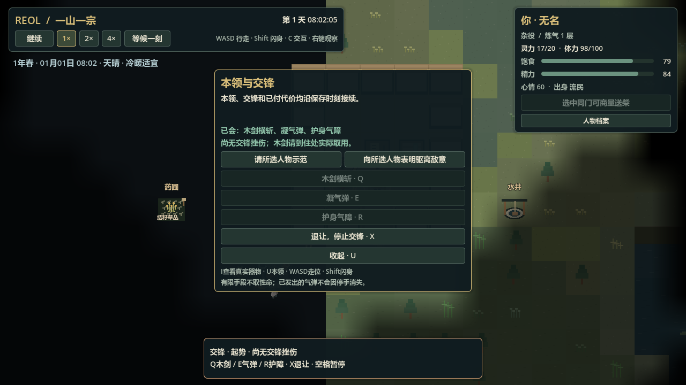
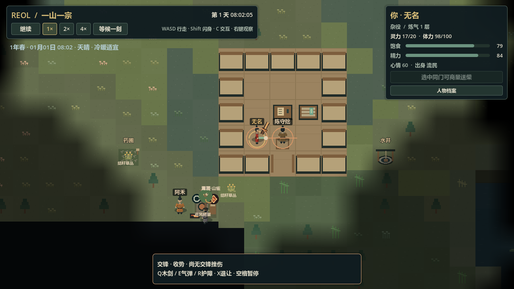

# U1-a：实物武器与超凡冲突验收

> 历史资料：保留原日期与结果，不是现行指令或任务；当前信息查[项目记忆地图](../../README.md)。归档于2026-11-11。

日期：2026-11-03。范围见[规格](https://github.com/fewnfds/reol/blob/8c3deaa972f932e999167b61ea6b166b928cfe5f/docs/archive/specifications/transcendent_conflict.md)。这是地面人身的有限驱离冲突，完整战斗、学习网、组织战争和首小时冒险仍待实施；最终构建数字只在[BASELINE](../../status/baseline.md)维护。

## 实际变更

- 原`SimArtifacts`增加能力类别和真实木剑，木剑没有伪造的储热/裂损字段。新局住处有一把，河湾具名人物实际保管另一把；原取放、耗时、唯一保管、个人熟悉与有限观察继续生效。辨认木剑不会自动学会剑法或御气。
- `SimConflicts`持有有限多场驱离意图、技法阶段/支付凭据、气弹、气障、命中和当面示范记录。原身体继续唯一持有位置、朝向、qi与stamina；原健康域持有命中造成的挫伤，不另造战斗HP或蓝量。
- 木剑横斩按扇形、距离、同高度与实墙柜判定；气弹有实际飞行与扫掠，可误中旁人；气障按剩余承受量与共同时间失效。三阶段动作及固定步中间的精确发招边界都由共同调度结算。
- 同刻先收集双方接触再提交，避免遍历顺序吞掉互击。受击可打断手头工作或当面教学，保留已付成本、受托责任与真实伤势。已发气弹和已成气障不会因停手消失。
- 挫伤逐步恢复，负担达到门槛后收手；防守者会实际后退或遇阻停住，再恢复原自主。原鲜药经脉护理没有变成万能医疗。本包不实施致死、继承或转生。
- 首次正qi施术或原引息建立原灵源账中的历史检查点，以原人物余额和器物/寄魂/施术成本序号核对；零qi剑击不创建检查点。取消不退款，读取进行中状态不重复付款。
- 原body所属区只是保存位置；旅人可在河湾当面学习和交锋。教学过程由教师所属区记录，交锋由防守方所属区记录，实际接触始终用同一全局位置。跨所属区的见证复用原共享个人记忆，按实际距离、高度和遮挡筛选，不向远处人物广播。
- `U`本领与交锋，`Q/E/R`木剑/气弹/气障，`X`停手。暂停选择只排队，下一共同时间才真实起势付款。WASD走位、Shift闪身与施术按阶段互斥；走位或闪身中可正常保存。可见危险限制等待并降至正常速度，未获知的远处冲突不触发提示。交锋中收起大型办事/行旅面板。

## 兼容与失败修复

根35、区域31；新增冲突域1，原健康与灵源状态升级2，灵源内容定义仍1。原器物状态保4。v34显式迁入空冲突，不补木剑、学习经历、过去施法成本或战斗伤。旧迁移步骤保留当时v1字面形状，不调用已经升级的空状态制造混合格式。

本包发现并修复了：活护障经JSON往返被错误拒绝；第三人误伤没有中断教学；交锋空档合法走位被存档当作必须静止；旅人被数据所属区挡在当地学习/交战之外；跨区观察错误地按本村ID查询外国人物。各项保留正常与坏档回归，不放宽来源/成本或身体排他来凑通过。

首次全量`logs/check-test-20261103-233103.log`包含当时护障失败和旧格式投影不匹配，随后为继续修复主动停止，不能作为通过。临时pre-health旧档失败是从新档回投旧格式时遗漏删除新冲突域；修正测试投影，并增加非法混入现代域必须原子拒绝的断言。真实历史档仍只读。

中途完整检查`logs/check-test-20261103-234121.log`已通过；之后审查发现走位/跨区/误伤接缝。最终重新完整`python -u tools/godot.py check`退出0、CHECK PASSED，证据为`logs/check-structure-20261103-235307.log`、`logs/check-import-20261103-235307.log`与`logs/check-test-20261103-235313.log`，导入/测试检索无SCRIPT ERROR/ERROR/WARNING/FAIL，最终数字只看BASELINE。局部证据包括`combat-qi-probe-20261103-checkpoints-second.log`、`conflict-compatibility-probe-20261103-first.log`、`conflicts-probe-20261103-bystander-final.log`、`conflict-schema-probe-20261103-cross-owner-final.log`、`conflict-mobility-probe-20261103-final.log`、`conflict-archive-probe-20261103-first.log`。

## 真实流程与独立停开

`tests/runtime/helpers/conflict_replay.gd`及`tools/qa/conflict_restart.gd`只提交正常命令，不注入位置、资源、本领或NPC自主策略。实际新局：61750ms取得住处原木剑，追到陈守拙当面示范至124500ms，再走到同高度可达邻格拉开64像素；125000ms表明敌意、支付气弹，125200ms前摇中用原保存器保存。

真实源`logs/conflict_inflight.json`冻结为`tests/fixtures/session_v35.json`：173445字节，SHA256 `b0765c3a7147ce6789b6211fa4d1f222646a4086e2b47594fa8ab4d32e4dd37f`。玩家qi17，已学三种手段，持有原剑，气弹尚未发出，候选有效。

已完成的run200/201完整停开，以原loader读同档：125500ms实际发射、126750ms自然反击造成挫伤12，之后气障、木剑、128250ms停手，付原1钱借宿至3791250ms、伤势负担减至2，3800250ms实际抵达河湾；同一未来7325200ms的209986字节全联合快照一致，SHA256 `33d86a5ad8f41f479b0c8a9c84e2ba368c1e24716d3716e9762a7a8f1d0d250c`。支付只一次、qi14、实际受伤与候选检查有效。证据为`logs/conflict_future_live_a.json`/`_b.json`和`logs/conflict_restart_live_a.json`/`_b.json`。

最终代码run202/203已完整停开复核，`logs/conflict_future_final_a.json`/`_b.json`仍为上述209986字节及相同SHA；两个`conflict_restart_final_*.json`均记录受伤、一次支付和候选有效。`logs/conflict_manifest.json`直接逐字节比较两未来、源档与冻结fixture，并核对两张原生截图，`valid=true`。时间通过共同GameClock推进，这证明接续与事实一致，不冒充正常速度的两小时试玩。

## 画面与工具问题

实际1280×720原生窗口加载同一真实档，查看U页和125550ms实际飞弹；图片已逐张检查，证据`logs/conflict-native-visual-accepted-20261103.log`与`logs/conflict_native_methods_1280.png`、`logs/conflict_native_projectile_1280.png`。保留原代码像素；没有新增正式美术、镜像替代真八向或擅装插件。

较早截图脚本在自定义SceneTree启动前静态引用autoload/运行类，导致编译错误；改为运行时动态装配，最终原生捕获退出0。run195一次eval使用错误字段名，run196一次eval缩进混用，均已完整停开；错误不属于交付脚本，编辑器历史不清除。run200长重放超过MCP十秒响应时限，但其结果文件、候选及后续运行状态有效；后续用定时调用同一助手并保留结果，不重复提交同一世界命令。

## 尚未交付

当前入口是对眼前真实人物明确表达驱离敌意；尚无自动守护灵地、领地争端/战争、长期仇怨反应或完整任务回报。剑击只面向当前对手，气弹可误伤其他人；暂不支持兽身/雀身/空战、任意武器、杀伤/死亡清理、大型技能网络、突破或任意招式组合。NPC还没有完整视线/记忆/搜索规划，下一值守包须补起势/飞弹的实际可见性，不能把当前直接读取对手动作当完整有限认知。近远先共用有限规则，不宣称已完成事件粗算或海量战斗性能；历史保留也尚未验多年规模。后续按U1补利害场景，并与U2学习/器物、U3冒险交叉推进。
