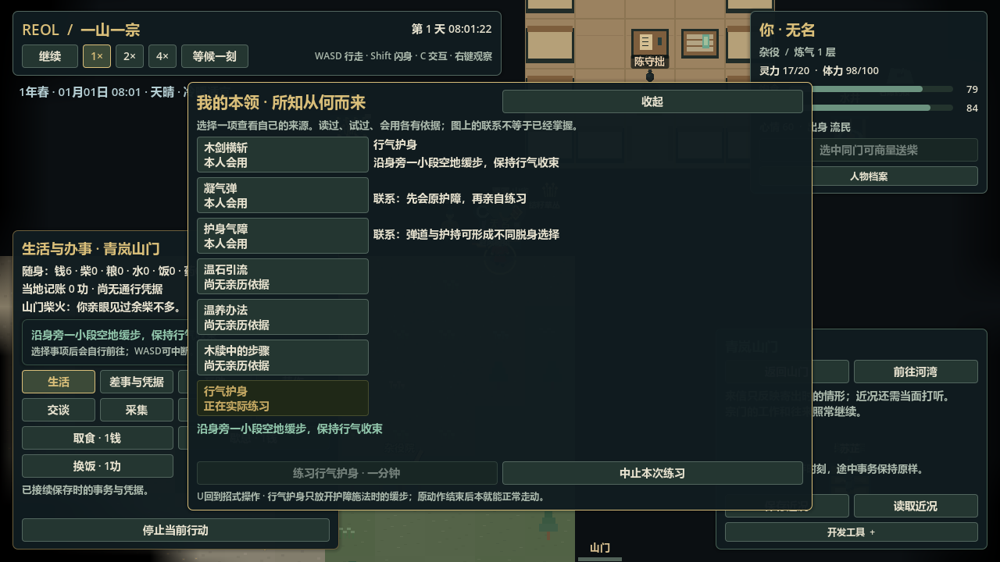
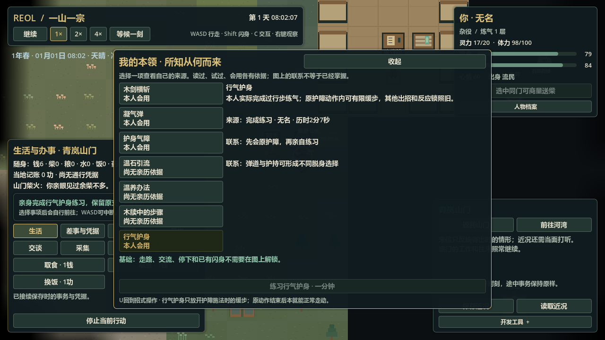
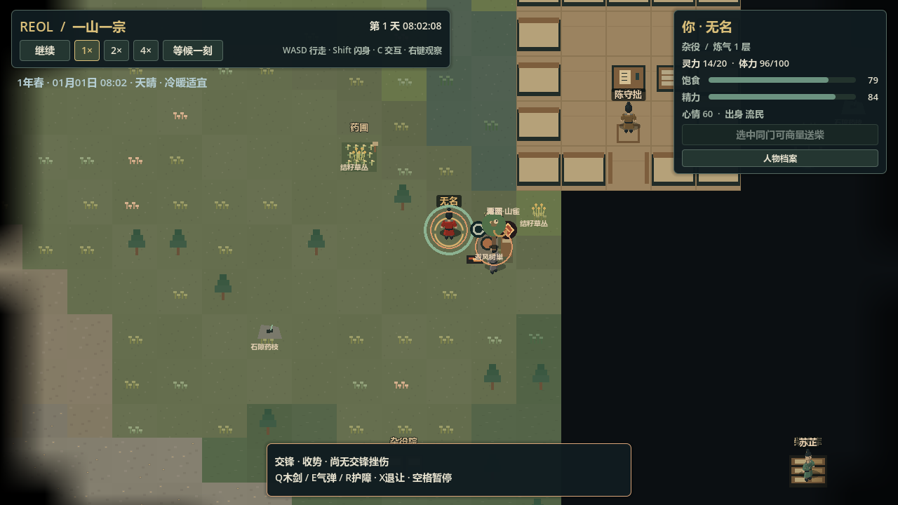

# U2-a：本人本领来源与行气护身

> 历史资料：保留原日期与结果，不是现行指令或任务；当前信息查[项目记忆地图](../../README.md)。归档于2026-11-11。

2026-11-04。产品、定向检查、普通主局与原生画面已验证；**最终完整回归通过，最新数字以 BASELINE 为准**。完整游戏与首小时切片未完成，原 Goal 保持 active。

## 交付与真实路线

U“本领与交锋”内可打开七项本领目录：三招、温石引流、本人所知温养版本、亲读木牍与行气护身。目录读取各原所有者的真实证据；持有、听说、读过、草拟、练成分别成立，查询不另存学会集合、不展示他人后台本领或位置。

已实际学会原护障的人，可付原qi3/体力2，调息10秒、身旁空地往返四段各10秒、收束10秒。完成前不授技；手动移动、阻路、控制/身体变化或真实受击可中止，成本保留。NPC同入口/同费用，但本包没接NPC自主寻找进阶练习的目的。练习不产生战斗护障，温石仍储热。

完成后只在原500毫秒护障动作内允许45%速度缓步；下一招、闪身、反应锁与行旅仍排他。原施法动作结束后本就能正常走动，不重复解锁。

普通开局run227先找陈守拙未成，后由实际在近处的石头同意示范一分钟；67750ms完成原教学并开始练习，82750ms保存于第一段缓步。真实完成后重返老师近处、明确敌意，按原R与WASD，250毫秒内位移23.9990234375像素；原动作占用和费用保持。没有注满资源、传送、写学习史或关闭NPC自主。

另有独立构造布位的真实规则战术对照（不是普通主局试玩）：同一before-choice档、同一已发气弹、同样费用与500毫秒护障动作，站定实际中弹/吸收12，缓步移出弹道后无该命中、原容量12保留；未练进阶的原护障即使有侧向输入仍锁位并实际中弹。未改招式时间、速度、命中半径或注入命中记录；`logs/capability-tactics-first-20261104.log`定向通过。

## 时间、候选与修复

Regional每个真实规则边界先提交原手动身体运动，再结原世界；原时钟回调仅提前表达中断行旅的输入，不再双写位移。已有速度与目标同时限幅，最终命中边界新加反应锁也立即收敛原速度，保证当刻真实档有效。NPC仍由原交锋运动执行。

单个活手动身体内部按整数毫秒积步，空输入且速度零立即退出，不额外唤醒世界。实机隔离运动/真实几何240段，每段50毫秒：中位86微秒、p95 121微秒、最大162微秒（`logs/capability_motion_timing.json`）；这不是完整帧或世界规模验收。

已修：JSON数值嵌套数组造成walk档拒绝；完成停止时刻依赖推进切片；闪身把请求欠算门槛误用于执行中；练习/行旅漏排他；命中末边界残速导致真实档拒绝；受击中断归因。失败保留于`capability-first/second/third-20261104.log`和probe日志；后续定向为`capability-fifth-20261104.log`、`capability-practice-first-20261104.log`。

根39 / 区域35 / 练习1 / 灵源3。根38仅显式补空练习及qi费用practice_floor1，不补历史/老师/资源；现代混旧格式拒绝。候选独立恢复各原所有者，再核前置时刻、过程、路线、费用/本人事件，成功后原子替换。

## 原档、停开和画面

| 真实只读档 | 时刻/过程 | 字节 | SHA256 |
|---|---|---:|---|
| `tests/fixtures/session_v39.json` | 82750ms，练习第一段缓步 | 178052 | `396fe171bc0384335bece4120fa7ac4e7aecfee0cd1f8c3629909d1cf0976bab` |
| `tests/fixtures/session_v39_guard.json` | 128751ms，已练成且原护障动作内缓步 | 199268 | `fe8629a5aa8ea068adc2112720801bfaa9538562c566f57cabcd6acc8f382f2e` |

run227/228两个完整停开进程用原loader读相同原档，两组未来均逐字节相同、候选有效：

| 过程 | 最终毫秒 | 联合UTF-8字节 | SHA256 |
|---|---:|---:|---|
| 原练习完成 | 127750 | 191407 | `9138751e77caaec25afda64cf463e944a7638221c015a7e91c78c5a54d8538f3` |
| 原护障/交锋/主动退让 | 146751 | 215764 | `67e3a430ceeb74ff69ae1a294f60c8866b1d1cdc4b7c9cda6ceaecd31b3dfd72` |

后者原qi14，无重复支付。重放入口`tests/runtime/helpers/capability_replay.gd`；证据`logs/capability_restart_comparison.json`与`capability_restart_{p,g}_{a,b}.json`。run228后来一次工具game_eval空格/制表符混用导致调试暂停，已停开run229；不是产品脚本错误，未清历史日志。

原生1280×720三图已逐张查看；`logs/capability-native-20261104.log`退出0，无错误/警告。

这是七项目录和一项进阶用法，不是完整天赋盘、修炼突破、自由创法、全种族学习或自动寻师。高坐标原闪身毫秒积步可能累积不足0.1像素的float32量化差，原保存位置不改写。新冒险地点、独特器物、首小时流程、远区规模与独立包仍待完成。

最终完整检查：结构/导入`check-structure/import-20261104-055825.log`、测试`check-test-20261104-055831.log`，退出0、CHECK PASSED，无FAIL/错误/警告。首完整检查`check-test-20261104-054733.log`保留：旧pre-health手造格式需显式投影新空练习；两个精确整数端点改为小于0.1像素公差；原真实墙后案例按区间起点许可移动，避免把ready到期后的许可回溯用于前一段，第三次原命中从130350ms变为130400ms。原高坐标斜弹/三次命中/双方伤势/费用/联合未来断言保持。390条旧案例定向复测见`capability-legacy-corrections-20261104.log`，通过后再完整重跑。没有修改原历史档或重造命中。
