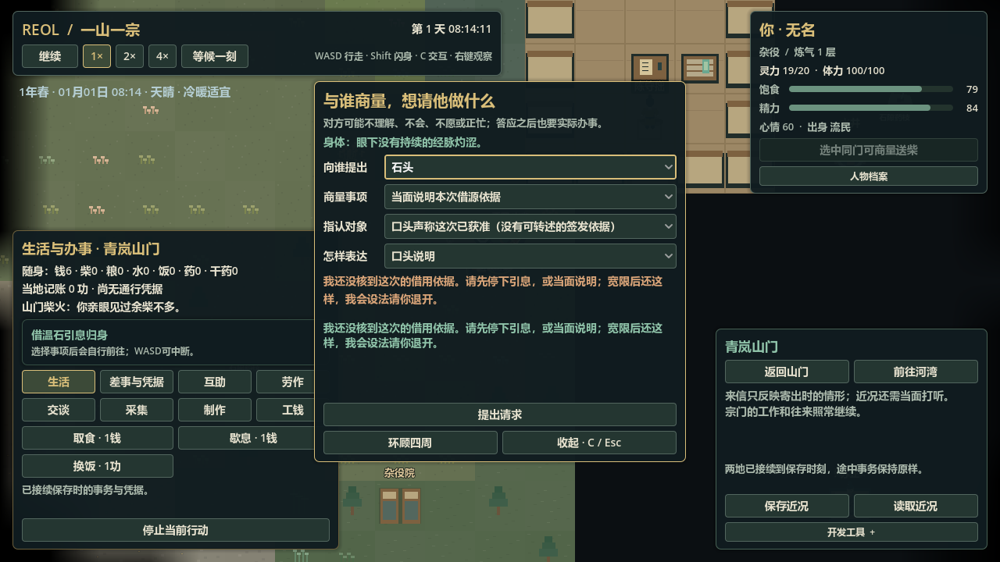
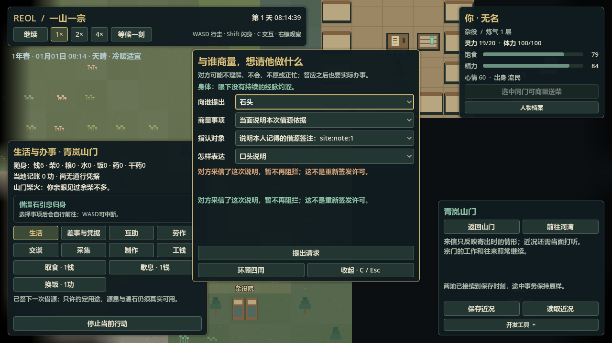
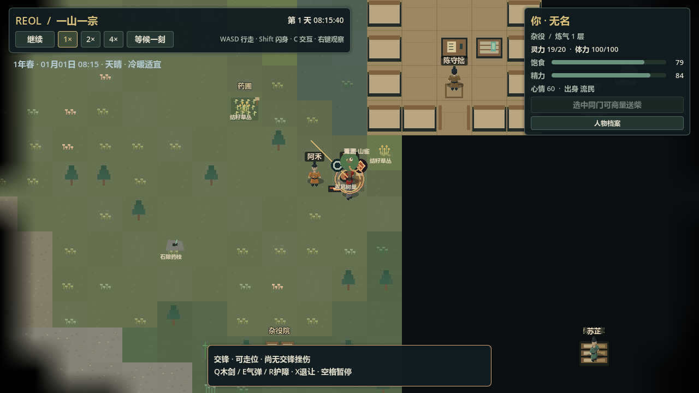

# U1-b2：公源看护、说明与驱离验收

> 历史资料：保留原日期与结果，不是现行指令或任务；当前信息查[项目记忆地图](../../README.md)。归档于2026-11-11。

2026-11-04。完整游戏 Goal 保持 active，完整游戏和首小时切片均未完成。本文记录本包实际范围；最终完整检查数字仅在 [BASELINE](../../status/baseline.md) 维护。

## 已接通的行为

新主局显式装配两小时的原石头看护安排，范围只有原地火隙和原温石。他先完成个人日常、已有运送、吃饭歇息与先前职责，有空才通过原 `check_kitchen` 动作真实前往。看护域只持有有限安排、观察、具名说明和警告，不持有另一份身体、路径、源量、qi、伤势或账本。

本人同高、近旁、无遮挡、能通信且确实可照看时，看见真实引息才提出警告。90 秒宽限内源过程继续，未产出、不扣源、不取消、不自动开战。C 可以向石头说明自己确实记得的借源签注，也可以说一条未证实的口头说法；对方按自己的已知和原社会决定采信。收到旧签注不等于远程查遍公簿，用过但未被他发现的签注仍可能被误信。提前说明只绑定本人随后亲见的一次具体引息。

继续取用且宽限到期、本人仍亲见并具有实际能力时，内部受限入口复核该 warning，再中断同一原引息、关联唯一原交锋。石头可以作为主动方自主走位/施术，玩家作为被动方仍保持手动。双方仍支付原 qi/体力、受挫伤并退让；无没收、夺产或全门派敌对。没有实际可用招式、缺气、灼涩或低体力不能强开假战斗。玩家能停手、说明、主动退让和离开。

## 代码与持久化

- 规则/显式开局：`data/definitions/source_care.json`、`data/scenarios/source_care.json`。
- 有限状态/联合候选：`scripts/sim/source_care.gd`、`source_care_schema.gd`。
- 原自主接缝/共同时间：`RegionalSimulation` 的 initiative handoff、原 native action、有限观察边界与中断回调；原源成功先于同刻升级。
- 原交锋：逐人控制策略与逐人提示先采样；内部开场只接受有确实到期依据的 warning，普通玩家入口保留原时间保护。双方原所属区边界失效通知保持一致。
- 根38/区域34/看护1/交锋3。真实旧根37显式补空看护，原交锋2只补空 cause；不补过去出勤、警告、任命或交锋。现代包混旧区域拒绝，坏档不改活世界。
- 读档先恢复原世界、钟与当前主体，再把本人已收到的活警告显示出来并停止等候/暂停；不消耗最后一个毫秒。鸟/残识视角不接收原人身的私人警告。

## 定向与失败修复

实际命令入口为 `logs/source_care_targeted_agent_20261104.gd`，调用新纯规则/迁移/共同请求回读/原冲突与自主控制套件；日志保留在 `logs/source-care-*-20261104*.log`。最终纯规则日志 `source-care-pure-agent-20261104-final.log`、迁移 `source-care-migration-agent-20261104-first.log`、共同冲突 `source-care-pure-and-conflicts-agent-20261104-third.log`、真实运行接续/UI `source-care-continuity-20261104.log` 均退出0，无脚本错误/警告。完整回归结果只看 BASELINE。

已覆盖：原劳动与需求优先、非零定点余数的需求首次临界毫秒、细步与稀疏完整未来一致、失视/高度/听说、个体来源与误信、提前说明单次绑定、取消和截止同毫秒源成功、真实驱离/控制权/成本、双方自主与跨所属区重选、旧档空迁移、错警告/原因/说明/binding 等坏候选原子拒绝。

首轮失败均保留日志，没有用旧绿色代替本包验证：

1. 原 native handoff 被提前推迟吞掉，和空闲时反复压到下一毫秒造成事件风暴；改成真实 handoff 保留、其他重试按有限时间边界，原需求/健康/既有职责仍优先。
2. JSON 数字浮点化使嵌套事件/政策及时间文本不一致，改为原纯值规范化和明确整数时间，不放松因果校验。
3. 公共 `observe` 把标准 `status` 回执误读成 `code` 导致 run218 UI 错误，改回标准结果并补共同入口回归。
4. 出勤被其他交锋中断后曾有同毫秒孤立动作引用，新增窄化中断通知；看护观测位置绑定原静止 source job，历史观察不使用今天的墙重演。
5. 原生截图工具首次在 SceneTree 入口提前引用单例/依赖类型，编译失败；只改工具的启动依赖，最终原生截图进程正常退出0。失败日志仍保留。
6. 原源面板和C请求面板同层重叠，可能盖住真实警告；在原面板互斥逻辑中只关闭源视图，不取消物理引息。最终定向 `source-care-continuity-20261104-final.log` 已从源面板打开状态验证警告可见、源job仍活；原生工具也改成复现这一产品路径。
7. 回看旧警告曾把本人的任意交锋当成该警告后续；改为引用本条具体 `warning.conflict` 的真实参与者，交锋结束后保留亲历，未知第三人仍不能读取。`source-care-observation-agent-20261104-final.log` 的精确反例通过。

首轮完整检查 `logs/check-test-20261104-015935.log` 只有旧 `test_conflict_runtime` 的反击伤势预期失败：旧fixture把所有人设为非自主，却期待defender按原固定AI反击。本包已改为逐人控制策略，已只恢复本次对手开场前自主，保留真实伤势、命中来源及存读断言；定向`conflict-runtime-agency-agent-20261104-final.log`通过，随后完整检查`check-test-20261104-021031.log`退出0/CHECK PASSED。完整数字仍仅在BASELINE维护。

## 真实普通路线和完整进程停开

`tools/qa/source_care_restart.gd` / `tests/runtime/helpers/source_care_replay.gd` 只发原移动、取物、学习、交谈、引息、停手、退让和归还指令，并推进原钟；不改位置、知识、NPC自主、余额或健康。实际新局 run219/221/222 形成以下三份不可变档：

| 档案 | 原时刻/过程 | UTF-8字节 | SHA256 |
|---|---|---:|---|
| `tests/fixtures/session_v38.json` | 851250ms，警告已亲收、宽限未到、原引息中 | 229976 | `79c390a681a1c711b6dc3044bc5d79718b539e5916899187e3132c051a9d6067` |
| `tests/fixtures/session_v38_explained.json` | 879750ms，真实签注转述被采信、原引息投入30秒 | 249586 | `88f040041a96b6210af07bdb5ac2cc65e1be8a881709f0174dd56b4d69c16ca3` |
| `tests/fixtures/session_v38_conflict.json` | 940900ms，原源已取消，石头已付费起势、尚未发出气弹 | 239771 | `c45d885fe93a4e5057685d89eb08b3e2d38bf93c6ac022ae14f9af4716257ea2` |

最终代码 run225/226 为两个完整停止再开启的游戏进程，同源执行同一普通路线，全部联合候选有效，四组完整未来逐字节相同；与此前run223/224也相同。证据 `logs/source_care_verified_restart_comparison.json` 与 `source_care_restart_verified_*.json`：

| 路线 | 最终共同毫秒 | 联合字节 | SHA256 |
|---|---:|---:|---|
| 警告后主动停手，再实际前往河湾 | 1016000 | 145988 | `f9b3b96c45db05aab3e89c02e802a164e14046f932b3e02eaa1d9e8d038b5180` |
| 警告后继续，原看护施术；玩家退让，再实际前往河湾 | 1015700 | 153873 | `88793da404a123e99b494327cd1314ebaaf95b166f89985ca4364061d8786d2b` |
| 从已付费起势档继续同一施术/退让/行旅 | 1015700 | 153873 | `88793da404a123e99b494327cd1314ebaaf95b166f89985ca4364061d8786d2b` |
| 说明后和平引息，原石复位，管事亲往核验/回桌登记，当面听结果，再行旅河湾 | 1223250 | 178611 | `25dc8d5afe7a10cf586aaac79e11d2937d516067b9b90ea5efb9621cb31f361e` |

实际冲突中气弹先打到同处灶旁的老周，保留真实误伤挫伤，没有为了演示改成必中特定对手。玩家退让后没有新造第二警告/交锋。和平路线只吸收本人剩余容量1，源付6、损耗3，签注只用一次；温石由原物件实际放回，由原管事亲见登记。看不见/不同高/失控的反例主要由明确构造的纯规则场景覆盖，不冒称主局自然必然发生全部组合。

## 原生画面

`python` 子进程运行 `godot --path . --script res://tools/qa/source_care_visual_capture.gd`，原生窗口1280×720，读取上述真实档，原画面已逐张查看。最终日志 `logs/source-care-native-20261104-alert.log` 退出0，三次保存=0，无错误/警告。警告页先实际打开源面板，再由原收信路径关闭视图并显示警告，物理引息保持；其余只调整镜头和已知回执的界面选择，不改原世界。

## 保留限制与下一步

仅一处公源/公器/指定人物的有限安排；没有完整产权、偷窃追偿、搜身/没收、通用巡逻/任免、自动查簿、全组织敌意、致死/战争、远区交锋粗算或完整外交/继任。观察为有限周向视线，不是听声/神识/隐身搜索。等候按原分钟提交收到警告后暂停，90秒宽限使首次可响应尚有余量；显式大数 `advance_msec` 是开发工具同步指令，不模拟玩家每帧响应。

下一包应将超凡玩法带向[有来源本领网与一项实际操作变化](https://github.com/fewnfds/reol/blob/8c3deaa972f932e999167b61ea6b166b928cfe5f/docs/archive/specifications/capability_network_first.md)，随后尽早接新地点/任务冒险；不会继续扩复杂农务，也不把本包当成完整游戏验收。
