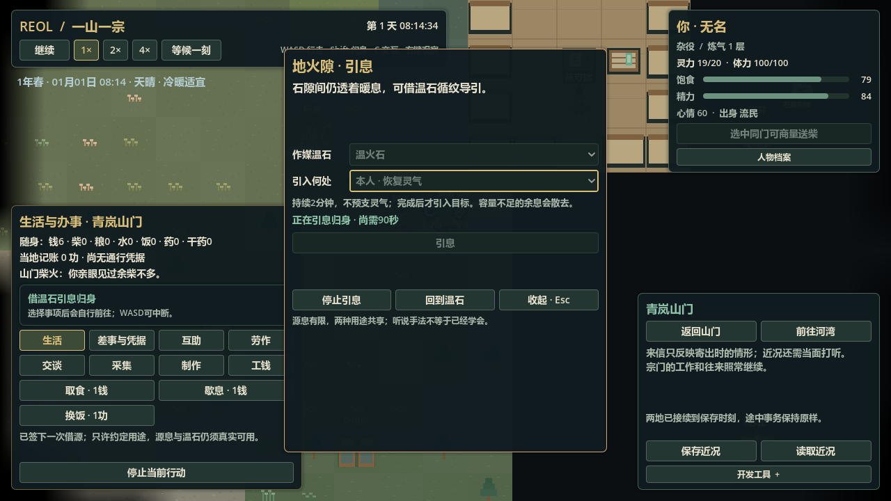
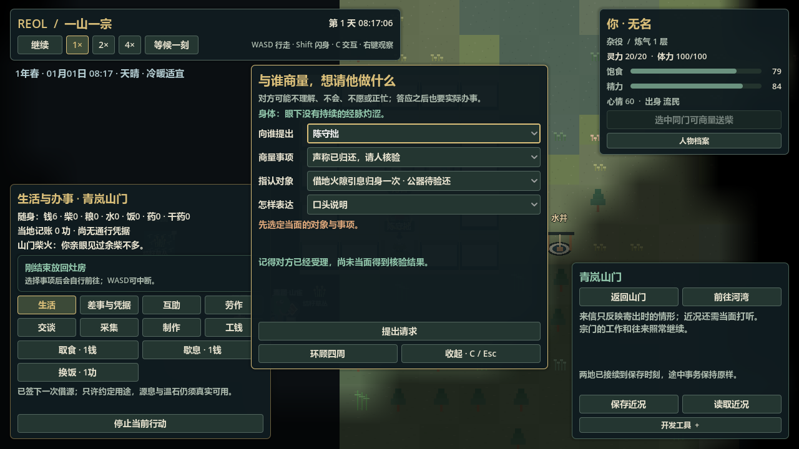

# U1-b1：一次借源与公器验还

> 历史资料：保留原日期与结果，不是现行指令或任务；当前信息查[项目记忆地图](../../README.md)。归档于2026-11-11。

日期：2026-11-04。范围见[规格](https://github.com/fewnfds/reol/blob/8c3deaa972f932e999167b61ea6b166b928cfe5f/docs/archive/specifications/source_loan.md)。**本包最终完整检查、真实在途档/最终两次完整停开与原生画面已通过。** 最新完整测试数字与兼容版本只维护在[BASELINE](../../status/baseline.md)。看护、警告、驱离与完整游戏均未完成。

## 实际实现

普通新局显式装配山门原地火隙与原温石的一次借用安排。人身C通过原动作/对象补全询问安排、申请一次借源、请求验还；说明来自眼前现任有权人，个人已知安排进入原社会记忆。借用同时绑定具体机构、职位、用途和公器，不因摆了桌子或私人交情自动取得资格。

申请者实际持有原温石、学会原循纹手法，并得到当面同意后，原服务占用申请者身体去值事房办理。完成时复核现任、桌案、登记载体与实际身体条件，才签一次具名许可。记录属于公簿的借用附页，不增加贡献余额、不改变器物归属，也不保证此刻有源息。

实际用源仍由原两分钟引息过程执行；开始成功后同步关联许可，完成的原record才记一次使用。源量、原qi、石中储量和实物保管仍各归原所有者。无许可没有新增空气墙；取消不提前恢复，已过最迟开始时刻不能重新开工，期限前开始的真实过程可以正常完成。

验还时，申请者说“已交回”只形成具名声明。原管事同意后由自己的身体真实走到灶旁，按本人的位置、高度和视线查看同一原石；然后沿原路回值事房，用原桌案登记。申请者不被锁在原地，远处轮询只知道曾受理，不自动获知现场结果。正式登记写“已核公器复位；申请人声称归还”，不把声明作者写成客观亲放者。

第三人代还可满足本条款；原石尚在别人身上、换成另一物或现场不可见则不能确认复位。已经亲见后再发生的保管变化不倒写过去；核验者返程中断保留原观察，后续有限登记引用原check，取消过的身体job不复活。最终登记对自己的当前服务锁仅作窄化豁免，原控制、其他身体占用、职位和真实桌案检查继续有效。

## 存档、边界与修复

本包根37/区域33/事项1，其余领域沿原格式；旧档显式迁入空事项，不补地方安排、说明、许可或过往验还。新旧切换恢复各自内容，当前根不能混带旧区域来抹掉记录。候选先恢复独立事项形状与原服务，再在源、器物、社会记录等全部恢复后交叉核验，失败不部分替换活世界。

条款、决定、原办理job、声明、现场观察、登记事件和原source record有相互引用。历史观察校验记录的时间、距离、高度与原物件引用，不拿现在的墙门或私下placed作者证明过去。公开服务入口也重核原声明/同意和未结状态；提前调用结算、重放旧条款或重复回调不能提前造许可、消费或登记。

首轮定向运行暴露了`SimSocialMemory.record`的typed数组错误：传入无类型空数组不能满足`Array[String]`。失败保留于`logs/source-loan-targeted-agent-20261104.log`；已改为显式类型数组后重新定向验证。此前导入成功没有被当作该运行错误已经通过。

初次实机准备时原温石正被NPC实际占用，未把拒绝绕成成功；等待原过程结束后继续普通取用。后续准备与重放没有注入物资、本领、任职或位置，没有关闭NPC自主。共同时间批量推进用于验证执行与接续，不代替正常速度的长时间试玩。

## 已有定向证据

纯规则覆盖同意与签发时重新复核、重复申请、最后一批源竞争、取消重试、最迟开始边界、通信/理解/权限、虚报与第三人代还、观察后的新保管、中断续登记、坏候选原子拒绝，以及细步/稀步和在途存读相同未来。运行适配回归覆盖原请求门面、服务和旧档切换；fixture保持原始字节。

- `logs/source-loan-targeted-agent-20261104-final.log`：借源、迁移、原请求/UI及机构服务定向组合运行，无失败。
- `logs/source-loan-public-entry-agent-20261104.log`：公开入口/提前回调与纯规则回归，无失败。
- `logs/source-loan-domain-load-20261104.log`：原感知迁移、旧交锋迁移及真实交锋档继续，无失败。
- `logs/source-loan-continuity-agent-20261104.log`：真实新档的普通loader与两次独立主场景未来，无失败。

以上为定向证据；最终完整检查与最终实机停开证据见下节，不以局部断言代替整体回归。

## 真实在途档与完整停开

`tests/runtime/helpers/source_loan_replay.gd`与QA入口只提交普通人身选择、原取石/探查、旅行、C请求、原引息、原放回和共同时间。run213正常准备：780750ms已实际持石并掌握方法，842251ms完成具名签发，844750ms开始原引息，874750ms在进行30秒后保存。此时原qi19，`site:note:1.bound=spirit:1`，没有提前恢复；原过程截止964750ms。`logs/source_loan_prepare.json`的candidate_valid为true，另保留签后尚未使用的`logs/source_loan_signed.json`。

真实源档原样冻结为[session_v37.json](../../../tests/fixtures/session_v37.json)：215793 UTF-8字节，SHA256 `64c9ee3cf0bfa3cd8bf012a1461f8c2b0992740d4907cd1d8de7b66886bd030a`。对应`logs/source_loan_inflight.json`；没有覆盖原v36或更早档。

run213继续`replay_loan(...,"a")`，完整停止游戏进程后run214以原loader重放同档为b：964750ms原引息成功，原qi19→20，源实际output1/loss3，许可只消费原`spirit:1`；实际放回同一温石后，1026250ms管事受理，1026500ms保存原核验行程，申请者身体已自由。

该第二在途档原样冻结为[session_v37_inspection.json](../../../tests/fixtures/session_v37_inspection.json)：228744 UTF-8字节，SHA256 `3dd9795a3acef897120af35cb7389537d6337c2366e929a2b48d1587ac2e2fa3`。此时`service:job:4.actor=chen_shouzhuo`，stage为inspect、phase为travel，现场观察仍为空；申请者单独保存在`options.requester=player`。对应`logs/source_loan_inspection_b.json`。

管事1087540ms亲见原石在灶旁，1148830ms回桌登记；玩家当时远处查询仍只得到pending。随后通过实际当面回话获知归位结清，再实际行旅河湾。到1218500ms，a/b两份完整联合快照153594字节逐字节相同，SHA256 `a5f446a118640438023d76c37bde52f50b5916d3d49ea883854399c29b9105c6`；原qi20、原石仍在kitchen、两份候选均有效。

初次过程报告为`logs/source_loan_restart_a.json`与`_b.json`，联合未来为`logs/source_loan_future_a.json`与`_b.json`。最终代码收束后又完整停开run215/216，分别从真实引息中及管事核验去程档继续，报告`source_loan_restart_c/d.json`与`source_loan_inspection_restart_c/d.json`；四份完整未来字节均与上述153594字节/SHA完全相同。两档候选有效，`logs/source_loan_manifest.json valid=true`；原v34/v35/v36及两新v37档均保持原SHA。

最终命令`python -u tools/godot.py check --test-timeout 1800`退出0、CHECK PASSED，结构`logs/check-structure-20261104-012604.log`、导入`logs/check-import-20261104-012604.log`、测试`logs/check-test-20261104-012610.log`；最终导入/测试错误、警告与FAIL行数0。旧完整世界迁移比较只投影新增空事项，显式检查它没有历史地方规定，源fixture未改写。收尾run216通过原loader恢复核验去程、1026500ms暂停、候选有效、helper live；游戏日志无错误/警告，编辑器游标17后无新增。

## 原生画面与范围

`tools/qa/source_loan_visual_capture.gd`读取上述真实引息/核验行程档，原生1280×720捕获，两图由主代理逐张查看。`logs/source_loan_visual_20261104.log`记录两张保存成功，运行退出0，无脚本错误。

这是一个公源、公器、指定职位和有限借用/验还样本，不是通用产权、任意合同、完整任务图、可携私账、完整机构继任或守卫系统。继续沿[真实利害顺序](https://github.com/fewnfds/reol/blob/8c3deaa972f932e999167b61ea6b166b928cfe5f/docs/archive/specifications/transcendent_stakes.md)接有限看护/警告与实际驱离，再用场景需要驱动能力组合与冒险。
