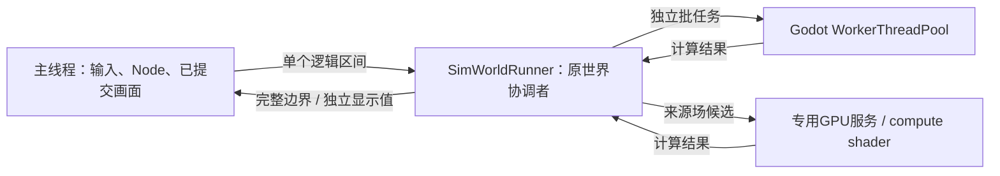

# 计算接入与并行执行

本页是现有机制的选择指南与代码入口，不是所有功能必须实现的接口或验收清单。小规模、低频且足够快的计算可以直接写在原领域；接入共同时序也不意味着必须多线程。产品与因果边界见[constraints](constraints.md)，领域职责见[owner表](architecture/02-owners.md)。

## 新计算从哪里接

先定位事实归属和实际输入，再按工作性质选用；同一个功能可以组合几种方式。

| 工作性质 | 适用方式 | 现有入口 / 可读的实例 |
|---|---|---|
| 少量判断、库存/预约/伤害等争用结果 | 直接由原领域有序处理 | [共同结算](settlement-contract.md)、[事件](event-contract.md)；不要为了并行拆散一笔事务 |
| 稀疏变化、到期后果 | 只处理变脏或到期子集 | [SimParticipationIndex](../../scripts/sim/execution/participation_index.gd)、[SimEventQueue](../../scripts/sim/execution/event_queue.gd) |
| 持续变化但输入暂时稳定 | 结算时间区间，输入改变前结清旧段 | 身体需求、环境温度响应；跨输入变化或阈值时分段 |
| 周期变化、能直接求值的派生属性 | 按逻辑时刻及受体按需计算 | [五行潮汐](world-environment-contract.md#时间变化与受体)；逻辑上全图变化不必建立全图定时遍历 |
| 可以接受采样误差或稍后重评的工作 | 内容周期、稳定错峰、重复变化合并 | [SimCadence](../../scripts/sim/execution/simulation_cadence.gd)、[领域频率](simulation-pacing.md#领域频率)；已受理命中/转移不能丢弃 |
| 大批相互独立的判断、数学或投影 | 冻结/借出输入 → 分块计算 → 校验 → 采用 | [SimBatchExecution](../../scripts/sim/execution/batch_execution.gd)；空间候选、身体和场计算共用Godot池 |
| 已有冷热/五行来源场的内容扩展 | 复用现有场CPU/GPU候选路径 | [环境合同](world-environment-contract.md)、下文GPU入口 |
| 新的GPU算法 | 有收益依据时实现专用kernel和数据布局 | Godot提供RenderingDevice；当前场shader不会自动执行任意GDScript |
| 可丢弃的画面/缓存工作 | 发布独立显示值、延后或合并重建 | [ReolPresentationWork](../../scripts/runtime/presentation_work.gd)、[身体发布](../../scripts/sim/execution/body_publication.gd) |

先使用足够简单的做法；出现大批独立工作时复用批执行，不必先造注册表、通用基类或全量ECS。若现有接口迫使领域暴露无关状态或制造昂贵快照，可以调整接口或保留局部顺序实现，并说明真实限制。串行是合法执行方式，错误接入导致的无声退化才需要避免。

现有低优先级呈现工作由`ReolPresentationWork`合并、限额并提升久候任务；地形预绘和光照贴图已接入。玩法中允许慢周期重评的内容走原领域频率/稳定错峰，到期后果仍沿共同结算及CPU批续算；这与可丢弃的呈现缓存有不同的采用条件。Godot共用worker池分担计算，但当前没有一个可以把任意业务回调随意延后的通用低优先级池。先减少无用工作，再按可见性、逻辑截止和实际依赖选择已有入口。

## 执行链与职责

[SimWorldSettlement](../../scripts/sim/execution/world_settlement.gd)装配的是逻辑先后关系，`add_step()`不会自动把领域代码并行化。[SimWorldRunner](../../scripts/sim/execution/world_runner.gd)独占原世界执行该顺序，内部适合并行的阶段显式派发任务。阶段、事件和共同时间只由[结算合同](settlement-contract.md)解释。

### CPU批生命周期

任务对象实现`run()`，持有稳定的输入和自己的输出；`SimBatchExecution.start(chunks, workers)`使用Godot池，`finish()`收集完成结果，协调者可在真正需要的依赖上`finish(true)`。小集合或`workers=0`执行同一任务代码的串行路径。`workers=-1`按硬件/独立块选并发，显式正数是本批上限；不是创建相应数量的线程，也不是在线最优调参器。实际规则与阈值以[执行器](../../scripts/sim/execution/batch_execution.gd)和各任务类常量为准，CLI语法只查[usage](tooling/usage.md)。

借读期间原owner不修改输入，worker不访问活SceneTree、隐式同步getter或共享可变搜索上下文。原owner验证时间、代次、对象和依赖，再按领域规则采用；资源争用和随机生效不由完成快慢决定。独立分区写入是少数已验证阶段的能力，不是给任意任务开放共享写权限。

`cancel()`撤销结果采用，不会杀掉运行中的算法。借读原表的任务先join再修改输入；复制输入的任务可以退休后收集。退出/换世界回收任务。线程handle、计时和可重建输入不入档；保存与失败恢复见[存读管线](architecture/04-persistence.md)。

### 身体：需求输入与运动输入分开

[SimBodyRead](../../scripts/sim/execution/body_read.gd)提供路线、控制、来源参与与库存观察输入；[SimBodyNeedsRead](../../scripts/sim/execution/body_needs_read.gd)单独借出需求使用的衣着、环境、劳动和休息表。其`Source`既绑定原owner回调，也识别这些回调是否仍是标准输入；没有任意worker回调注册器。

[SimActorAdvance](../../scripts/sim/actor_advance.gd)计算需求与当前实际本地区间的路线候选，[SimBodyDeadlines](../../scripts/sim/execution/body_deadlines.gd)判断下一边界。小集合保留直接入口，路线搜索/修复和效果提交仍由原行动owner负责。原生数据内容沿相应表扩展即可受益；新增计算规则仍要实现自身算法。

替换需求回调后，只有需求积分回到原owner；运动候选和边界判断继续使用共用读取。未知回调可能改变身体，所以该批不提前并行写位置，原投影逐人复核候选。恢复原回调后，需求借读自动恢复。更换控制、几何或crossing回调仍会撤销相应标准运动输入，不能把未知逻辑标作线程安全。

原需求分区、以及满足完整路线/输入和观察者隔离证明的运动分区，可独占写入互不别名的原身体；join后才更新共享索引、按原ID通知空间消费者。额外观察者或输入失配保留逐人入口。判断集中在`VillageSimulation._can_partition_projection()`与`RegionalSimulation.native_projection_isolated()`，不用在新领域复制这些条件。

## 共享空间读取与批量查询

[SimWorldGeometry](../../scripts/sim/world_geometry.gd)从原地形/建筑提供可复用几何页；局部变化替换页并使受影响证明失效。并发搜索使用私有[SimGridNavigation.Search](../../scripts/sim/grid_navigation.gd)，不共享可变AStar上下文。

[SimBodyReadView](../../scripts/sim/body_read_view.gd)捕获同边界身体列，[SimSpatialQueries](../../scripts/sim/execution/spatial_queries.gd)分块求线段候选；固定合并顺序处理等距离，原交锋owner仍复核遮挡、伤害和消耗。这是新批查询可参考的完整例子，不是全部空间算法的强制模板。

## GPU来源场与CPU后端

[EnvironmentFieldComputeRuntime](../../scripts/runtime/environment_field_compute_runtime.gd)负责来源场单请求、ticket、取消、完成及后端选择；[EnvironmentFieldGPU](../../scripts/runtime/environment_field_gpu.gd)持本地RenderingDevice和专用[shader](../../assets/shaders/environment_field_compute.glsl)。GPU线程只持不可变job；上传、提交、同步读回发生在该线程，不能把`sync()`等待称作没有成本的异步执行。

同一个compact job可交给[SimFieldCompute](../../scripts/sim/execution/field_compute.gd)分块CPU计算。GPU不可用/输入不适用时由原场owner继续CPU路径；大批响应输入使用[SimFieldResponseInput](../../scripts/sim/execution/field_response_input.gd)。来源覆盖、传输、通道组合与温度/五行的原子采用语义只维护在[环境合同](world-environment-contract.md)。

扩展同类发源物不需要另写GPU服务；毒气扩散等新方程不自动适用当前shader。后端只改变算在哪里，不改变领域事实、逻辑时间或提交权；不要求每个新计算都实现CPU和GPU两份算法。

## 宿主交接与呈现

[ReolSimulationHost](../../scripts/runtime/simulation_host.gd)在模拟独占期间停用会读活世界的旧回调；[signal bridge](../../scripts/runtime/simulation_signal_bridge.gd)保留域内同步通知，向Node的通知在完整回复后递送。邮箱完成用Godot延后通知收取，仍有process后备入口；通知只续算已准入债务，与当帧共享预算。时间准入/过载只查[pacing](simulation-pacing.md)。

[SimBodyPublication](../../scripts/sim/execution/body_publication.gd)输出脱离原对象的姿态、衣着与布局，[ReolBodyPresentation](../../scripts/runtime/body_presentation.gd)在主线程分批应用。旧UI/画布仍在完整交接窗口读世界，当前没有让所有视图永久双缓冲；新视图也可以按实际需要选择。

## 诊断与证据

任务计时分准备、执行、等待、采用、发布；嵌套项不能相加。`actor_execution.input_modes`显示需求/运动是否借读，`needs_callback_rows`记录需求回到owner的行数，`projection_retained_*`解释运动保留逐人采用的原因。小批主动串行和输入不支持并行应分开看，不能用CPU总占用或线程数证明收益。

测量数值和已知缺口只维护在[BASELINE](../status/baseline.md)，工具参数在[usage](tooling/usage.md)，验证强度在[开发循环](workflow/testing.md)。不为接入一个普通功能自动运行整套压力矩阵。

依据：[Godot线程安全](https://docs.godotengine.org/en/4.7/tutorials/performance/thread_safe_apis.html)、[WorkerThreadPool](https://docs.godotengine.org/en/4.7/classes/class_workerthreadpool.html)、[compute shaders](https://docs.godotengine.org/en/4.7/tutorials/shaders/compute_shaders.html)。成熟项目来源见[研究](../../design/research/large_simulation_optimization.md)，不把研究中的历史Reol调用链当当前实现。
