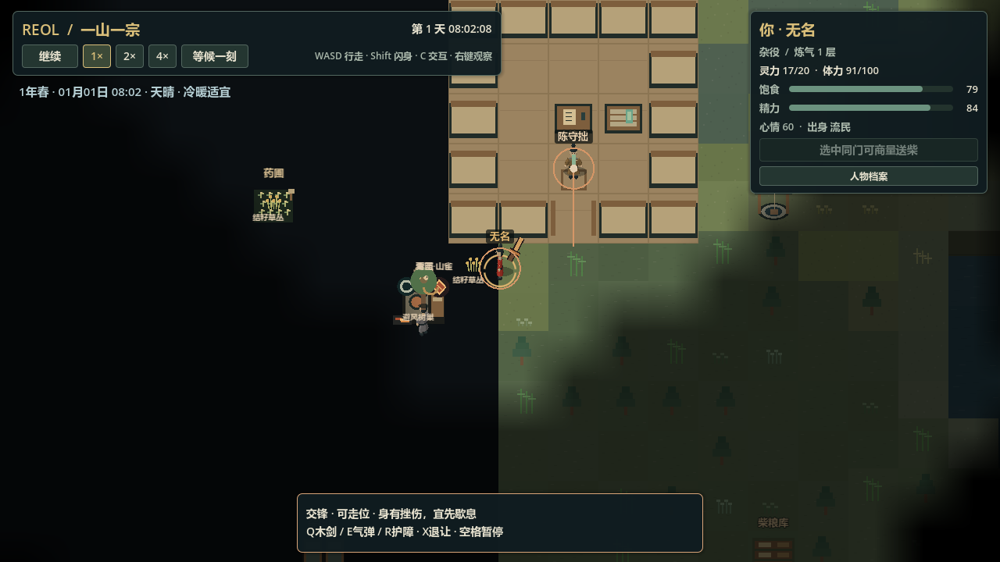
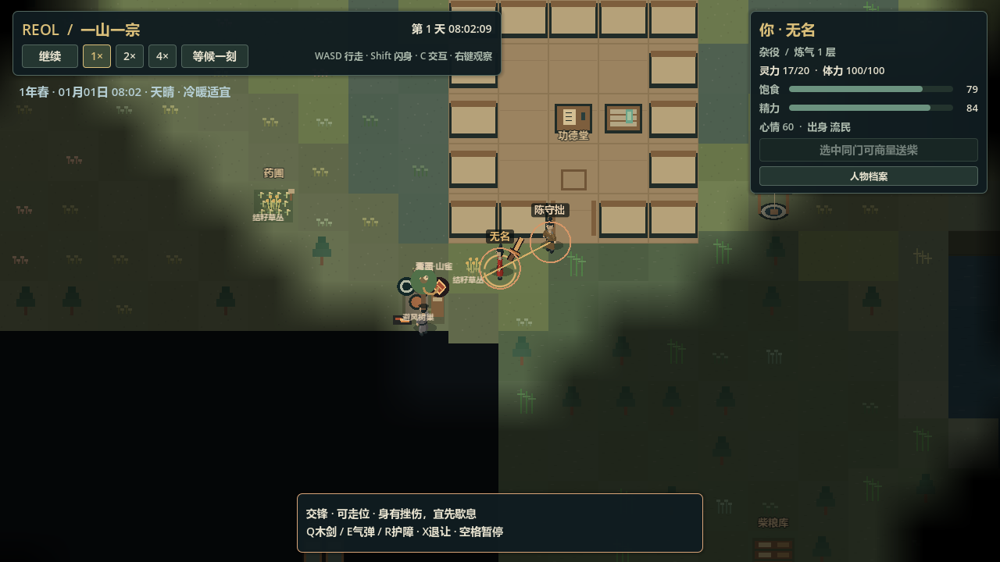

# U1-b0：交锋有限感知与存读验收

日期：2026-11-04。范围见[规格](../plans/conflict_perception.md)。已通过最终完整检查、真实档/两次完整停开与原生画面；最新数字及版本以[BASELINE](../BASELINE.md)为准。借源/看护驱离、完整搜索规划和完整游戏未完成。

## 实际实现

原交锋参与者按自身物理位置、有限视距、同高度、岩石与真实墙柜观察；与玩家迷雾分开。每人只保留一条对手最后亲见，失去视线后只往旧见处查看，过期后停下戒备。隐藏的新位置、新起势不进入决策；护障只因可见且可能威胁本人的剑/气弹起势或在途飞弹触发，来自别场的眼前飞弹同样可反应。

同刻先形成全部当前线索，再提交NPC新动作，避免场次遍历先后造成提前反应。退让不读取隐藏敌方坐标，已成护障和已发飞弹仍按原物理规则继续。普通人物、qi/体力、器物保管、伤势和共同时间没有第二份所有者。

根36/区域32/交锋2，旧v35从保存现在启用、目击为空，不补造过去观察。候选验证所记录点、时刻、距离、高度与启用边界；不拿当前位置/当前门墙证明历史。原v35及更早fixtures保留原SHA。

最终复核实际构造了根36但区域31/交锋1的混版候选，发现它可绕到区域独立兼容路径并自动补目击字段。已补联合版本匹配检查：当前根必须带当前区域，只有显式旧根迁移能转入现代形状；区域独立调试恢复保留其明确旧版入口。混版拒绝、活世界原子不变与真实旧根继续有普通loader回归。

## 自动化与发现的问题

最终`python -u tools/godot.py check --test-timeout 1800`退出0、CHECK PASSED；证据`logs/check-test-20261104-010211.log`、`logs/check-import-20261104-010204.log`与`logs/check-structure-20261104-010204.log`，最终日志检索无SCRIPT ERROR/ERROR/WARNING/FAIL。工具默认900秒仍保留，本机这次显式放宽上限，未跳过测试；最终计数仅在BASELINE维护。

纯规则覆盖遮挡、高差、跨保存所属区、隐藏挪位、过期、背向/远剑/护障起势、跨场来弹与反向/射程不足、未知退让，以及近细/远稀与存读同未来。普通主场景测试覆盖真实v35的空线索迁移、首个未来目击、目击在途保存和新旧反复切换；坏字段/时间/范围等原子拒绝，原自然反击/伤势/护障/木剑/恢复断言保留。

真实走位继续时发现高坐标斜向飞弹的累加误差，使实际第三次命中被`_hits`候选检查误拒。失败证据`logs/perception_future_restart_a.json`和`logs/perception_restart_restart_a.json`保留。已改成从原发射点与累计标量距离求下一位置；旧在途实际位置原样保存，下一段仍从该点开始。候选按float32坐标尺度和有限步数给出亚像素误差界，当前全图/射程下小于1/8像素；原命中半径未放宽，1像素横向伪造仍拒绝。高坐标长斜射、耗尽射程、旧累加在途及细/稀一致有独立回归。

00:15完整检查运行中发现精度问题，00:25检查运行中确认混版漏洞，两次均由开发者主动停止并重新检查，不是最终通过。原输出保留为`logs/check-test-20261104-001513.log`和`logs/check-test-20261104-002522.log`，进程停止返回码记录在工具输出中；最终应以修正后的整轮检查为准。

00:31开始的完整检查`logs/check-test-20261104-003143.log`还暴露一处旧档批量预期遗漏：`test_spirit_source_continuity.gd`比较空交锋域时未将新感知启用时刻投影为各旧档原现在，产生33条FAIL；已修该预期，继续完整比较全部其他事实，不改fixture。该轮另在末尾`test_world_persistence`触及900秒进程上限并退出124，没有完成。全目录复查其余空交锋预期均已显式设原现在，另一个故意夹带现代域的负例保留。后续检查须在修复后重新完整执行，不把定向绿或超时当最终通过。测试工具新增显式`--test-timeout`正整数参数，默认900秒不变，本机最终使用1800秒；原错误检测/退出码/超时失败保留，Python回归覆盖参数传递及非法值。

## 真实流程

`tests/runtime/helpers/conflict_perception_replay.gd`及QA入口只提交原加载、共同时间和正常移动意图。原真实v35在125200ms载入，继续已付款起势，沿值事房实际门口走到墙后，于128050ms保存`logs/perception_hidden.json`。未注入墙体、位置、资源、本领或NPC策略。

源186545字节、SHA256 `c26b67a75d5ad39d3579c2fda49496a2208b2b9c9c2b64e03a791f52ec8edd73`，原样冻结为`tests/fixtures/session_v36.json`；玩家实际位置`[16385.62109375,16288.02734375]`，陈守拙保留127750ms看见的`[16439.12109375,16288.93359375]`，当前视线为false，完整联合候选有效。随后陈守拙沿最后线索走到门口，实际重获视线、反击；没有因玩家离开房间冻结。

最终代码run206/207两次完整游戏进程停开，原loader读同一隐藏档，再6秒真实搜索/重获视线/施法/伤势→停手→60秒生活，194050ms两份完整联合快照120116字节逐字节相同，SHA256 `a85669f609de256e3924c9795c8e6f6a8198b909cc1861637175cc0db09485cc`，qi17、挫伤负担24，候选均有效。原v35原SHA保持；`logs/perception_manifest.json`核对两未来/源档/fixture/图像并为valid=true；具体`logs/perception_future_final_a.json`、`_b.json`和`logs/perception_restart_final_a.json`、`_b.json`。共同时间批量推进证明接续，不代替正常速度长时间试玩。

包络严格匹配修正后，再完整停开run209/210复核同一流程：两份全联合仍为上述字节数与相同SHA，候选都有效，`logs/perception_future_envelope_b.json`、`_c.json`及对应restart报告为本包最终运行证据，manifest已指向这两次。run208第一次eval未取得可用结果、也未产生输出文件，随后停止；没有把该次当成功重放。最终游戏日志无脚本错误/警告，编辑器游标17后无新增条目。

## 画面与范围

原生1280×720载同一真实隐藏档，观察墙后与1700ms后实际搜索。两图已逐张查看，`logs/perception-native-visual-20261104.log`无脚本错误；捕获入口`tools/qa/conflict_perception_visual_capture.gd`。这是NPC交锋感知，尚未将玩家探索迷雾改成室内墙体视线，也不把当前画面当完整可见性系统验收。

首轮run204在QA脚本/测试写入后的实机呈现中遇到`SimArtifacts.object_cell`弱引用无所有者错误；完整停开run205未复现。该失败未隐去，最终须以代码稳定后的新进程为准，不能用导入成功代替真实运行。

## 后续

首版没有听声、神识、隐身、视锥、兽身/空战感知或完整绕障搜索；新旧档不会自动生成守卫。继续[U1-b1借源](../plans/transcendent_stakes.md)，再补有限看护/警告和冲突利害，用真实场景驱动能力组合与冒险。
