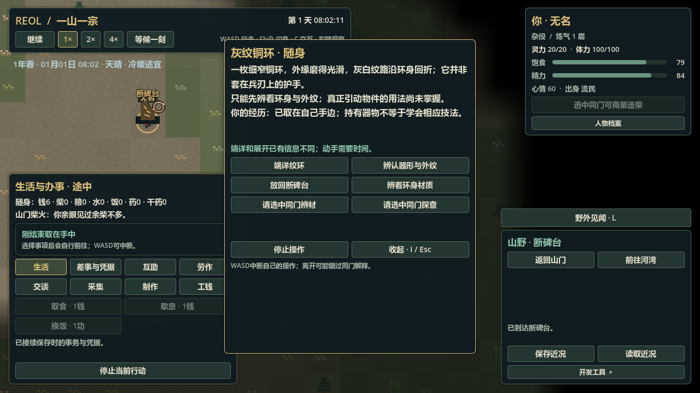
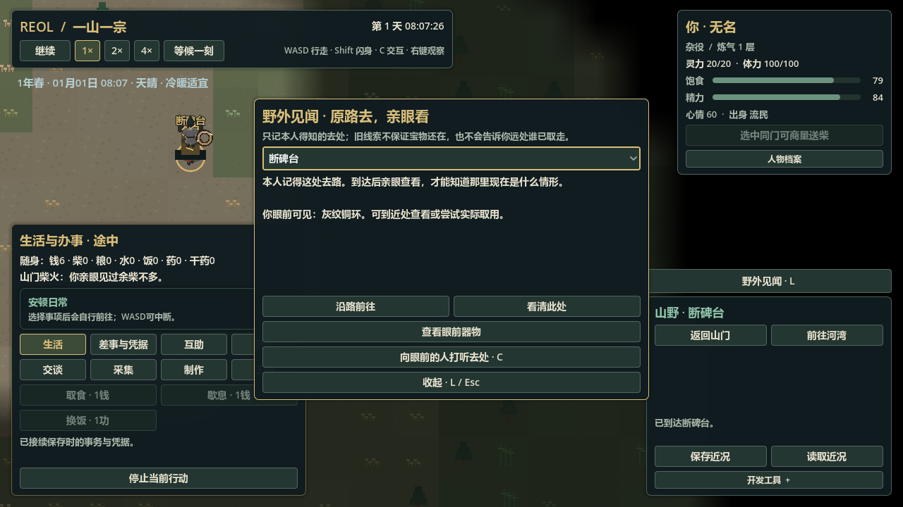

# U3-a：断碑台、个人线索与自主寻物

2026-11-04。产品和普通主局路线、真实三档两次完整停开已通过；完整检查正在执行，暂不作为最终绿色验收。完整游戏与首小时切片未完成，原Goal保持active。

## 实际交付

原512×512地图中装配一处可达断碑台；不是第三个Village。每次新局显式创建一枚原实物灰纹铜环，器物只有原objects里的region/container位置，地点槽不建库存镜像。固定槽的真实位置归field_opportunities；人离开聚落仍用原身体/行囊/资源，显示与选择按实际位置和FOW读取原owner。

C“打听野外去处”向实际能当面交流的人请求，依其原个人来源和意愿回话。陈守拙与小满新局各有明确开局旧闻；玩家初始不知。听说地点不知当下宝物或远方持有人；真实到场同高/无遮挡可形成本人亲见。L野外见闻页只投影本人所知，查询、显示重建和候选检查不写记忆、不产生宝物。可以不问人、靠真实走到现场发现。

小满（river_shi_tou）依自己的线索与目的出行，原备粮/生活/职责/伤势优先。寻物到期可提前唤醒原空闲决策，但仍经原Village选择/initiative顺序；不抢正在做的事，不清凭据。真实原路线、需要消耗与原take过程取得同一个环，完工后返回；遇阻/失控/冲突/身体需要可中止并留下结果，回原日常。玩家先到与NPC先到不重生第二枚。

环此包只端详、辨材、外形研究、取放。环的外形研究与听说明确不授使用能力。新环的取放起止均核真实连续位置、同高/距离/遮挡；在别人行囊内仍需同意。**隔空搬取、私人物品交换、围绕机缘的明确冲突后果仍未实现**；定义中的remote_draw只表示后续适配类别。

## 真实普通主局与停开

run230正常人身开局，原路跟随陈守拙；第一回因真实距离/视线未闻，随后本人正忙，63000ms才当面听到旧闻。实际沿原路走向断碑台，63750ms保存途中；71500ms到达，普通I页take一分钟，101500ms中途保存，131500ms同一环进入原玩家行囊。没有传送、注满资源、改学习史或关闭NPC自主。

run231新普通主局只选人身并等待，**未问线索/未接事**；420137ms保存于小满原出行中。后续497137ms他实际完成原take，仍在原河湾身体行囊；玩家498387ms才向陈守拙听闻，后来原路到空台，626887ms继续世界，未见远方环或持有人。

以下真实源原样另存，不覆盖普通用户档，历史档保持字节：

| 源 | 保存时刻 | UTF-8字节 | SHA256 |
|---|---:|---:|---|
| tests/fixtures/session_v40.json | 63750ms，玩家去程 | 175899 | 383717fbed1a214a2e0d3e38ae4ff495a4d9b33666ff245fdb75e0900649a8b1 |
| tests/fixtures/session_v40_take.json | 101500ms，实际取环中 | 176779 | 8a97fabf282c80a69cd718496a92889dfd30aa97be0ca728c4b17f2d065d4d02 |
| tests/fixtures/session_v40_npc.json | 420137ms，小满原去程 | 206397 | 27186018991b78ee1201e2d1286e16af206c72d7d3e9289cdf328fc40acbf7c0 |

run231/232两完整停止/重启进程，三个源各经原loader和相同普通命令继续，全联合未来逐字节相同，候选均有效：

| 分支 | 未来时刻 | UTF-8字节 | SHA256 |
|---|---:|---:|---|
| 玩家去程→实际取环 | 131500ms | 183568 | c27cb162cbc0ca92cae8a3525528636fccb2ebba9ddbde6694c0c380815b721c |
| 取环中→完成 | 131500ms | 183596 | a2a1c11a029b5ca176622eef253796d7c8a14ae625d7d3b832990805f6fb39f1 |
| NPC取环→后来访空台 | 626887ms | 242207 | b2de4db3a227f1554f1faf98ac467f2e1ba15640a363fc4106fbbe84067669d4 |

`logs/field_restart_comparison.json valid=true`。两个早到分支源的最后观察时点不同，故只比较同源停开未来，不冒称两个不同历史完全相同。真正原生窗口图与下方测试分别记录，不把共同时间批量推进当作正常速度数小时试玩。

## 候选、时间与修复

根40/区域36/地点1；原器物4/灵源3不变。旧根39/区域35显式迁空地点、寻物与历史，不补宝物/旅行/玩家线索。现代缺域、混旧版本拒绝。固定槽shape先于原器物候选恢复，完整跨域因果在所有候选所有者就绪后验证，成功后才原子替换活会话。

行路边界保持原连续位置/实际费用；地点亲见按固定两秒观察时点与显式到场，不依UI帧或调用步长。trip史上限64，满后不再抢原日常；查询纯投影。完整候选核唯一环来源与连续保管链、原take/place、当面分享的真实原记忆与毫秒先后，以及原route/身体互斥；非法actor引用在查speed/几何前拒绝，空域时钟也拒布尔伪整数；固定地点必须落在候选自己的真实可行走地形，不能把存档地标安在岩壁中。

已修：新脚本缩进/级联解析错误、动态typed空见证数组；site行旅被旧服务反馈当聚落索引；NPC原闲置轮询造成42分钟无故延迟（仍保留原任务/凭据优先）；出发晚于retry造成合法档拒绝；坏actor索引、连续take/他人place/倒序保管、同分钟未来来源。失败日志保留，不改真实历史fixture。

首导入`logs/import-20261104-062043.log`失败；`field-focused-initial.log`为该解析级联；`field-main-initial.log`为typed见证入口；`field-main-typed-witnesses.log`断言0失败但服务site索引脚本错误，不视作绿色。`field-npc-probe-initial.log`如实记录30分钟未出发；`field-npc-reason-agent.log`为无修改普通主局的实际原因探针。

修复后`field-focused-second.log`为本包及六套历史领域1996断言0失败、0脚本错误/警告；`field-focused-final.log`七套375断言0失败、0错误/警告。另器物134、因果54纯定向证据保留。`field-arrival-archives-final.log`补到达同刻刷新与三真实档独立loader，共35断言通过；`field-candidate-final.log`补空域布尔时钟严格拒绝与因果/真实迁移，共196断言通过。首完整检查`logs/check-test-20261104-063709.log`为169组通过、3组失败；其中旧载入的到达提示断言、无FOW测试场景的两个远区可见性断言失败。已补无FOW时真实距离筛选。旧持续性用例原先抵达聚落中心便直接选远处住舍的人；补上真实走到其住舍的路线，再核原休息过程/选择/返回卸载，未删除这些行为断言。首次该定向未补靠近时出现missing-view脚本错误及其清理级联，日志`field-failed-suite-final.log`保留；最终复测结果待补。

## 原生画面

最终`logs/field-native-final-20261104.log`退出0，0脚本错误/警告。1280×720四图已逐张查看：早到可见原环、本人已取环、野外小满实际到台、后来空台。镜头仅平移让现场与L页同时可见，没有改变人物/世界；每图等待原区块绘制450帧，未用手造场景代替。暂停到达活动反馈已立即恢复日常，原生图显示修复结果。

## 范围限制

只有一个固定落点遗迹、一枚器物、一位指定人物目的，不是通用任务/产权/拍卖/第三聚落/全图寻宝。没有通用NPC规划或自主寻师。永久两秒观察是当前有限两聚落成本，未验多年/海量世界；后续须按移动/邻近事件门控，不能宣称已实现全世界事件化远区。地点trip史满后退回原日常，无永久无界重试。

不借机扩农业，不等正式美术。原48视图人物CPU/纹理预算、设备声音历史和大型世界限制仍按BASELINE保留。
