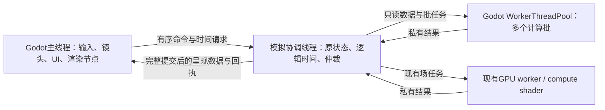

# 多核模拟执行方案

类型：本阶段实施设计。授权和交付顺序只在[唯一主计划](../../plans/foundation-priorities.md)，当前运行事实在[批执行合同](../../engineering/execution-batches.md)和[BASELINE](../../status/baseline.md)。2026-11-11替换泛化候选，明确主要计算多核化；下文目标结构尚未全部实现。

## 目标结构

有序规则由一个协调者组织；大块计算由多个worker同时执行。线程数和任务完成顺序不改变命中、库存、随机或到期时刻。主线程不再同步运行整个世界；协调线程也不能变成只有一个核心执行全部重活的最终架构。CPU/GPU可并行准备独立结果，只在实际消费者处等待必要依赖。

Godot提供线程池、Thread、Semaphore与渲染服务，GDScript可直接使用。这里重构任务和数据边界，不编写CPU指令、不先引入新语言或换引擎。`process_thread_group`适用于独立场景节点组，不能自动分解当前RefCounted模拟世界；本项目优先使用现有`SimBatchExecution`及显式协调线程。

## 数据如何交接

- 原身体、库存、行动等继续各有唯一可写owner。这个owner可驻留模拟线程，逻辑所有权不等于主线程所有权；不复制两套可以分别修改的世界。
- 几何/空间/条件由原owner维护带代次的只读视图。稳定地形按块复用，植物/建筑/大型身体变化只替换受影响块；任务持有旧块到完成。读取不触发`synchronize_actor`、世界通知或缓存扩容。
- 热身体/路线输入以已有packed列扩展，尽量在owner更新时维护，不为每帧任务深复制全部Dictionary。只发布当前批次会用到的字段；冷状态保持原表示。暂不为了ECS名字全量改写内容系统。
- 任务输入标明世界代次、逻辑时刻、主体/动作标识、依赖版本和范围；输出放私有缓冲。共享读取视图不可并发修改，随机抽取由原owner稳定安排；必要的新独立随机流要有明确保存与顺序语义。

一次性全图快照不作为默认方案。本轮原地图导航探针已经显示从实时getter重建约2.4万格需要约0.6秒（debug），远大于这批路径搜索本身；这是输入表示问题，不应继续增加worker掩盖。具体探针边界见BASELINE。

## 执行单元与串行尾部

| 工作族 | 分给worker的内容 | 原owner的提交责任 |
|---|---|---|
| 身体与组合空间 | 已受理路线的批量投影、空间候选、批量条件读取；覆盖实际查询需要的人物而非固定全员轮询 | 更新身体/索引、通知跨格、行动到达与中断；避免逐对象回调重新算一遍 |
| 行动规划与认识 | 已知目标的路线请求、感知/视线、工作候选评分；共享几何和本人允许知道的输入 | 预约、资源争用、目标复核及行动受理；查询索引不自动变成角色知识 |
| 战斗 | 同一输入时刻的接触/射线/投射物候选、几何与命中数学 | 原同刻规则、伤势/消耗与终止。不得按线程完成先后扣血 |
| 环境和自然过程 | 相互独立的受体/响应段、足够大的来源批次；可用现有GPU或CPU路径 | 输入改变前结清旧段、验证候选、采样/阈值及原生命周期效果 |
| 呈现准备 | 从完整提交状态生成纯绘图/布局/单位显示数据 | 主线程更新Node/贴图；UI和绘制不访问模拟线程中的活对象 |

首次主要接入链选择身体/空间读取及其服务/战斗消费者；目前`native_actors`、环境、服务、交锋都是已测成本域，但域名不是可直接并行的独立任务。原有服务/行动回调会同步身体并修改过程，必须先拆计算与采用，不能把整个`settle_at_ms`扔进线程池。

原寻路`SimGridNavigation._graphs`共享可变AStar上下文，不能从多个线程直接调用。使用每个执行槽独有的AStar实例及相同只读几何；保持原通行/斜角规则、预算和确定的平局。线程池的任务不固定绑定某个OS线程，所以私有实例归执行槽，不能假设永远在同一线程复用。Godot导航服务与自定义格子通行的语义是否一致，须明确比较后才替换。

## 调度与延迟

沿原kernel阶段声明输入何时可用、候选何时必须采用。尽早提交同一依赖层的真实工作，独立任务继续运行；不在每次提交后立即阻塞等待，也不另建第二个业务时钟或逐实体事件平台。

到期后需要结果的规则边界保持PENDING；呈现继续消费上一份完整结果。未来选择可以遵守已有较慢逻辑频率，已受理攻击/取放等后果保持原时刻。规划若需要等待，等待状态归原行动/结算游标，不能以“空路线”冒充不可达。先采集候选再仲裁时，必须明确是否改变原先后可见性；无法保持等价的业务更改单独说明，不能隐藏在线程改造中。

当前GameClock的6–10ms合作预算用于保护主线程；迁移到协调线程后要重新界定执行额度，不能把同一主线程帧截止照搬成所有后台worker必须停工的理由。未来时间仍沿原有限准入约束，防止无限超前或积压；计算机会、逻辑时间和渲染帧三者分开。

任务粒度按工作量和批成本选择；允许少量工作沿同算法串行。首轮以2/4/8 worker比较有代表性的重批次，最终并发数由端到端结果决定，不固定用满20条逻辑线程。跨域共用Godot线程池，避免每个领域各开8个线程或给每个NPC建Thread。一次批量请求的截止年龄与积压有界，取消后及时收集，不为吞吐增加无穷在途世界。

## 主线程、恢复与生命周期

主线程提交带序号的命令和时间额度，协调线程在原安全边界受理并回执；玩家的忙碌缓冲与共同过载政策继续使用原语义。暂停、速度、保存和加载也是明确控制消息，不由两个线程各自推进时钟。

完整边界后发布紧凑、不可变的呈现数据。`CommittedWorldCanvas`已有完整提交概念，但其主线程捕获仍会读活世界；后续把纯数据准备移到owner侧，主线程只采用。普通面板中的同步查询也要换成已发布信息或有回执的查询，不能只迁移时钟代码就宣布主线程解耦。

换世界、取消动作、替换目标或输入变化使旧候选作废。成功恢复在独立候选验证后提升会话代次，丢弃旧结果并回收任务；失败不替换活会话。保存仍由原通用管线在完整边界捕获，不保存线程、任务句柄或显示缓冲。开发期只支持当前格式，无需兼容历史状态。

## 如何判断成功

分别测主线程、模拟协调线程和worker的实际CPU时间；`Time.get_ticks_usec`测到的是经过时间，不能自动解释为CPU执行。Windows可用线程CPU计时/ETW观察运行与等待，再结合现有阶段记录。只在诊断模式增加追踪，普通运行不逐任务落盘。

同一运行窗口内记录：准备/复制字节与耗时、提交、排队、计算、结果已好但未被收集的延迟、CPU/GPU依赖等待、采用、发布，以及实际任务量/弃用率/并行覆盖。不能把线程ID数当同时并行数，也不能把kernel耗时与它包含的worker等待再相加。原身体批指标已补采样窗口差值，历史累计仍明确标注。

并行覆盖按“真正迁出原串行关键路径的工作”评估，不能按对象数计算；其分母需由同负载串行基线或对应完整调用计时给出。若只迁走很小一部分，无论局部快多少，整游戏提升都有限。这个指标用来决定下一个主要计算族，而不是为提高覆盖率恢复已经删除的无用计算。

采用相同逻辑输入的串行/worker回放核对结果；端到端用相同release负载比较真实流速、主线程尖峰、帧P95/P99和输入响应。最终产品出口仍为300个持续行动人物的1×与稳定60FPS；局部算子加速不代替此目标。阶段收益低时重看串行尾部、数据复制或任务依赖，不以CPU占用率上升收尾。

首轮仅一个45秒混合窗口和一个有界导航重放探针。它们已证明当前并行覆盖不足和私有数据任务可执行，不证明整个模拟已多核化。实现每段后只做相关短顺序/取消核对与必要对照，方法见[开发循环](../../engineering/workflow/testing.md)。成熟项目原理及版本边界见[研究](../../../design/research/large_simulation_optimization.md#多核执行2026-11-11)。
