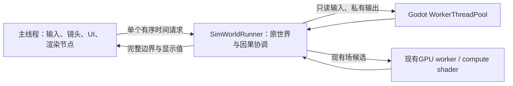

# 多核模拟执行

类型：当前执行设计与取舍。交付顺序在[唯一主计划](../../plans/foundation-priorities.md)，API在[批执行合同](../../engineering/execution-batches.md)，测量在[BASELINE](../../status/baseline.md)。

## 线程与所有权

`SimWorldRunner`使用常驻Thread、Mutex和Semaphore邮箱。它不访问Node、Input或GameClock，不复制另一套可写世界。原RegionalSimulation、领域owner、身体和库存仍是唯一事实，SimLocalMotion仍写原玩家身体。工作完成次序不能改变规则采用顺序、随机或时间戳。

为接入现有界面，本轮采用**单一世界的独占交接**。计算期间，`ReolSimulationHost`停用会读取世界的旧逻辑/UI回调；绘图只回放已捕获参数，镜头与人物插值继续运行。完整回复后，主线程短暂取得世界、处理命令和旧画布，再归还协调线程。身体发布已是脱离原对象的显示值；其他画布/面板尚未全部改成永久双缓冲。这是明确的串行尾部，不能把“后台结算”理解为主线程零成本。

`ReolSimulationSignalBridge`在交接时暂存领域向Node的通知，保留领域内部同步信号。回复后恢复原连接、按记录次序在主线程递送；不从worker调用SceneTree。输入在完整边界重放，暂停/速度键立即响应，已接受的区间仍完成。保存等待同一边界，加载/换世界先回收旧协调线程和批任务。

## 共用计算底座

| 工作族 | worker计算 | 原owner保留 |
|---|---|---|
| 身体与呈现 | 需求与路段数学；完整身体显示的路线位置、姿态、衣着 | 原身体采用、空间通知、到达/中断和Node更新 |
| 空间与战斗 | 同边界线段×身体候选，私有搜索上下文可复用共享几何 | 原规则顺序、遮挡复核、伤害与消耗 |
| 环境基场 | 同一compact job的16×16 CPU场块或既有GPU路径 | 原场版本验证、采纳与取消 |
| 来源响应 | 各候选tile的温度/五行响应输入；每任务私有气候memo | 历史、容量、锚点和多owner原子提交 |

`SimBatchExecution`复用Godot线程池；小集合可以同算法串行，任务不各开线程。身体显示64人一块，候选空间按64身体分块，场和响应按16×16格。并发不是游戏规则：`--actor-workers=-1`按硬件和批量选择，`0`串行，显式1–64可压测，不再限8；`--simulation-thread=off`关闭协调线程供同构建对照。生产默认及高并发取舍由BASELINE维护。

`SimWorldGeometry`由原owner维护16×16页，局部变化替换旧页，已捕获输入保留旧页并带来源/版本。路径不能跨worker共享可变AStar；普通同步入口使用其缓存，真正并发查询使用私有`SimGridNavigation.Search`。当前普通行动路线搜索仍由协调者顺序调用，未引入另一个规划平台。

身体显示复用原身体成员表，只在owner等待计算的期间借出原字典；任务结果不留身体/动作引用。冷定义共享只读，候选scratch由每个任务独占。任务结束后由原owner检查时刻、世界代次、依赖和对象，再提交；库存/预约/扣血等争用不并发写入。

## 时间、等待与失败

GameClock仍负责宿主时间准入与公共时刻，协调线程沿原kernel阶段推进。一次固定步正常完整处理，大跨度显式快进可在完整内部边界交还；不会保存半步游标。主线程6–10ms软预算不再限制后台总计算机会，后台需要CPU/GPU结果时等待实际依赖，不以毫秒计时器反复延后。

最多一个世界请求在途，不无限超前或积压快照。过载沿原规则减少未来时间准入，已受理后果不丢失。取消撤销候选采用权，结束/换世界回收任务；失败停止世界并保留原保存文件。保存只存领域原状态和共同时间，不存线程、邮箱、计时或显示缓存；开发期只支持当前格式。

## 如何验收

Windows线程CPU时钟用于区分真实执行与等待；GDScript微秒计时仍是经过时间。分别报告准备、任务计算、依赖等待、交接/通知、主线程显示发布及输入边界延迟，不把包含关系相加。CPU总占用率和线程ID数量都不能单独证明吞吐提升。

同构建比较串行、任务池和不同worker数；保留普通300人对照，但压力场景扩展到上千运行单位、几十房间、冷热/五行来源变化，逐级找到满速容量与过载拐点。短检查核对相关顺序、隔离、取消和数值；真实release窗口用于画面帧时和吞吐，不恢复旧CI或全量长回归。

依据：[Godot多线程](https://docs.godotengine.org/en/4.7/tutorials/performance/using_multiple_threads.html)、[线程安全](https://docs.godotengine.org/en/4.7/tutorials/performance/thread_safe_apis.html)、[WorkerThreadPool](https://docs.godotengine.org/en/4.7/classes/class_workerthreadpool.html)。成熟模拟项目的取舍见[研究](../../../design/research/large_simulation_optimization.md#多核执行2026-11-11)。
