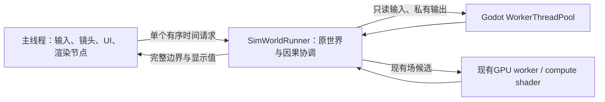

# 多核模拟执行

类型：当前执行设计与取舍。交付顺序在[唯一主计划](../../plans/foundation-priorities.md)，API在[批执行合同](../../engineering/execution-batches.md)，测量在[BASELINE](../../status/baseline.md)。

## 线程与所有权

`SimWorldRunner`使用常驻Thread、Mutex和Semaphore邮箱。它不访问Node、Input或GameClock，不复制另一套可写世界。原RegionalSimulation、领域owner、身体和库存仍是唯一事实，SimLocalMotion仍写原玩家身体。工作完成次序不能改变规则采用顺序、随机或时间戳。

原世界采用**独占交接**，人物显示则使用脱离原对象的发布值。计算期间，`ReolSimulationHost`停用会读取世界的旧逻辑/UI回调；绘图、镜头、人物插值及`ReolBodyPresentation`的分批Node采用继续运行。完整回复后，主线程处理命令、少量选中/玩家反馈和旧画布，再归还协调线程。其他画布/面板尚未全部改成永久双缓冲，这段读取窗口仍单独测量。

`ReolSimulationSignalBridge`在交接时暂存领域向Node的通知，保留领域内部同步信号。回复后恢复原连接、按记录次序在主线程递送；不从worker调用SceneTree。输入在完整边界重放，暂停/速度键立即响应，已接受的区间仍完成。保存等待同一边界，加载/换世界先回收旧协调线程和批任务。

协调者发布邮箱后发出无世界引用的`reply_ready`信号，宿主以Godot `CONNECT_DEFERRED`接收。在主线程idle队列收取回复，并可继续已准入的时间债务；普通process仍是预算耗尽或异常终止的后备入口。完成通知不准入新的现实时间，且与同一引擎process帧共享软预算，避免连续idle回调反复放大预算。帧外完成的逻辑时间/宿主工作归入下一次节奏观察，不依赖完成快慢决定业务顺序。`--simulation-completion=frame`保留原逐帧收取供同包对照。

## 共用计算底座

| 工作族 | worker计算 | 原owner保留 |
|---|---|---|
| 身体与呈现 | 借读原热表，准备需求/恢复输入、路段数学及下次边界；验证候选/观察者后的独占身体分区写入；显示位置、姿态、衣着、同格排列 | 原锚点和队列采用、空间通知、到达/中断；Node只在主线程从独立发布值更新 |
| 空间与战斗 | 同边界线段×身体候选，私有搜索上下文可复用共享几何 | 原规则顺序、遮挡复核、伤害与消耗 |
| 环境基场 | 同一compact job的16×16 CPU场块或既有GPU路径 | 原场版本验证、采纳与取消 |
| 来源响应 | 各候选tile的温度/五行响应输入；每任务私有气候memo | 历史、容量、锚点和多owner原子提交 |

`SimBatchExecution`复用Godot线程池；小集合可以同算法串行，任务不各开线程。身体显示64人一块，候选空间按64身体分块，场和响应按16×16格。并发不是游戏规则：`--actor-workers=-1`按硬件和批量选择，`0`串行，显式1–64可压测，不再限8；`--simulation-thread=off`关闭协调线程供同构建对照。生产默认及高并发取舍由BASELINE维护。

`SimWorldGeometry`由原owner维护16×16页，局部变化替换旧页，已捕获输入保留旧页并带来源/版本。路径不能跨worker共享可变AStar；普通同步入口使用其缓存，真正并发查询使用私有`SimGridNavigation.Search`。当前普通行动路线搜索仍由协调者顺序调用，未引入另一个规划平台。

`SimBodyRead`集中借出原身体、环境暴露、衣物、休息、控制及来源参与表；准备时不再逐人调用回调并复制热列。64人一块计算需求、当前段或整路投影及跨格时刻，128人以上可分块推算下次边界，小集合沿同一热读取直接判断；不透明的自定义provider仍走原顺序入口。候选对齐下一个实际本地区间，同一外层请求内继续分派后续区间。需要修路或退出整路积分的判断回到原owner。无通知的边界结果集中采用，参与索引对大量改动一次建堆，小集合保留索引更新。

候选验证后采用**独占分区阶段**：每个任务写分配人物的原需求/余数字典。若整批路线证明和全部输入仍有效，实际连接又只含不读取同伴位置的标准观察者，同一分区还可写原位置/朝向/整路游标；新增外部观察者则保留逐人投影。全部任务结束后owner更新共享锚点，按原ID发出空间/跨格通知，集中采用已证明的段内延续边界，之后才允许行动后果。详细条件见批执行API。身体实例和需求字典在原创建/恢复路径中互不别名；名册/共享索引、库存/预约/扣血等争用仍顺序处理，不增加另一套身体状态或可写owner。

`SimBodyPublication`复用身体成员表、输出独立显示值；同格排列也在发布阶段完成，每个占用格的高度由原owner解析一次。主线程只冻结本次可见格样本，`ReolBodyPresentation`借共用呈现队列分批更新人物Node。保留一个正在应用的帧和一个最新等待帧，既不无限积压，也不因反复替换而饿死后面的ID。旧帧不能覆盖较新的选中人物，换世界/显式刷新撤销旧呈现。

## 时间、等待与失败

GameClock仍负责宿主时间准入与公共时刻，协调线程沿原kernel阶段推进。一次固定步正常完整处理，大跨度显式快进可在完整内部边界交还；不会保存半步游标。主线程6–10ms软预算不再限制后台总计算机会，后台需要CPU/GPU结果时等待实际依赖，不以毫秒计时器反复延后。

最多一个世界请求在途。过载沿原规则减少未来时间准入，已受理后果不丢失。取消撤销候选采用权；借读原表的任务须先join再允许修改输入，已经进入独占需求采用阶段则必须完成该阶段后才交还。结束/换世界回收任务；失败停止世界并保留原保存文件。保存只存领域原状态和共同时间，不存线程、邮箱、计时或显示缓存；开发期只支持当前格式。

## 如何验收

Windows线程CPU时钟用于区分真实执行与等待；GDScript微秒计时仍是经过时间。分别报告准备、任务计算、需求采用、边界判断/采用、依赖等待、交接/通知、主线程显示发布及输入边界延迟，不把包含关系相加。人物显示还报告帧等待年龄、最大切片和在模拟忙碌期间实际执行的次数。CPU总占用率和线程ID数量都不能单独证明吞吐提升。

同构建比较串行、任务池和不同worker数；保留普通300人对照，但压力场景扩展到上千运行单位、几十房间、冷热/五行来源变化，逐级找到满速容量与过载拐点。短检查核对相关顺序、隔离、取消和数值；真实release窗口用于画面帧时和吞吐，不恢复旧CI或全量长回归。

依据：[Godot多线程](https://docs.godotengine.org/en/4.7/tutorials/performance/using_multiple_threads.html)、[线程安全](https://docs.godotengine.org/en/4.7/tutorials/performance/thread_safe_apis.html)、[WorkerThreadPool](https://docs.godotengine.org/en/4.7/classes/class_workerthreadpool.html)。成熟模拟项目的取舍见[研究](../../../design/research/large_simulation_optimization.md#多核执行2026-11-11)。
